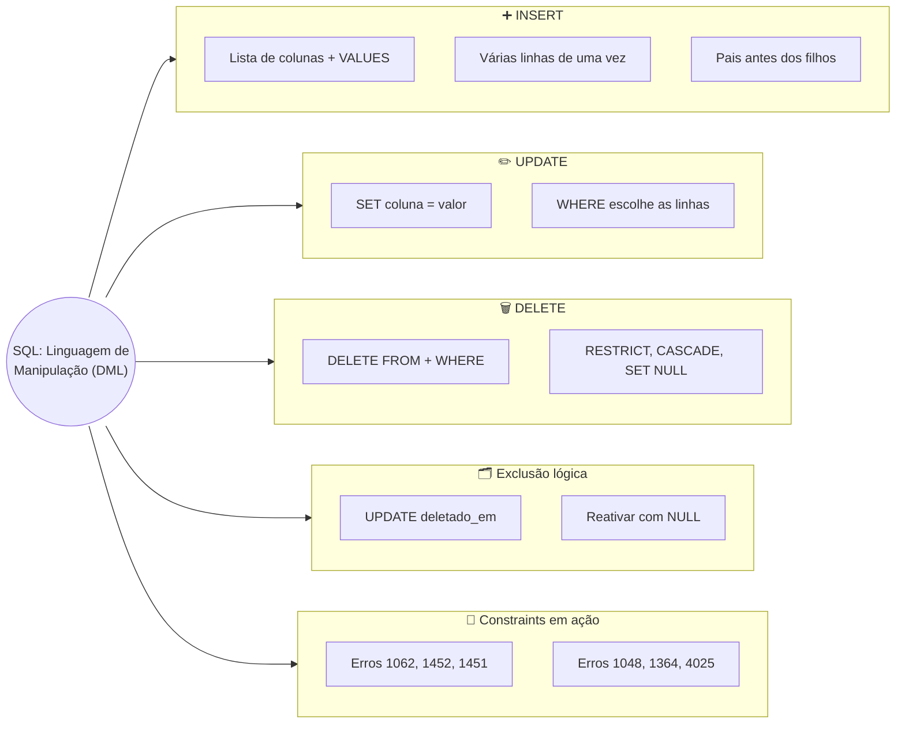
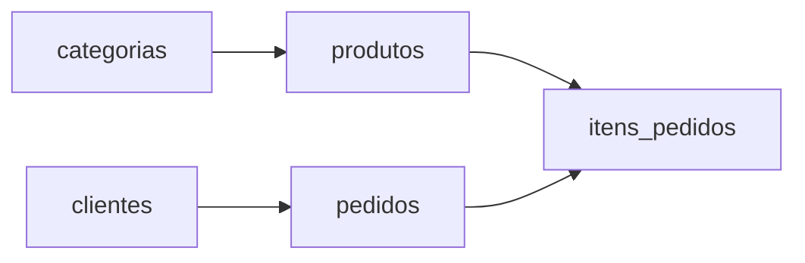

# Tópico 06 — SQL: Linguagem de Manipulação de Dados (DML)

**Disciplina:** Banco de Dados e Aplicações (IBD951)  
**Professor:** Ronan Adriel Zenatti · ronan.zenatti@cps.sp.gov.br  
**Fatec Jahu — 2º Semestre/2026**

---

## 🎯 Objetivos da Aula

Ao final desta aula você deverá ser capaz de:

- Explicar o papel da DML (Data Manipulation Language) e como ela se diferencia da DDL
- Cadastrar dados com `INSERT`, em uma ou várias linhas, respeitando a ordem entre tabelas "pai" e "filha"
- Corrigir dados já cadastrados com `UPDATE`, sempre delimitando quais linhas serão alteradas com `WHERE`
- Remover dados com `DELETE` e prever o que acontece quando a tabela é referenciada por uma chave estrangeira
- Aplicar a exclusão lógica (`deletado_em`) como alternativa segura à exclusão física
- Ler as mensagens de erro mais comuns e descobrir qual constraint barrou a operação
- Seguir um checklist de segurança antes de executar qualquer `UPDATE` ou `DELETE`

---

## 🗺️ Mapa Mental da Aula



---

## 1. DML: do prédio pronto para a mercadoria na prateleira

No Tópico 05 você construiu a **estrutura** do banco com a **DDL** — `CREATE`, `ALTER` e `DROP`. As tabelas existem, mas estão **vazias**: nenhuma linha, nenhum cliente, nenhum produto. Agora vamos colocar dados lá dentro.

A **DML (Data Manipulation Language — Linguagem de Manipulação de Dados)** é a subcategoria da SQL que **mexe nos dados** guardados dentro das tabelas. Ela tem três comandos:

| Comando | O que faz | Exemplo do dia a dia |
|---|---|---|
| `INSERT` | **Cadastra** uma linha nova | Preencher uma ficha de cadastro nova |
| `UPDATE` | **Corrige** dados de linhas que já existem | Atualizar o telefone na ficha do cliente |
| `DELETE` | **Remove** linhas | Tirar da prateleira o produto vencido |

> 💡 **Do dia a dia:** lembra da padaria do Tópico 05? A DDL foi a reforma do imóvel — balcão, prateleiras, forno. Agora a padaria vai abrir: a DML é o trabalho de **todo dia** — repor os pães na prateleira (`INSERT`), trocar a etiqueta de preço quando o fermento sobe (`UPDATE`) e tirar o bolo que passou da validade (`DELETE`). A estrutura quase não muda; os dados mudam o tempo todo.

Dois termos que vamos usar o tempo todo:

- **Linha** (ou **registro**): um item cadastrado numa tabela. Em `clientes`, cada pessoa é uma linha.
- **Coluna** (ou **campo**): uma característica daquele item. Em `clientes`, `nome`, `cpf` e `email` são colunas.

---

## 2. Preparando o ambiente

Vamos trabalhar no banco `loja_virtual` do Tópico 05. Para todos começarem do mesmo ponto, rode **uma vez** o **script completo da Seção 11 do [Tópico 05](Aula_06_SQL_DDL.md)** — ele apaga e recria o banco `loja_virtual` com as cinco tabelas, **todas vazias**. Depois, selecione o banco:

```sql
USE loja_virtual;
```

> ⚠️ **Atenção:** esse script começa com `DROP DATABASE IF EXISTS loja_virtual;` — ele **apaga tudo** que já existir nesse banco. Se você já tinha dados cadastrados que quer manter, não rode o script de novo.

### Espiando dentro de uma tabela

Para conferir o resultado dos nossos comandos, precisamos de uma forma de **olhar** o conteúdo de uma tabela. Existe um comando para isso, o `SELECT` — ele é o assunto do **Tópico 07**, e aqui vamos usar só a forma mais simples dele:

```sql
SELECT * FROM categorias;
```

Leia assim: *"selecione tudo (`*` significa **todas as colunas**) da tabela `categorias`"*. É como abrir a gaveta do arquivo e olhar as fichas, **sem mexer em nenhuma**. Por enquanto, use o `SELECT * FROM` só como "espiadinha" depois de cada comando; no próximo tópico você vai aprender a fazer consultas de verdade.

> 📐 **Sobre as tabelas mostradas nesta aula:** as tabelas reais têm também as colunas de log (`criado_em`, `atualizado_em`, `deletado_em` — Regra 9). Nos resultados abaixo, omiti algumas colunas para a tabela caber na tela; no seu terminal você verá todas.

---

## 3. INSERT — cadastrando dados

### 3.1 Anatomia do comando

```sql
INSERT INTO nome_da_tabela (coluna1, coluna2, coluna3)
VALUES (valor1, valor2, valor3);
```

Leia assim: *"insira na tabela X, **nas colunas** A, B e C, **os valores** 1, 2 e 3"*. O primeiro valor vai para a primeira coluna listada, o segundo para a segunda, e assim por diante — **a ordem importa**.

> 💡 **Do dia a dia:** `INSERT` é preencher uma **ficha de cadastro** na secretaria da escola ou no cartório. A ficha tem campos já impressos (as colunas) e você escreve a informação de uma pessoa em cada campo. A lista de colunas diz **em quais campos** você vai escrever; os `VALUES`, **o que** você escreve em cada um.

Regras para escrever os valores (o termo técnico para um valor escrito direto no comando é **literal**):

| Tipo do valor | Como escrever | Exemplo |
|---|---|---|
| Texto (`VARCHAR`, `CHAR`, `TEXT`) | Entre **aspas simples** | `'Ana Souza'` |
| Data (`DATE`) | Aspas simples, formato **ano-mês-dia** | `'1990-05-14'` |
| Número (`INT`, `DECIMAL`) | **Sem aspas**; decimal com **ponto**, não vírgula | `14.90` |
| Ausência de valor | A palavra `NULL`, **sem aspas** | `NULL` |

> ⚠️ **Armadilha:** `14,90` (com vírgula) não é o número catorze e noventa — a vírgula separa valores. E um texto sem aspas é interpretado como nome de coluna e dá erro. Se o texto tiver um apóstrofo, escreva-o **duas vezes**: `'Pão d''água'`.

### 3.2 Primeiro INSERT

```sql
INSERT INTO categorias (nome, descricao)
VALUES ('Padaria', 'Pães, bolos e salgados');
```

O MariaDB responde:

```text
Query OK, 1 row affected (0.004 sec)
```

*"1 row affected"* significa **uma linha afetada** — uma linha foi cadastrada. Confira com a espiadinha:

```sql
SELECT * FROM categorias;
```

```text
+--------------+---------+------------------------+-------+
| id_categoria | nome    | descricao              | ativa | ...
+--------------+---------+------------------------+-------+
|            1 | Padaria | Pães, bolos e salgados |     1 | ...
+--------------+---------+------------------------+-------+
```

Repare que apareceram coisas que **você não escreveu**: `id_categoria = 1` e `ativa = 1`. Quem preencheu? O próprio banco — veja a seguir.

### 3.3 Colunas que você pode omitir

Nem toda coluna precisa aparecer no `INSERT`. Na tabela `categorias`, cada coluna tem um "responsável":

| Coluna | Quem preenche | Por quê |
|---|---|---|
| `id_categoria` | O **banco** | É `AUTO_INCREMENT`: o banco gera 1, 2, 3… sozinho. **Nunca informe o id** |
| `nome` | **Você** | É `NOT NULL` e não tem `DEFAULT`: sem informar, dá erro |
| `descricao` | Você, **ou fica `NULL`** | Aceita `NULL` (é opcional) |
| `ativa` | O banco (valor `DEFAULT 1`) | Se você não informar, vale o padrão definido no `CREATE TABLE` |
| `criado_em`, `atualizado_em` | O banco (`DEFAULT CURRENT_TIMESTAMP`) | Data e hora do cadastro, automáticas |
| `deletado_em` | Fica `NULL` | Só será preenchida numa exclusão lógica (Seção 7) |

> 💡 **Do dia a dia:** é a ficha da secretaria de novo. O número de protocolo no canto da ficha é carimbado pela própria secretaria (o `AUTO_INCREMENT`); a data de entrada também é carimbada por ela (`DEFAULT CURRENT_TIMESTAMP`); os campos opcionais, como "observações", você pode deixar em branco (`NULL`). O que **você** precisa preencher são só os campos obrigatórios que não têm valor padrão.

Por isso, este `INSERT` funciona informando apenas o nome:

```sql
INSERT INTO categorias (nome) VALUES ('Bebidas');
```

A `descricao` ficou `NULL` e a `ativa` ficou `1`.

> 📐 **Sempre escreva a lista de colunas.** O MariaDB aceita `INSERT INTO categorias VALUES (...)` sem a lista, mas aí você teria que informar **todas** as colunas, na ordem exata em que foram criadas — inclusive as automáticas. Se alguém acrescentar uma coluna na tabela com `ALTER TABLE` amanhã, seu comando quebra. Com a lista de colunas, o comando diz exatamente o que faz. Nesta disciplina, a lista de colunas é **obrigatória**.

### 3.4 Várias linhas num único INSERT

Para cadastrar vários itens de uma vez, separe cada grupo de valores por vírgula:

```sql
INSERT INTO categorias (nome, descricao) VALUES
    ('Mercearia',  'Arroz, feijão, macarrão e enlatados'),
    ('Hortifruti', 'Frutas, legumes e verduras'),
    ('Limpeza',    'Produtos de limpeza e higiene');
```

```text
Query OK, 3 rows affected (0.001 sec)
Records: 3  Duplicates: 0  Warnings: 0
```

É mais rápido e mais legível do que três comandos separados. Agora `categorias` tem cinco linhas: Padaria (1), Bebidas (2), Mercearia (3), Hortifruti (4) e Limpeza (5).

### 3.5 A ordem importa: primeiro os "pais", depois os "filhos"

Lembra da **chave estrangeira (FK)** do Tópico 05? A tabela `produtos` tem a coluna `categoria_id`, que **aponta** para uma linha de `categorias`. A tabela que é apontada é a **pai**; a que aponta é a **filha**. O banco **não deixa** você cadastrar um produto de uma categoria que não existe — então a categoria precisa ser cadastrada **antes**.



Leia as setas como "precisa existir antes de". Então a ordem de cadastro é: **primeiro** `categorias` e `clientes` (não dependem de ninguém), **depois** `produtos` e `pedidos`, e **por último** `itens_pedidos`.

> 💡 **Do dia a dia:** é o mesmo raciocínio da caderneta de fiado do mercadinho. Você só consegue anotar uma compra "no nome do Seu Zé" se o Seu Zé **já tem ficha** na caderneta. Cadastrar o cliente vem primeiro; anotar a compra vem depois. E, na hora de demolir (`DROP`), vale a ordem inversa — a que você viu no Tópico 05.

Vamos cadastrar os clientes, em três variações:

```sql
-- Com todas as colunas opcionais preenchidas
INSERT INTO clientes (nome, cpf, email, data_nascimento, telefone)
VALUES ('Ana Souza', '11122233344', 'ana.souza@email.com', '1990-05-14', '14991234567');

-- Omitindo o telefone (opcional): a coluna fica NULL
INSERT INTO clientes (nome, cpf, email, data_nascimento)
VALUES ('Bruno Lima', '22233344455', 'bruno.lima@email.com', '1988-02-20');

-- Duas linhas de uma vez; o telefone do Diego informado explicitamente como NULL
INSERT INTO clientes (nome, cpf, email, data_nascimento, telefone) VALUES
    ('Carla Mendes', '33344455566', 'carla.mendes@email.com', '1992-09-03', '14997654321'),
    ('Diego Alves',  '44455566677', 'diego.alves@email.com',  '1985-11-30', NULL);
```

> 💡 **Por que o CPF vai entre aspas?** Porque no Tópico 05 ele foi definido como `CHAR(11)` — é **texto**, não número. CPFs podem começar com zero (`01234567890`); como número, o zero da frente sumiria. Com aspas, o valor é guardado exatamente como você digitou. (Os CPFs desta aula são fictícios.)

Agora os produtos, que dependem de `categorias`. O `categoria_id` precisa ser um id que **já existe** lá:

```sql
INSERT INTO produtos (categoria_id, nome, preco, estoque) VALUES
    (1, 'Pão francês (kg)',  14.90,  50),
    (1, 'Bolo de fubá',      18.00,  12),
    (3, 'Café torrado 500g', 17.50,  40),
    (3, 'Arroz 5kg',         29.90,  30),
    (2, 'Refrigerante 2L',    9.99,  24),
    (5, 'Detergente 500ml',   2.99, 100);
```

Por fim, um pedido da Ana (cliente 1) e os seus itens. Aqui há um detalhe: o `id_pedido` foi gerado pelo banco, e **você precisa dele** para cadastrar os itens. A função `LAST_INSERT_ID()` devolve exatamente isso: **o último id gerado automaticamente** na sua conexão.

> 💡 **Do dia a dia:** é o número da senha que o caixa do açougue acabou de te entregar. Você não escolheu o número, mas precisa dele para o atendente saber qual pedido é o seu.

```sql
INSERT INTO pedidos (cliente_id, data_pedido)
VALUES (1, '2026-10-05');

-- LAST_INSERT_ID() devolve o id do pedido que acabamos de criar (1)
INSERT INTO itens_pedidos (pedido_id, produto_id, quantidade, preco_unitario) VALUES
    (LAST_INSERT_ID(), 1, 2, 14.90),   -- 2 pães franceses
    (LAST_INSERT_ID(), 4, 1, 29.90);   -- 1 arroz 5kg

-- Um segundo pedido, do Bruno (cliente 2), com 1 item
INSERT INTO pedidos (cliente_id, data_pedido)
VALUES (2, '2026-10-06');

INSERT INTO itens_pedidos (pedido_id, produto_id, quantidade, preco_unitario)
VALUES (LAST_INSERT_ID(), 5, 3, 9.99);   -- 3 refrigerantes
```

> 💡 **Por que `preco_unitario` é informado de novo?** Lembra do *snapshot* do Tópico 05? O item guarda o preço **no momento da compra**, mesmo que o preço do produto mude depois.

Confira os pedidos e seus itens:

```sql
SELECT * FROM pedidos;
SELECT * FROM itens_pedidos;
```

```text
+-----------+------------+----------------+-------------+----------+-------------+ ...
| id_pedido | cliente_id | funcionario_id | data_pedido | status   | valor_total | ...
+-----------+------------+----------------+-------------+----------+-------------+ ...
|         1 |          1 |           NULL | 2026-10-05  | pendente |        0.00 | ...
|         2 |          2 |           NULL | 2026-10-06  | pendente |        0.00 | ...
+-----------+------------+----------------+-------------+----------+-------------+ ...

+----------------+-----------+------------+------------+----------------+----------+ ...
| id_item_pedido | pedido_id | produto_id | quantidade | preco_unitario | desconto | ...
+----------------+-----------+------------+------------+----------------+----------+ ...
|              1 |         1 |          1 |          2 |          14.90 |     0.00 | ...
|              2 |         1 |          4 |          1 |          29.90 |     0.00 | ...
|              3 |         2 |          5 |          3 |           9.99 |     0.00 | ...
+----------------+-----------+------------+------------+----------------+----------+ ...
```

Note que `status = 'pendente'` e `valor_total = 0.00` vieram dos `DEFAULT` do `CREATE TABLE`, e `funcionario_id` ficou `NULL` (venda sem atendente — opcional). O `valor_total` ainda está zerado; vamos corrigi-lo com `UPDATE` na Seção 5.

!!! example "🔍 Checkpoint 1 — Cadastrando mais dados"
    Com o banco no estado atual, escreva os `INSERT` para:
    (a) uma nova categoria `Frios`, com a descrição `Queijos, presuntos e embutidos`;
    (b) dois produtos dessa categoria, em **um único** `INSERT`: `Presunto fatiado (kg)`, R$ 39,90, estoque 8; e `Queijo mussarela (kg)`, R$ 44,90, estoque 6;
    (c) um novo cliente, `Elisa Rocha`, CPF `55566677788`, e-mail `elisa.rocha@email.com`, nascida em `1995-07-09`, **sem** telefone.

    Dica: o `id` da categoria `Frios` você descobre com um `SELECT * FROM categorias;`. Os checkpoints seguintes e as seções de `UPDATE` e `DELETE` usam estes dados.

    🔑 Resolução no [Gabarito do Tópico 06](Topico_06_Gabarito.md#checkpoint-1) — tente resolver antes de conferir.

---

## 4. Quando o banco diz NÃO — constraints em ação

No Tópico 05 você declarou `PRIMARY KEY`, `FOREIGN KEY`, `UNIQUE`, `NOT NULL` e `CHECK`. Naquele momento elas eram só texto num `CREATE TABLE`. Agora, com dados entrando, é que elas **trabalham**: toda vez que um `INSERT` (ou `UPDATE`) viola uma regra, o banco **recusa o comando inteiro** e devolve uma mensagem de erro.

> 💡 **Do dia a dia:** as constraints são o **porteiro do prédio**. Você pode até chegar com a ficha na mão, mas se o CPF já está cadastrado, se falta um documento obrigatório ou se você quer entrar para o apartamento 99 de um prédio que só tem 20, o porteiro barra na entrada. Quem sai ganhando é o prédio: ninguém consegue sujar o cadastro com dado errado.

Experimente cada comando abaixo e compare a mensagem com a tabela:

```sql
-- 1) CPF repetido (violou UNIQUE)
INSERT INTO clientes (nome, cpf, email, data_nascimento)
VALUES ('Ana Souza Duplicada', '11122233344', 'outra.ana@email.com', '1991-01-01');
-- ERROR 1062 (23000): Duplicate entry '11122233344' for key 'uq_cpf'

-- 2) Produto numa categoria que não existe (violou FOREIGN KEY)
INSERT INTO produtos (categoria_id, nome, preco)
VALUES (99, 'Produto fantasma', 1.00);
-- ERROR 1452 (23000): Cannot add or update a child row: a foreign key constraint fails (...)

-- 3) NULL explícito numa coluna NOT NULL
INSERT INTO clientes (nome, cpf, email, data_nascimento)
VALUES (NULL, '66677788899', 'sem.nome@email.com', '1990-01-01');
-- ERROR 1048 (23000): Column 'nome' cannot be null

-- 4) Coluna NOT NULL esquecida, sem DEFAULT
INSERT INTO clientes (nome) VALUES ('Fulano');
-- ERROR 1364 (HY000): Field 'cpf' doesn't have a default value

-- 5) Valor que quebra uma regra de CHECK (preço negativo)
INSERT INTO produtos (categoria_id, nome, preco)
VALUES (1, 'Pão com preço negativo', -5.00);
-- ERROR 4025 (23000): CONSTRAINT `ck_preco` failed for `loja_virtual`.`produtos`

-- 6) Menos valores do que colunas
INSERT INTO categorias (nome, descricao) VALUES ('Frios');
-- ERROR 1136 (21S01): Column count doesn't match value count at row 1

-- 7) Data no formato brasileiro
INSERT INTO clientes (nome, cpf, email, data_nascimento)
VALUES ('Data Ruim', '77788899900', 'data.ruim@email.com', '14/05/1990');
-- ERROR 1292 (22007): Incorrect date value: '14/05/1990' for column ... 'data_nascimento'

-- 8) Valor fora da lista do ENUM
INSERT INTO pedidos (cliente_id, data_pedido, status)
VALUES (1, '2026-10-01', 'sumiu');
-- ERROR 1265 (01000): Data truncated for column 'status' at row 1
```

> 📐 **Os comandos 6 a 8 não são constraints** — são erros de digitação ou de formato, e o banco também recusa. Os cinco primeiros são o porteiro em ação.

| Código | Mensagem (resumo) | Qual regra barrou | Como resolver |
|---|---|---|---|
| **1062** | `Duplicate entry '...' for key 'uq_cpf'` | `UNIQUE` (ou `PRIMARY KEY`) | Esse valor já existe. Confira com um `SELECT` ou use outro valor. O nome após `for key` indica **qual** constraint barrou |
| **1452** | `Cannot add or update a child row` | `FOREIGN KEY` (você é o filho) | O id "pai" não existe. Cadastre o pai antes ou corrija o id |
| **1048** | `Column '...' cannot be null` | `NOT NULL` | Você mandou `NULL` explícito numa coluna obrigatória |
| **1364** | `Field '...' doesn't have a default value` | `NOT NULL` sem `DEFAULT` | Você esqueceu de informar uma coluna obrigatória |
| **4025** | `CONSTRAINT '...' failed` | `CHECK` | O valor viola a regra de domínio (preço, estoque, quantidade) |
| **1136** | `Column count doesn't match value count` | — (sintaxe) | Conte colunas e valores: precisam ser iguais |

> ⚠️ **"Tudo ou nada":** se um `INSERT` com várias linhas tiver **uma** linha inválida, o banco recusa o comando **inteiro** — nenhuma das linhas é cadastrada. É como o caixa do mercado: se um dos itens do carrinho não passa no leitor, a compra toda fica parada até resolver, em vez de passar metade.

> 📐 **"Buracos" nos ids são normais.** Mesmo quando um `INSERT` é recusado, o `AUTO_INCREMENT` pode ter "gasto" um número. Por isso, depois de erros, você pode ver ids como 1, 2, 5 — o 3 e o 4 foram consumidos por tentativas que falharam. O id só precisa ser **único**, não precisa ser sequencial. Regra de ouro: **nunca chute um id** — olhe com `SELECT` antes de usá-lo em um `WHERE`.

!!! example "🔍 Checkpoint 2 — O banco aceita ou rejeita?"
    Para cada comando abaixo, **antes de executar**, responda: o banco **aceita** ou **rejeita**? Se rejeitar, qual constraint barra e qual o código do erro? Depois execute e confira.

    ```sql
    -- (a)
    INSERT INTO categorias (nome) VALUES ('Padaria');

    -- (b)
    INSERT INTO produtos (categoria_id, nome, preco) VALUES (3, 'Macarrão 500g', 5.49);

    -- (c)
    INSERT INTO produtos (categoria_id, nome, preco, estoque)
    VALUES (3, 'Farinha de trigo', 6.20, -10);

    -- (d)
    INSERT INTO itens_pedidos (pedido_id, produto_id, quantidade, preco_unitario)
    VALUES (1, 4, 1, 29.90);

    -- (e)
    INSERT INTO pedidos (cliente_id, data_pedido) VALUES (50, '2026-10-07');
    ```

    🔑 Resolução no [Gabarito do Tópico 06](Topico_06_Gabarito.md#checkpoint-2) — tente resolver antes de conferir.

---

## 5. UPDATE — corrigindo dados

### 5.1 Anatomia do comando

```sql
UPDATE nome_da_tabela
SET coluna1 = novo_valor1,
    coluna2 = novo_valor2
WHERE condição;
```

Leia assim: *"atualize a tabela X, **defina** a coluna 1 como tal valor, **somente nas linhas em que** a condição for verdadeira"*.

> 💡 **Do dia a dia:** `UPDATE` é pegar a ficha do cliente, passar a borracha no telefone antigo e escrever o novo. Só que, no banco, você precisa dizer **qual ficha**. Se você disser "troque o telefone", sem dizer de quem, o banco entende que é para trocar o telefone **de todo mundo**.

O **`WHERE`** (em português, *"onde"*) é o **filtro** que escolhe quais linhas serão afetadas. Ele será estudado a fundo nos próximos tópicos; por agora, usaremos a forma mais segura e simples: filtrar pelo **id**, que é único e identifica **uma** linha.

```sql
WHERE id_cliente = 2    -- somente a linha cujo id_cliente é 2
```

### 5.2 Exemplos

```sql
-- Atualizando uma coluna de uma linha: o Bruno agora tem telefone
UPDATE clientes
SET telefone = '14998887766'
WHERE id_cliente = 2;
```

```text
Query OK, 1 row affected (0.001 sec)
Rows matched: 1  Changed: 1  Warnings: 0
```

Veja que o `UPDATE` também mexe na coluna `atualizado_em` **sozinho**, por causa do `ON UPDATE CURRENT_TIMESTAMP` que você declarou no Tópico 05 (Regra 9). Já o `criado_em` continua com a data do cadastro:

```sql
SELECT * FROM clientes WHERE id_cliente = 2;
```

```text
| id_cliente | nome       | ... | telefone    | criado_em           | atualizado_em       | ...
|          2 | Bruno Lima | ... | 14998887766 | 2026-10-21 19:00:27 | 2026-10-21 19:00:46 | ...
```

O lado direito do `SET` pode ser um **cálculo** feito com o valor atual da própria coluna:

```sql
-- Reajuste de 10% em todos os produtos da categoria Padaria (id 1)
UPDATE produtos
SET preco = preco * 1.10
WHERE categoria_id = 1;
-- Query OK, 2 rows affected   →  Pão francês: 14.90 → 16.39 · Bolo de fubá: 18.00 → 19.80

-- Baixa de estoque: venderam 2 refrigerantes
UPDATE produtos
SET estoque = estoque - 2
WHERE id_produto = 5;
```

Várias colunas de uma vez, separadas por vírgula, e também mudando um `ENUM`:

```sql
-- Novo preço e novo estoque do Arroz 5kg
UPDATE produtos
SET preco = 31.50, estoque = 25
WHERE id_produto = 4;

-- Pedido 1 confirmado, e agora sabemos o total: 2 × 14,90 + 1 × 29,90 = 59,70
UPDATE pedidos
SET status = 'confirmado', valor_total = 59.70
WHERE id_pedido = 1;
```

Para "apagar" um dado opcional sem excluir a linha, atribua `NULL`:

```sql
UPDATE clientes SET telefone = NULL WHERE id_cliente = 3;
```

> 📐 **`WHERE` pode usar qualquer coluna**, não só o id: `WHERE nome = 'Bebidas'` funciona. Mas só use essa forma quando tiver certeza de que o valor identifica a linha que você quer — nomes se repetem. O `WHERE` com id é o mais seguro.

### 5.3 "Rows matched" × "Changed"

Depois de um `UPDATE`, o MariaDB mostra duas contagens:

```text
Rows matched: 1  Changed: 1  Warnings: 0
```

| Contagem | Significa |
|---|---|
| **Rows matched** (linhas encontradas) | Quantas linhas **passaram no `WHERE`** |
| **Changed** (linhas alteradas) | Quantas dessas linhas **realmente mudaram** de valor |

Se você repetir um `UPDATE` que coloca **o mesmo valor que já estava lá**, aparece `Rows matched: 1  Changed: 0` e `0 rows affected`. Não é erro: a linha foi encontrada, mas já estava do jeito pedido. E se aparecer `Rows matched: 0`, o seu `WHERE` não encontrou **nenhuma** linha — ou o id está errado, ou a linha não existe.

### 5.4 O `UPDATE` também passa pelo porteiro

As constraints valem para `UPDATE` também. Tentar deixar o estoque negativo:

```sql
UPDATE produtos SET estoque = -3 WHERE id_produto = 1;
-- ERROR 4025 (23000): CONSTRAINT `ck_estoque` failed for `loja_virtual`.`produtos`
```

A linha **não é alterada** — o estoque do pão continua como estava.

### 5.5 O maior perigo do `UPDATE`: esquecer o `WHERE`

```sql
-- ⚠️ NÃO EXECUTE: isto zera o preço de TODOS os produtos da loja
UPDATE produtos SET preco = 0;
```

Sem `WHERE`, o filtro some e o comando vale para **todas as linhas da tabela**. O banco não pergunta "tem certeza?". Seria o equivalente a o gerente do mercado, querendo corrigir a etiqueta do arroz, trocar a etiqueta de **todas** as mercadorias da loja pelo mesmo preço.

Existem três hábitos que evitam esse desastre:

1. **Escreva o `WHERE` primeiro.** Monte o comando de trás para frente: filtro, depois `SET`.
2. **Confira antes com `SELECT`.** Rode `SELECT * FROM produtos WHERE id_produto = 4;` — se aparecer **exatamente** a(s) linha(s) que você quer alterar, aí sim troque `SELECT *` por `UPDATE ... SET`.
3. **Leia o resultado.** Se você esperava alterar 1 linha e apareceu `Rows matched: 2000`, algo está errado — e você descobriu na hora, não na segunda-feira.

Além disso, o MariaDB oferece um **modo de segurança** que recusa `UPDATE` e `DELETE` sem `WHERE` que use uma coluna chave:

```sql
SET sql_safe_updates = 1;   -- liga o modo de segurança

UPDATE produtos SET preco = 0;
-- ERROR 1175 (HY000): You are using safe update mode and you tried to update a table
-- without a WHERE that uses a KEY column

SET sql_safe_updates = 0;   -- desliga (volta ao normal)
```

!!! example "🔍 Checkpoint 3 — Reajustes e baixas"
    Escreva os comandos `UPDATE` para:
    (a) trocar o telefone do cliente **Diego Alves** (confira o id dele com `SELECT`) para `14993332211`;
    (b) dar baixa de **3 unidades** no estoque do `Refrigerante 2L`;
    (c) marcar o **pedido 2** como `enviado`;
    (d) sem executar, responda: o que acontece com `UPDATE produtos SET estoque = estoque - 100 WHERE id_produto = 5;` se o estoque atual do refrigerante for menor que 100? O estoque fica negativo?

    🔑 Resolução no [Gabarito do Tópico 06](Topico_06_Gabarito.md#checkpoint-3) — tente resolver antes de conferir.

---

## 6. DELETE — removendo dados

### 6.1 Anatomia do comando

```sql
DELETE FROM nome_da_tabela
WHERE condição;
```

Leia assim: *"apague da tabela X as linhas em que a condição for verdadeira"*. Note que não há lista de colunas: o `DELETE` remove a **linha inteira**, não um campo dela. (Para "esvaziar" só um campo, use `UPDATE ... SET coluna = NULL`.)

> 💡 **Do dia a dia:** `DELETE` é **rasgar a ficha** e jogar no lixo, ou tirar o bolo vencido da prateleira e levar para o descarte. Depois que a ficha foi rasgada, não há como colar de volta — e o `WHERE` é o que diz **qual** ficha.

```sql
-- Remove a cliente Elisa (id 5), que ainda não fez nenhum pedido
DELETE FROM clientes WHERE id_cliente = 5;
-- Query OK, 1 row affected (0.001 sec)
```

> ⚠️ **Dois detalhes:**
> - Se o `WHERE` não encontrar nenhuma linha (por exemplo, o id já foi apagado), o MariaDB responde `Query OK, 0 rows affected` — **não é erro**. Confira sempre a contagem.
> - **`DELETE` sem `WHERE` apaga TODAS as linhas** da tabela. Vale o mesmo checklist do `UPDATE`.

### 6.2 O `DELETE` e as chaves estrangeiras

Aqui as ações `ON DELETE` do Tópico 05 passam a fazer diferença de verdade. Veja os três comportamentos:

**`RESTRICT` — o banco barra.** A categoria Padaria (id 1) tem produtos vinculados:

```sql
DELETE FROM categorias WHERE id_categoria = 1;
-- ERROR 1451 (23000): Cannot delete or update a parent row: a foreign key constraint fails (...)
```

Compare com o erro 1452 da Seção 4: o **1452** acontece quando o **filho** tenta apontar para um pai que não existe; o **1451** acontece quando alguém tenta apagar um **pai** que ainda tem filhos. O produto 1 (Pão francês), que já foi vendido no pedido 1, também não pode ser apagado, por causa da FK `fk_item_produto`:

```sql
DELETE FROM produtos WHERE id_produto = 1;
-- ERROR 1451 (23000): Cannot delete or update a parent row: ... fk_item_produto ...
```

**`CASCADE` — o banco leva os filhos junto.** A FK de `itens_pedidos` para `pedidos` foi criada com `ON DELETE CASCADE`. Apagar o pedido 2 apaga os itens dele também:

```sql
DELETE FROM pedidos WHERE id_pedido = 2;
-- Query OK, 1 row affected
-- O item 3 (3 refrigerantes) sumiu junto; os itens do pedido 1 continuam lá.
```

**`SET NULL` — o filho fica sem referência.** É o caso de `pedidos.funcionario_id`: se o funcionário for removido, o pedido continua existindo, mas com `funcionario_id = NULL`.

| Ação (`ON DELETE`) | O que acontece ao apagar o **pai** | Nesta aula |
|---|---|---|
| `RESTRICT` | O banco **recusa** (erro 1451) | Categoria com produtos; produto já vendido |
| `CASCADE` | Os **filhos são apagados** junto | Pedido → seus itens |
| `SET NULL` | A FK dos filhos vira `NULL` | Pedido sem atendente |

> 💡 **Do dia a dia:** `RESTRICT` é o cartório que não deixa fechar uma matrícula de imóvel enquanto houver pendência. `CASCADE` é o clube que, ao cancelar o titular, cancela os dependentes junto. `SET NULL` é o crachá que continua no sistema depois que o dono foi desligado. Você escolheu a regra no `CREATE TABLE` do Tópico 05 — e agora vê ela trabalhando.

### 6.3 Não confunda `DELETE`, `DROP` e `TRUNCATE`

| Comando | Categoria | O que remove |
|---|---|---|
| `DELETE FROM clientes WHERE ...` | **DML** | **Linhas** da tabela (a tabela continua existindo) |
| `TRUNCATE TABLE itens_pedidos` | DDL | **Todas** as linhas de uma vez, de forma rápida, zerando o `AUTO_INCREMENT`. Não aceita `WHERE`, e o MariaDB **recusa** (erro 1701) se a tabela for referenciada por uma FK |
| `DROP TABLE itens_pedidos` | DDL | A **tabela inteira** — estrutura e dados |

> 💡 **Do dia a dia:** `DELETE` é tirar mercadorias da prateleira; `TRUNCATE` é esvaziar a prateleira inteira num só movimento; `DROP` é **demolir** a prateleira. Os dois últimos você usará com muito mais cuidado.

---

## 7. Exclusão lógica — apagar sem apagar

Na prática profissional, a maioria dos sistemas **quase nunca** usa `DELETE` em dados de negócio como clientes, pedidos e produtos. Imagine que a Ana pediu para sair da loja, mas ela tem pedidos antigos — com `RESTRICT`, o `DELETE` seria recusado; com `CASCADE`, você apagaria o **histórico de vendas** da empresa. Nenhuma das duas é boa.

A solução é a **exclusão lógica** (em inglês, ***soft delete***): em vez de rasgar a ficha, você **marca** a ficha como cancelada. É para isso que existe a coluna **`deletado_em`** da **Regra 9** das convenções da disciplina — presente em toda tabela:

```sql
-- "Excluindo" o cliente Diego (id 4) de forma lógica
UPDATE clientes
SET deletado_em = NOW()
WHERE id_cliente = 4;
```

A função **`NOW()`** devolve a data e a hora **de agora**. (Uma *função* é como uma pequena máquina: você aciona, ela devolve um valor pronto.) O Diego continua na tabela, só que agora com `deletado_em` preenchido:

```text
| id_cliente | nome         | deletado_em         |
|          1 | Ana Souza    | NULL                |
|          2 | Bruno Lima   | NULL                |
|          3 | Carla Mendes | NULL                |
|          4 | Diego Alves  | 2026-10-21 19:00:46 |
```

> 💡 **Do dia a dia:** é riscar a ficha com **caneta vermelha** e escrever "CANCELADO em 21/10" — ela continua na gaveta, mas todo mundo sabe que não vale mais. Se o cliente voltar, basta tirar o carimbo.

Reativar é só desfazer a marca:

```sql
UPDATE clientes SET deletado_em = NULL WHERE id_cliente = 4;
```

**Convenção:** `deletado_em IS NULL` significa **ativo**; `deletado_em` preenchido significa **excluído logicamente**. Nos próximos tópicos, você aprenderá a escrever consultas que **ignoram** os excluídos (`WHERE deletado_em IS NULL`) — o sistema "finge" que eles não existem, mas o histórico está preservado.

### Qual usar?

| | Exclusão física (`DELETE`) | Exclusão lógica (`UPDATE deletado_em`) |
|---|---|---|
| **Dado fica no banco?** | Não — some para sempre | Sim — só marcado |
| **Dá para desfazer?** | Não (só com backup) | Sim, é só voltar para `NULL` |
| **Histórico/auditoria** | Perdido | Preservado |
| **Quando usar** | Dado sem valor histórico (teste, cadastro errado sem vínculo), ou quando a lei exigir apagar de verdade (ex.: pedido do titular dos dados pela **LGPD**) | **Padrão da disciplina** para dados de negócio (clientes, produtos, pedidos) |

> ⚠️ **Pegadinha da exclusão lógica:** a linha "excluída" **continua ocupando** os valores únicos. Se o Diego foi excluído logicamente e alguém tentar cadastrar um novo cliente com o **mesmo CPF**, o `UNIQUE` barra: `ERROR 1062 — Duplicate entry '44455566677' for key 'uq_cpf'`. Para esse caso, o certo é **reativar** o cadastro antigo (`deletado_em = NULL`), não criar um novo.

!!! example "🔍 Checkpoint 4 — Apagando com responsabilidade"
    (a) Sem executar: o que acontece com `DELETE FROM categorias WHERE id_categoria = 5;` (categoria `Limpeza`, que tem o produto `Detergente 500ml`)? Qual código de erro aparece, e por quê?
    (b) A cliente **Carla Mendes** pediu para ser removida do cadastro, mas ela tem histórico de compras. Escreva o comando que a exclui **logicamente**.
    (c) Carla desistiu de sair. Escreva o comando que a **reativa**.
    (d) Explique, com suas palavras, por que `DELETE FROM clientes;` (sem `WHERE`) é perigoso.

    🔑 Resolução no [Gabarito do Tópico 06](Topico_06_Gabarito.md#checkpoint-4) — tente resolver antes de conferir.

---

## 8. Checklist de segurança antes de apertar Enter

Pregue este checklist (mentalmente) ao lado do teclado:

1. ✅ Estou no banco certo? (`SELECT DATABASE();`)
2. ✅ O comando tem `WHERE`? Se não tem, eu **quero mesmo** mexer na tabela inteira?
3. ✅ Rodei um `SELECT` com o **mesmo `WHERE`** e apareceram exatamente as linhas que eu esperava?
4. ✅ Para `INSERT`: escrevi a lista de colunas? Os pais já existem?
5. ✅ Depois de rodar: a contagem (`rows affected` / `Rows matched`) bate com o que eu esperava?
6. ✅ É um dado de negócio com histórico? Então **exclusão lógica**, não `DELETE`.

---

## 📝 Exercícios de Fixação

### Exemplo Resolvido — Identifique os erros

Os três comandos abaixo foram escritos por um estagiário apressado. Antes de olhar a resposta, liste **todos** os problemas que você encontra:

```sql
insert into Cliente values ('Maria', 11122233344, 'maria@email.com', '03/04/1991');

update produtos set preco = 0;

delete from pedidos;
```

??? question "🔍 Ver a resolução"
    **Comando 1 (`insert`):**

    - palavras reservadas em minúsculas — deveriam estar em MAIÚSCULAS (Regra 3);
    - `Cliente`: o nome da tabela está no singular e com inicial maiúscula — deveria ser `clientes` (Regras 2 e 4);
    - se a tabela fosse `clientes`, o comando continuaria errado: **não tem lista de colunas** — e a tabela tem 9 colunas, então só 4 valores gera erro 1136. (Do jeito que está, com `Cliente`, o MariaDB nem chega a esse ponto: responde erro 1146, `Table 'loja_virtual.cliente' doesn't exist`);
    - o CPF `11122233344` está **sem aspas** — a coluna é `CHAR(11)`, é texto; como número, um CPF começado por zero perderia o zero;
    - a data `'03/04/1991'` está no formato brasileiro — o MariaDB exige `'1991-04-03'` (erro 1292).

    **Comando 2 (`update`):** sem `WHERE` — zera o preço de **todos** os produtos. Palavras reservadas também em minúsculas.

    **Comando 3 (`delete`):** sem `WHERE` — apaga **todos** os pedidos (e, por causa do `ON DELETE CASCADE`, todos os itens também!). Além disso, pedidos são dado de negócio com histórico: o certo seria exclusão lógica.

    Versão corrigida:

    ```sql
    INSERT INTO clientes (nome, cpf, email, data_nascimento)
    VALUES ('Maria', '11122233344', 'maria@email.com', '1991-04-03');

    -- ajustando o preço de UM produto (o Detergente, id 6)
    UPDATE produtos
    SET preco = 3.20
    WHERE id_produto = 6;

    UPDATE pedidos
    SET deletado_em = NOW()
    WHERE id_pedido = 2;
    ```

---

## 🃏 Flashcards de Revisão

??? question "Quais são os três comandos da DML e o que cada um faz?"
    `INSERT` cadastra linhas novas, `UPDATE` altera dados de linhas existentes e `DELETE` remove linhas.

??? question "Por que sempre escrever a lista de colunas no `INSERT`?"
    Porque assim o comando diz exatamente em quais colunas cada valor vai, deixa o banco preencher as automáticas (`AUTO_INCREMENT`, `DEFAULT`) e não quebra se alguém acrescentar uma coluna na tabela depois.

??? question "Qual a ordem correta para cadastrar `categorias`, `produtos` e `itens_pedidos`, e por quê?"
    Primeiro `categorias`, depois `produtos`, por último `itens_pedidos` — o "pai" (apontado pela FK) precisa existir antes do "filho" (que aponta). Do contrário, erro 1452.

??? question "O que acontece se eu rodar um `UPDATE` ou um `DELETE` sem `WHERE`?"
    O comando vale para **todas** as linhas da tabela, sem pedir confirmação. Por isso: conferir com `SELECT` antes, ler a contagem depois e, se quiser uma rede de segurança, ligar `SET sql_safe_updates = 1`.

??? question "Qual a diferença entre o erro 1452 e o erro 1451?"
    O **1452** ocorre ao **inserir/atualizar um filho** que aponta para um pai inexistente. O **1451** ocorre ao **apagar/alterar um pai** que ainda tem filhos (com `ON DELETE RESTRICT`).

??? question "O que é exclusão lógica e por que ela é o padrão da disciplina?"
    É "apagar" preenchendo a coluna `deletado_em` com `NOW()` em vez de remover a linha. Preserva o histórico, permite reativar (voltando para `NULL`) e evita conflitos com `ON DELETE RESTRICT`/`CASCADE`.

---

## ✅ Quiz de Fixação

<quiz>
Você precisa cadastrar um produto novo da categoria "Mercearia", que **ainda não existe** na tabela `categorias`. Qual a ordem correta?
- [ ] Cadastrar o produto primeiro, depois a categoria
- [x] Cadastrar a categoria primeiro, depois o produto
- [ ] A ordem não importa, o banco organiza sozinho
- [ ] Cadastrar os dois ao mesmo tempo, no mesmo `INSERT`

O produto tem uma FK (`categoria_id`) apontando para `categorias`. O "pai" precisa existir antes do "filho" — do contrário o banco devolve o erro 1452.
</quiz>

<quiz>
Na tabela `categorias`, o comando `INSERT INTO categorias (nome) VALUES ('Bebidas');` funciona. Quais colunas são preenchidas **automaticamente pelo banco**, sem você informar? (selecione todas as corretas)
- [x] `id_categoria`, por ser `AUTO_INCREMENT`
- [x] `ativa`, por ter `DEFAULT 1`
- [x] `criado_em`, por ter `DEFAULT CURRENT_TIMESTAMP`
- [ ] `nome`, porque o banco adivinha pelo contexto

`id_categoria`, `ativa` e `criado_em` têm um mecanismo automático (`AUTO_INCREMENT` ou `DEFAULT`). Já o `nome` é `NOT NULL` sem `DEFAULT`: o banco não adivinha, você precisa informar. A `descricao` ficou `NULL` por ser opcional.
</quiz>

<quiz>
O que acontece ao executar `UPDATE produtos SET preco = 10.00;` (sem `WHERE`)?
- [ ] O banco recusa o comando, pois falta o `WHERE`
- [ ] Apenas o primeiro produto da tabela é alterado
- [x] O preço de **todos** os produtos passa a ser 10,00
- [ ] O banco pergunta se você tem certeza

Sem `WHERE`, o filtro desaparece e o comando vale para todas as linhas. O MariaDB, por padrão, não pergunta nada — só recusaria se o modo `sql_safe_updates` estivesse ligado.
</quiz>

<quiz>
A categoria `Padaria` (id 1) tem produtos cadastrados, e a FK `fk_produto_categoria` usa `ON DELETE RESTRICT`. O que acontece com `DELETE FROM categorias WHERE id_categoria = 1;`?
- [ ] Remove a categoria e todos os produtos dela
- [ ] Remove a categoria e deixa `categoria_id` como `NULL` nos produtos
- [x] O banco recusa o comando com o erro 1451
- [ ] Remove a categoria normalmente, e os produtos ficam "órfãos"

`RESTRICT` impede apagar um "pai" que ainda tem "filhos". O erro 1451 (`Cannot delete or update a parent row`) é a resposta típica.
</quiz>

<quiz>
Qual comando faz a exclusão **lógica** do cliente de id 7?
- [ ] `DELETE FROM clientes WHERE id_cliente = 7;`
- [ ] `DROP TABLE clientes;`
- [x] `UPDATE clientes SET deletado_em = NOW() WHERE id_cliente = 7;`
- [ ] `UPDATE clientes SET deletado_em = NULL WHERE id_cliente = 7;`

A exclusão lógica é um `UPDATE` que preenche `deletado_em`. O `DELETE` é a exclusão física, o `DROP TABLE` remove a tabela inteira, e o último comando faz o contrário: **reativa** o cliente.
</quiz>

---

## 📝 Resumo

Neste tópico você começou a **trabalhar com os dados** de verdade. Viu que a **DML** tem três comandos: `INSERT` (cadastrar), `UPDATE` (corrigir) e `DELETE` (remover). No `INSERT`, aprendeu a sempre escrever a lista de colunas, a deixar o banco preencher o que é automático (`AUTO_INCREMENT`, `DEFAULT`, `NULL`) e a respeitar a ordem "pais antes de filhos" imposta pelas chaves estrangeiras. Viu as constraints do Tópico 05 **em ação** e aprendeu a ler os erros mais comuns (1062, 1452, 1048, 1364, 4025). No `UPDATE` e no `DELETE`, aprendeu que o `WHERE` é o que separa um ajuste pontual de um desastre, e adotou o hábito de conferir com `SELECT` antes. Por fim, viu como as ações `RESTRICT`, `CASCADE` e `SET NULL` se comportam ao apagar, e por que, para dados de negócio, a **exclusão lógica** com `deletado_em` costuma ser a escolha mais segura.

---

## 🏆 Conquista da Aula

!!! success "Selo desbloqueado: ✏️ Operador(a) de Dados"
    Você deixou de olhar para tabelas vazias: cadastrou clientes, produtos e pedidos,
    corrigiu preços e estoques, apagou com critério e ainda aprendeu a "apagar sem
    apagar". E, principalmente, aprendeu a **ler o que o banco responde** quando ele diz
    não. Seu banco `loja_virtual` está povoado — a próxima parada da Trilha do(a)
    Consultor(a) SQL é fazer as perguntas certas a esses dados com o `SELECT`.

---

## 📚 Referências

- ELMASRI, R.; NAVATHE, S. B. *Sistemas de Banco de Dados*. 7 ed. Cap. 6 — SQL Básico. São Paulo: Pearson, 2018.
- Documentação oficial do MariaDB — [INSERT](https://mariadb.com/kb/en/insert/)
- Documentação oficial do MariaDB — [UPDATE](https://mariadb.com/kb/en/update/)
- Documentação oficial do MariaDB — [DELETE](https://mariadb.com/kb/en/delete/)

---

## 🔗 Navegação

⬅️ [Tópico 05 — SQL: Linguagem de Definição de Dados (DDL)](Aula_06_SQL_DDL.md) · ➡️ [Tópico 07 — SQL: Consultas Básicas (DQL)](Topico_07_SQL_DQL.md)

---

*Fatec Jahu · IBD951 · Prof. Ronan Adriel Zenatti · 2026*
