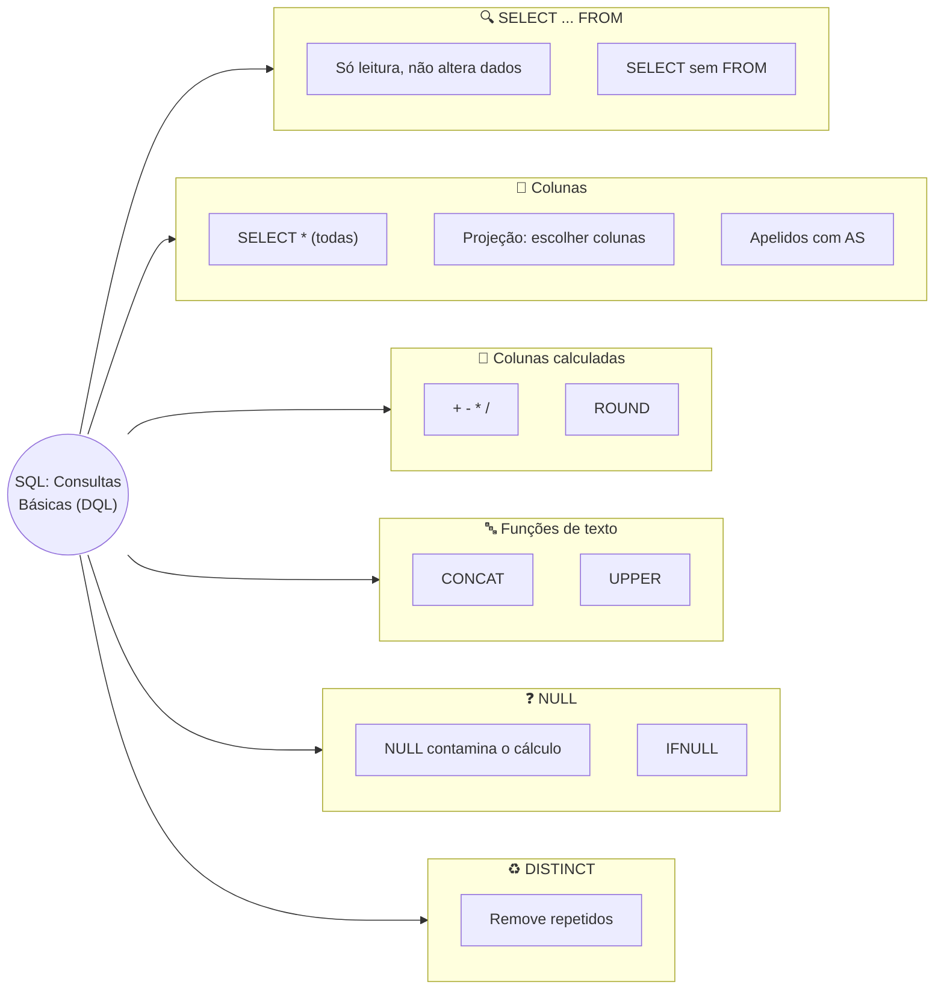

# Tópico 07 — SQL: Consultas Básicas (DQL) — SELECT e Projeção de Colunas

**Disciplina:** Banco de Dados e Aplicações (IBD951)  
**Professor:** Ronan Adriel Zenatti · ronan.zenatti@cps.sp.gov.br  
**Fatec Jahu — 2º Semestre/2026**

---

## 🎯 Objetivos da Aula

Ao final desta aula você deverá ser capaz de:

- Explicar o papel da DQL (Data Query Language) e por que o `SELECT` não altera nenhum dado
- Escrever consultas com `SELECT ... FROM ...` para ler dados de uma tabela
- Escolher exatamente quais colunas aparecem no resultado (projeção) e em que ordem
- Dar nomes mais claros às colunas do resultado com apelidos (`AS`)
- Montar colunas calculadas com operações aritméticas e com as funções `ROUND`, `CONCAT`, `UPPER` e `IFNULL`
- Explicar o que é `NULL` dentro de uma consulta e como evitar que ele "contamine" um cálculo
- Eliminar linhas repetidas do resultado com `DISTINCT`
- Reconhecer e corrigir os erros mais comuns ao escrever um `SELECT`

---

## 🗺️ Mapa Mental da Aula



---

## 1. DQL: fazer perguntas ao banco

No Tópico 06 você **colocou dados** na `loja_virtual` (`INSERT`), **corrigiu** (`UPDATE`) e **apagou** (`DELETE`). Agora vem a parte que, na prática, você mais vai usar no dia a dia de trabalho com bancos de dados: **consultar**.

A **DQL (Data Query Language — Linguagem de Consulta de Dados)** é a subcategoria da SQL para **fazer perguntas** ao banco. Ela tem **um único comando**: o **`SELECT`** (em português, *"selecione"*).

A grande diferença para a DML do tópico anterior: o `SELECT` **só lê**. Ele **nunca** altera, cadastra ou apaga nada. Você pode rodar um `SELECT` mil vezes sem medo de estragar os dados.

> 💡 **Do dia a dia:** `INSERT`, `UPDATE` e `DELETE` são o funcionário da padaria **mexendo** no estoque. O `SELECT` é o cliente **olhando a vitrine** — ou você abrindo o extrato no aplicativo do banco: você vê o saldo, mas não muda nenhum centavo só por olhar. Por isso o `SELECT` é o comando mais seguro da SQL — e o melhor lugar para começar a "treinar o olho".

Uma consulta sempre devolve uma **tabela de resultado**: linhas e colunas, como uma planilha. Ela existe apenas na tela naquele momento; a tabela original, guardada no banco, continua intacta.

---

## 2. Preparando o ambiente

Para todos obterem **os mesmos resultados** que aparecem nesta aula, vamos partir de um banco com dados conhecidos. Faça os dois passos abaixo, **nesta ordem**:

**Passo 1.** Rode o **script completo da Seção 11 do [Tópico 05](Aula_06_SQL_DDL.md)**. Ele recria o banco `loja_virtual` com as cinco tabelas, todas vazias.

**Passo 2.** Rode o **script de carga** abaixo, que cadastra 6 categorias, 6 clientes, 11 produtos, 5 pedidos e 8 itens de pedido. Ele é feito só com os comandos `INSERT` que você aprendeu no Tópico 06:

??? note "📦 Script de carga de dados (clique para abrir)"
    ```sql
    USE loja_virtual;

    INSERT INTO categorias (nome, descricao) VALUES
        ('Padaria',    'Pães, bolos e salgados'),
        ('Bebidas',    NULL),
        ('Mercearia',  'Arroz, feijão, macarrão e enlatados'),
        ('Hortifruti', 'Frutas, legumes e verduras'),
        ('Limpeza',    'Produtos de limpeza e higiene'),
        ('Frios',      'Queijos, presuntos e embutidos');

    INSERT INTO clientes (nome, cpf, email, data_nascimento, telefone) VALUES
        ('Ana Souza',      '11122233344', 'ana.souza@email.com',      '1990-05-14', '14991234567'),
        ('Bruno Lima',     '22233344455', 'bruno.lima@email.com',     '1988-02-20', '14998887766'),
        ('Carla Mendes',   '33344455566', 'carla.mendes@email.com',   '1992-09-03', '14997654321'),
        ('Diego Alves',    '44455566677', 'diego.alves@email.com',    '1985-11-30', NULL),
        ('Elisa Rocha',    '55566677788', 'elisa.rocha@email.com',    '1995-07-09', NULL),
        ('Fábio Teixeira', '66677788899', 'fabio.teixeira@email.com', '1979-01-25', '14996543210');

    INSERT INTO produtos (categoria_id, nome, descricao, preco, estoque) VALUES
        (1, 'Pão francês (kg)',      'Assado todos os dias às 6h',  14.90,  50),
        (1, 'Bolo de fubá',          NULL,                          18.00,  12),
        (3, 'Café torrado 500g',     'Torra média, moído na hora',  17.50,  40),
        (3, 'Arroz 5kg',             NULL,                          29.90,  30),
        (2, 'Refrigerante 2L',       NULL,                           9.99,  24),
        (2, 'Suco de laranja 1L',    'Integral, sem açúcar',         7.50,  18),
        (4, 'Banana prata (kg)',     NULL,                           6.90,  35),
        (4, 'Tomate (kg)',           NULL,                           8.90,   0),
        (5, 'Detergente 500ml',      NULL,                           2.99, 100),
        (6, 'Presunto fatiado (kg)', NULL,                          39.90,   8),
        (6, 'Queijo mussarela (kg)', NULL,                          44.90,   6);

    INSERT INTO pedidos (cliente_id, data_pedido, status, valor_total, observacoes) VALUES
        (1, '2026-10-01', 'entregue',   47.30, NULL),
        (2, '2026-10-02', 'enviado',    49.88, 'Entregar após as 18h'),
        (1, '2026-10-05', 'confirmado', 22.50, NULL),
        (3, '2026-10-07', 'pendente',   25.76, NULL),
        (4, '2026-10-08', 'cancelado',  18.00, 'Cliente desistiu');

    INSERT INTO itens_pedidos (pedido_id, produto_id, quantidade, preco_unitario) VALUES
        (1, 1, 2, 14.90),
        (1, 3, 1, 17.50),
        (2, 4, 1, 29.90),
        (2, 5, 2,  9.99),
        (3, 6, 3,  7.50),
        (4, 7, 2,  6.90),
        (4, 9, 4,  2.99),
        (5, 2, 1, 18.00);
    ```

Se tudo deu certo, o MariaDB responde `Query OK` em cada `INSERT`. Garanta que o banco está selecionado antes de continuar:

```sql
USE loja_virtual;
```

> ⚠️ **Se esquecer o `USE`:** qualquer consulta a uma tabela responde `ERROR 1046 (3D000): No database selected` — o MariaDB não sabe em qual banco procurar a tabela.

> 📐 **Sobre a ordem das linhas nos resultados:** em alguns exemplos desta aula, as linhas do **seu** resultado podem aparecer em ordem diferente das mostradas aqui. Isso é normal: sem uma instrução explícita de ordenação, o banco escolhe a ordem que for mais conveniente para ele — e **não garante** nenhuma. Veja mais sobre isso na Seção 5.4.

---

## 3. A anatomia de um SELECT

### 3.1 Primeiro `SELECT`: sem tabela nenhuma

O `SELECT` mais simples não precisa de tabela. Ele funciona como uma **calculadora**:

```sql
SELECT 2 + 3;
```

```text
+-------+
| 2 + 3 |
+-------+
|     5 |
+-------+
```

Você já usou algo assim no Tópico 05, com `SELECT VERSION();` e `SELECT DATABASE();`. Também funciona com texto:

```sql
SELECT 'Olá, mundo!' AS mensagem;
```

(O `AS mensagem` dá um nome à coluna do resultado — veremos na Seção 5.)

### 3.2 Lendo dados de uma tabela

Para ler dados **guardados** numa tabela, o `SELECT` ganha um parceiro: o **`FROM`** (*"de"*), que diz **de qual tabela** vêm os dados:

```sql
SELECT coluna1, coluna2
FROM nome_da_tabela;
```

Leia assim: *"selecione estas colunas **da** tabela X"*.

> 💡 **Do dia a dia:** é o pedido no balcão do cartório: *"Preciso do nome e do endereço (o `SELECT`) **da** ficha de moradores (o `FROM`)"*. O atendente vai ao arquivo, pega a ficha certa e copia só aqueles campos para uma folha — a ficha original volta intacta para a gaveta.

**Detalhe importante:** o banco executa o `FROM` **primeiro** (vai até a tabela) e só depois o `SELECT` (escolhe o que mostrar). Mas nós escrevemos o `SELECT` antes, porque é assim que lemos a pergunta: *"o quê"* e depois *"de onde"*.

Convenções da disciplina (as mesmas dos tópicos anteriores):

- Palavras reservadas em **MAIÚSCULAS** (`SELECT`, `FROM`, `AS`, `DISTINCT`) — Regra 3. O MariaDB entenderia minúsculas, mas as maiúsculas deixam claro o que é comando e o que é nome de tabela ou de coluna.
- Nomes de tabelas e colunas em **minúsculas** com `snake_case` — Regras 1 e 2.
- Termine todo comando com **ponto e vírgula** (`;`).
- Para consultas longas, escreva cada cláusula (`SELECT`, `FROM`…) em uma linha: o MariaDB ignora quebras de linha e espaços extras, e o código fica legível.

---

## 4. `SELECT *` — todas as colunas

O asterisco (`*`) significa **"todas as colunas"**:

```sql
SELECT * FROM categorias;
```

```text
+--------------+------------+---------------------------------------+-------+---------------------+---------------------+-------------+
| id_categoria | nome       | descricao                             | ativa | criado_em           | atualizado_em       | deletado_em |
+--------------+------------+---------------------------------------+-------+---------------------+---------------------+-------------+
|            1 | Padaria    | Pães, bolos e salgados                |     1 | 2026-10-21 19:06:07 | 2026-10-21 19:06:07 | NULL        |
|            2 | Bebidas    | NULL                                  |     1 | 2026-10-21 19:06:07 | 2026-10-21 19:06:07 | NULL        |
|            3 | Mercearia  | Arroz, feijão, macarrão e enlatados   |     1 | 2026-10-21 19:06:07 | 2026-10-21 19:06:07 | NULL        |
|            4 | Hortifruti | Frutas, legumes e verduras            |     1 | 2026-10-21 19:06:07 | 2026-10-21 19:06:07 | NULL        |
|            5 | Limpeza    | Produtos de limpeza e higiene         |     1 | 2026-10-21 19:06:07 | 2026-10-21 19:06:07 | NULL        |
|            6 | Frios      | Queijos, presuntos e embutidos        |     1 | 2026-10-21 19:06:07 | 2026-10-21 19:06:07 | NULL        |
+--------------+------------+---------------------------------------+-------+---------------------+---------------------+-------------+
```

(As datas e horas de `criado_em` e `atualizado_em` serão as do momento em que **você** rodou o script de carga.)

Veja que a consulta mostrou até as colunas que você não escreveu no `INSERT`: as geradas pelo banco (`id_categoria`, `ativa`, `criado_em`…). O resultado tem **linhas** (uma por categoria) e **colunas** (uma por característica).

`SELECT *` é ótimo para **explorar**: *"que tabela é essa? Quais colunas ela tem? Como são os dados?"* — é o que você fez no Tópico 06 para conferir seus `INSERT`.

> ⚠️ **Mas evite `SELECT *` em sistemas de verdade.** Em uma aplicação, ele traz colunas que ninguém precisa (senhas, observações longas, colunas de log), gasta mais memória e rede, e muda de resultado se alguém acrescentar uma coluna na tabela amanhã. A prática profissional é **listar as colunas** de que você precisa — que é o próximo assunto. Daqui em diante, nesta disciplina, só use `SELECT *` para explorar.

> 💡 **Do dia a dia:** `SELECT *` é pedir *"traga a pasta inteira do funcionário"* quando você só queria saber o telefone dele. Funciona, mas é um monte de papel desnecessário carregado de um lado para o outro.

---

## 5. Projeção: escolhendo as colunas

### 5.1 Listando as colunas desejadas

**Projeção** é o termo técnico para **escolher quais colunas** aparecem no resultado. Em vez de `*`, escreva os nomes das colunas **separados por vírgula**:

```sql
SELECT nome, preco
FROM produtos;
```

```text
+-----------------------+-------+
| nome                  | preco |
+-----------------------+-------+
| Pão francês (kg)      | 14.90 |
| Bolo de fubá          | 18.00 |
| Café torrado 500g     | 17.50 |
| Arroz 5kg             | 29.90 |
| Refrigerante 2L       |  9.99 |
| Suco de laranja 1L    |  7.50 |
| Banana prata (kg)     |  6.90 |
| Tomate (kg)           |  8.90 |
| Detergente 500ml      |  2.99 |
| Presunto fatiado (kg) | 39.90 |
| Queijo mussarela (kg) | 44.90 |
+-----------------------+-------+
```

A tabela `produtos` tem 10 colunas, mas o resultado mostra só as duas pedidas. As **linhas** continuam todas lá — o `SELECT` com colunas escolhidas filtra o que você **vê** de cada linha, não quais linhas aparecem.

> 📐 **Atenção ao vocabulário:** na teoria de bancos de dados (álgebra relacional), existem duas operações com nomes parecidos. A **projeção** escolhe **colunas**. A **seleção** escolhe **linhas**. O comando `SELECT` do SQL faz a *projeção* (escolhe colunas) — e o filtro de linhas, a *seleção*, é feito por outra cláusula, a `WHERE`, assunto dos próximos tópicos. O nome do comando engana, mas o raciocínio é simples: **colunas = `SELECT`; linhas = `WHERE`**.

### 5.2 A ordem das colunas é você quem manda

As colunas aparecem na ordem em que você as escreve, e não na ordem em que foram criadas na tabela:

```sql
SELECT preco, nome
FROM produtos;
```

```text
+-------+-----------------------+
| preco | nome                  |
+-------+-----------------------+
| 14.90 | Pão francês (kg)      |
| 18.00 | Bolo de fubá          |
| 17.50 | Café torrado 500g     |
...
```

Você também pode repetir uma coluna, se fizer sentido, e escolher colunas de qualquer posição da tabela.

### 5.3 Apelidos com `AS`

Às vezes o nome da coluna na tabela não é o melhor para quem vai ler o resultado. O **apelido** (em inglês, *alias*) dá um **novo nome temporário** à coluna, **só no resultado**:

```sql
SELECT nome AS produto,
       preco AS preco_atual
FROM produtos;
```

```text
+-----------------------+-------------+
| produto               | preco_atual |
+-----------------------+-------------+
| Pão francês (kg)      |       14.90 |
| Bolo de fubá          |       18.00 |
| Café torrado 500g     |       17.50 |
...
```

> 💡 **Do dia a dia:** é a etiqueta que você cola na pasta antes de entregar para o chefe: o nome na gaveta continua o mesmo, mas na pasta que sai do arquivo está escrito o que ele precisa ler.

Regras do apelido:

- O apelido **não muda o nome da coluna na tabela** — só o rótulo da coluna no resultado daquela consulta.
- Siga a mesma convenção dos nomes de colunas: `snake_case`, minúsculas, **sem espaços** (`preco_atual`, não `Preço Atual`).
- A palavra `AS` é opcional para o MariaDB, mas **obrigatória** nesta disciplina: ela deixa claro que ali começa um apelido (veja a armadilha no Exemplo Resolvido).

### 5.4 Sem `ORDER BY`, a ordem das linhas não é garantida

Execute estas duas consultas e compare:

```sql
SELECT nome FROM categorias;
```

```text
+------------+
| nome       |
+------------+
| Bebidas    |
| Frios      |
| Hortifruti |
| Limpeza    |
| Mercearia  |
| Padaria    |
+------------+
```

```sql
SELECT nome, descricao FROM categorias;
```

```text
+------------+---------------------------------------+
| nome       | descricao                             |
+------------+---------------------------------------+
| Padaria    | Pães, bolos e salgados                |
| Bebidas    | NULL                                  |
| Mercearia  | Arroz, feijão, macarrão e enlatados   |
...
```

As mesmas seis categorias apareceram em **ordens diferentes**: na primeira, em ordem alfabética; na segunda, na ordem em que foram cadastradas. Isso acontece porque o banco pode ler os dados por "atalhos" internos (os índices criados pelas suas constraints `UNIQUE`) e entrega as linhas na ordem que encontrar.

**Regra de ouro:** se a ordem das linhas importa, você precisa **pedir** a ordem — com a cláusula `ORDER BY`, que veremos no Tópico 08. Sem ela, não confie em nenhuma ordem.

!!! example "🔍 Checkpoint 1 — Escolhendo colunas"
    Escreva as consultas a seguir:
    (a) o **nome** e o **e-mail** de todos os clientes;
    (b) o **nome** e o **estoque** de todos os produtos, com os apelidos `produto` e `quantidade_em_estoque`;
    (c) **todas as colunas** da tabela `itens_pedidos`.

    🔑 Resolução no [Gabarito do Tópico 07](Topico_07_Gabarito.md#checkpoint-1) — tente resolver antes de conferir.

---

## 6. Colunas calculadas

### 6.1 Operações aritméticas

Além de mostrar colunas como estão, o `SELECT` pode **calcular** valores novos a partir delas. Os operadores são os da matemática:

| Operador | Operação | Exemplo | Resultado |
|---|---|---|---|
| `+` | Soma | `SELECT 10 + 4;` | 14 |
| `-` | Subtração | `SELECT 10 - 4;` | 6 |
| `*` | Multiplicação | `SELECT 10 * 4;` | 40 |
| `/` | Divisão | `SELECT 10 / 4;` | 2.5000 |
| `DIV` | Divisão inteira (só a parte inteira) | `SELECT 10 DIV 4;` | 2 |
| `%` | Resto da divisão | `SELECT 10 % 4;` | 2 |

Na prática, o cálculo é feito **linha por linha**, usando os valores das colunas da própria linha. Na tabela `produtos`, qual é o valor total parado no estoque de cada produto (quantidade × preço)?

```sql
SELECT nome,
       estoque,
       preco,
       estoque * preco AS valor_em_estoque
FROM produtos;
```

```text
+-----------------------+---------+-------+------------------+
| nome                  | estoque | preco | valor_em_estoque |
+-----------------------+---------+-------+------------------+
| Pão francês (kg)      |      50 | 14.90 |           745.00 |
| Bolo de fubá          |      12 | 18.00 |           216.00 |
| Café torrado 500g     |      40 | 17.50 |           700.00 |
| Arroz 5kg             |      30 | 29.90 |           897.00 |
| Refrigerante 2L       |      24 |  9.99 |           239.76 |
| Suco de laranja 1L    |      18 |  7.50 |           135.00 |
| Banana prata (kg)     |      35 |  6.90 |           241.50 |
| Tomate (kg)           |       0 |  8.90 |             0.00 |
| Detergente 500ml      |     100 |  2.99 |           299.00 |
| Presunto fatiado (kg) |       8 | 39.90 |           319.20 |
| Queijo mussarela (kg) |       6 | 44.90 |           269.40 |
+-----------------------+---------+-------+------------------+
```

> 💡 **Do dia a dia:** é o que o gerente do mercado faz com a calculadora ao fazer o inventário: pega a quantidade de cada prateleira, multiplica pelo preço da etiqueta e anota na folha. A diferença é que o `SELECT` faz isso para todas as linhas de uma vez — e **não escreve nada** na tabela. A coluna `valor_em_estoque` existe só no resultado; ela **não foi criada** em `produtos`.

Outro exemplo, agora na tabela `itens_pedidos`: o subtotal de cada item de pedido.

```sql
SELECT pedido_id,
       produto_id,
       quantidade,
       preco_unitario,
       quantidade * preco_unitario AS subtotal
FROM itens_pedidos;
```

```text
+-----------+------------+------------+----------------+----------+
| pedido_id | produto_id | quantidade | preco_unitario | subtotal |
+-----------+------------+------------+----------------+----------+
|         1 |          1 |          2 |          14.90 |    29.80 |
|         1 |          3 |          1 |          17.50 |    17.50 |
|         2 |          4 |          1 |          29.90 |    29.90 |
|         2 |          5 |          2 |           9.99 |    19.98 |
|         3 |          6 |          3 |           7.50 |    22.50 |
|         4 |          7 |          2 |           6.90 |    13.80 |
|         4 |          9 |          4 |           2.99 |    11.96 |
|         5 |          2 |          1 |          18.00 |    18.00 |
+-----------+------------+------------+----------------+----------+
```

> ⚠️ **Divisão por zero não dá erro:** `SELECT 7 / 0;` devolve `NULL` (e não estoura o sistema). Fique atento: se uma coluna de resultado vier cheia de `NULL` num cálculo de divisão, confira se o divisor é zero.

### 6.2 Arredondando com `ROUND`

Vamos calcular um reajuste de 10% nos preços:

```sql
SELECT nome,
       preco,
       preco * 1.10 AS preco_reajustado
FROM produtos;
```

```text
+-----------------------+-------+------------------+
| nome                  | preco | preco_reajustado |
+-----------------------+-------+------------------+
| Pão francês (kg)      | 14.90 |          16.3900 |
| Bolo de fubá          | 18.00 |          19.8000 |
| Café torrado 500g     | 17.50 |          19.2500 |
| Arroz 5kg             | 29.90 |          32.8900 |
| Refrigerante 2L       |  9.99 |          10.9890 |
...
```

Repare que o resultado tem **quatro casas decimais** (`10.9890`): um preço em reais tem duas. Para isso existe a função **`ROUND`**.

Uma **função** é como uma pequena máquina embutida no banco: você entrega um ou mais valores, ela faz um trabalho e devolve um valor pronto. Você já usou funções sem saber: `VERSION()`, `DATABASE()`, `NOW()`. A `ROUND(valor, casas)` arredonda `valor` para o número de `casas` decimais informado:

```sql
SELECT nome,
       ROUND(preco * 1.10, 2) AS preco_reajustado
FROM produtos;
```

```text
+-----------------------+------------------+
| nome                  | preco_reajustado |
+-----------------------+------------------+
| Pão francês (kg)      |            16.39 |
| Bolo de fubá          |            19.80 |
| Café torrado 500g     |            19.25 |
| Arroz 5kg             |            32.89 |
| Refrigerante 2L       |            10.99 |
...
```

> 💡 **Do dia a dia:** é o troco no caixa. O caixa nunca devolve "R$ 10,989" — o centavo é a menor unidade, então o valor é arredondado para duas casas.

!!! example "🔍 Checkpoint 2 — Colunas calculadas"
    (a) Mostre o **nome** de cada produto e o seu **preço com 15% de desconto** (multiplique por `0.85`), arredondado para duas casas, com o apelido `preco_promocional`.
    (b) Mostre o `pedido_id`, o `produto_id` e o **subtotal** de cada item de pedido (`quantidade × preco_unitario`).
    (c) Depois de rodar o item (a), execute `SELECT nome, preco FROM produtos;`. Os preços mudaram? Por quê?

    🔑 Resolução no [Gabarito do Tópico 07](Topico_07_Gabarito.md#checkpoint-2) — tente resolver antes de conferir.

---

## 7. Funções de texto

As funções também trabalham com texto. Veremos duas das mais usadas.

### 7.1 `CONCAT` — juntando textos

**Concatenar** é "emendar" textos, um depois do outro. A função `CONCAT(texto1, texto2, ...)` junta quantos textos você quiser. Textos fixos vão entre aspas simples, como no `INSERT`:

```sql
SELECT CONCAT(nome, ' <', email, '>') AS contato
FROM clientes;
```

```text
+--------------------------------------------+
| contato                                    |
+--------------------------------------------+
| Ana Souza <ana.souza@email.com>            |
| Bruno Lima <bruno.lima@email.com>          |
| Carla Mendes <carla.mendes@email.com>      |
| Diego Alves <diego.alves@email.com>        |
| Elisa Rocha <elisa.rocha@email.com>        |
| Fábio Teixeira <fabio.teixeira@email.com>  |
+--------------------------------------------+
```

É o formato de um contato de agenda de e-mail: nome seguido do endereço entre `<` e `>`. Note os espaços **dentro** das aspas: o `CONCAT` junta exatamente o que você der, sem acrescentar nada.

> ⚠️ **No MariaDB, não use `+` para juntar textos** (como em outras linguagens): `'Ana' + 'Souza'` tenta somar dois números e dá `0`. Para juntar textos, é `CONCAT`.

### 7.2 `UPPER` — letras maiúsculas

```sql
SELECT nome,
       UPPER(nome) AS nome_maiusculo
FROM clientes;
```

```text
+-----------------+-----------------+
| nome            | nome_maiusculo  |
+-----------------+-----------------+
| Ana Souza       | ANA SOUZA       |
| Bruno Lima      | BRUNO LIMA      |
| Carla Mendes    | CARLA MENDES    |
| Diego Alves     | DIEGO ALVES     |
| Elisa Rocha     | ELISA ROCHA     |
| Fábio Teixeira  | FÁBIO TEIXEIRA  |
+-----------------+-----------------+
```

(Existe também o `LOWER`, que faz o contrário.) Repare que o `UPPER` só transforma o que **aparece no resultado**; o nome guardado na tabela continua como foi cadastrado. E, graças ao `utf8mb4` do Tópico 05, o `á` virou `Á` direitinho.

---

## 8. `NULL` dentro de uma consulta

Quando você aprendeu `NULL` (Tópicos 05 e 06), viu que ele significa **ausência de valor**. Agora vamos ver o que ele faz num cálculo. Olhe a coluna `telefone` dos clientes:

```sql
SELECT nome, telefone
FROM clientes;
```

```text
+-----------------+-------------+
| nome            | telefone    |
+-----------------+-------------+
| Ana Souza       | 14991234567 |
| Bruno Lima      | 14998887766 |
| Carla Mendes    | 14997654321 |
| Diego Alves     | NULL        |
| Elisa Rocha     | NULL        |
| Fábio Teixeira  | 14996543210 |
+-----------------+-------------+
```

O Diego e a Elisa não têm telefone cadastrado. Agora tente juntar um texto fixo com o telefone:

```sql
SELECT nome,
       CONCAT('Tel: ', telefone) AS contato
FROM clientes;
```

```text
+-----------------+------------------+
| nome            | contato          |
+-----------------+------------------+
| Ana Souza       | Tel: 14991234567 |
| Bruno Lima      | Tel: 14998887766 |
| Carla Mendes    | Tel: 14997654321 |
| Diego Alves     | NULL             |
| Elisa Rocha     | NULL             |
| Fábio Teixeira  | Tel: 14996543210 |
+-----------------+------------------+
```

O resultado do Diego **não** é `Tel: ` — é `NULL`. **Qualquer operação que envolva `NULL` resulta em `NULL`**: `1 + NULL` é `NULL`, `CONCAT('a', NULL)` é `NULL`.

> 💡 **Do dia a dia:** `NULL` é como um **buraco na receita**. Se a receita diz "misture a farinha, o ovo e [em branco]", você não consegue dizer qual bolo vai sair — o resultado inteiro fica indefinido. O `NULL` "contamina" o cálculo inteiro porque o banco não sabe qual valor usar no lugar do desconhecido.

A solução é combinar o `NULL` com um valor de reserva. A função **`IFNULL(valor, reserva)`** funciona assim: *"se `valor` for `NULL`, use `reserva` no lugar"*.

```sql
SELECT nome,
       IFNULL(telefone, 'não informado') AS telefone_contato
FROM clientes;
```

```text
+-----------------+------------------+
| nome            | telefone_contato |
+-----------------+------------------+
| Ana Souza       | 14991234567      |
| Bruno Lima      | 14998887766      |
| Carla Mendes    | 14997654321      |
| Diego Alves     | não informado    |
| Elisa Rocha     | não informado    |
| Fábio Teixeira  | 14996543210      |
+-----------------+------------------+
```

> 📐 **De novo, só no resultado:** o `IFNULL` troca o `NULL` por `'não informado'` apenas na exibição. Na tabela `clientes`, o telefone continua `NULL`.

---

## 9. `DISTINCT` — eliminando repetições

Qual é a categoria de cada produto? Uma consulta simples:

```sql
SELECT categoria_id
FROM produtos;
```

```text
+--------------+
| categoria_id |
+--------------+
|            1 |
|            1 |
|            2 |
|            2 |
|            3 |
|            3 |
|            4 |
|            4 |
|            5 |
|            6 |
|            6 |
+--------------+
```

São 11 linhas — uma por produto — com muita repetição. Se a pergunta for *"quais categorias têm produtos?"*, a repetição atrapalha. A palavra **`DISTINCT`** (*"distinto, diferente"*), escrita logo depois do `SELECT`, **elimina as linhas repetidas** do resultado:

```sql
SELECT DISTINCT categoria_id
FROM produtos;
```

```text
+--------------+
| categoria_id |
+--------------+
|            1 |
|            2 |
|            3 |
|            4 |
|            5 |
|            6 |
+--------------+
```

> 💡 **Do dia a dia:** é o fiscal do rodízio de pizza que, de olho na lista de pedidos da mesa, anota *"quais sabores já saíram"* — mesmo que a calabresa tenha sido pedida cinco vezes, ela entra uma vez só na lista.

Outro exemplo: quais clientes já fizeram pelo menos um pedido? Sem e com `DISTINCT`:

```sql
SELECT cliente_id FROM pedidos;            -- 5 linhas: o cliente 1 aparece 2 vezes
SELECT DISTINCT cliente_id FROM pedidos;   -- 4 linhas: cada cliente aparece uma vez
```

```text
+------------+       +------------+
| cliente_id |       | cliente_id |
+------------+       +------------+
|          1 |       |          1 |
|          1 |       |          2 |
|          2 |       |          3 |
|          3 |       |          4 |
|          4 |       +------------+
+------------+
```

Com **mais de uma coluna**, o `DISTINCT` olha a **combinação**: duas linhas só são "repetidas" se **todas** as colunas listadas forem iguais. Por exemplo, `SELECT DISTINCT cliente_id, status FROM pedidos;` devolve 5 linhas, porque nenhum cliente repete o mesmo status.

> ⚠️ **O `DISTINCT` não altera a tabela** — só esconde repetições no resultado. E use-o com um propósito: se a tabela é muito grande, remover repetições dá trabalho extra ao banco.

!!! example "🔍 Checkpoint 3 — Texto, NULL e DISTINCT"
    (a) Mostre o **nome em maiúsculas** de cada cliente e o telefone dele, trocando o `NULL` por `'sem telefone'`. Use os apelidos `nome_maiusculo` e `telefone_contato`.
    (b) Quais são os **status** de pedido que existem hoje na tabela `pedidos`, sem repetição?
    (c) Mostre uma coluna `etiqueta` com o nome de cada produto seguido de ` - R$ ` e do preço (exemplo: `Arroz 5kg - R$ 29.90`).

    🔑 Resolução no [Gabarito do Tópico 07](Topico_07_Gabarito.md#checkpoint-3) — tente resolver antes de conferir.

---

## 10. Erros comuns em um SELECT

Todo mundo erra ao escrever consultas, e ler a mensagem faz parte do trabalho. Os erros mais frequentes:

| Código | Mensagem (resumo) | Causa típica | Exemplo |
|---|---|---|---|
| **1054** | `Unknown column 'nom' in 'field list'` | Nome de **coluna** escrito errado ou inexistente | `SELECT nom FROM produtos;` |
| **1146** | `Table 'loja_virtual.produto' doesn't exist` | Nome de **tabela** errado (lembre: plural — Regra 4) | `SELECT nome FROM produto;` |
| **1064** | `You have an error in your SQL syntax ... near 'FROM produtos'` | Erro de **sintaxe**; aqui, vírgula sobrando antes do `FROM` | `SELECT nome, preco, FROM produtos;` |
| **1046** | `No database selected` | Esqueceu o `USE loja_virtual;` | — |

Na mensagem 1064, o MariaDB cita o **trecho onde se perdeu** (`near '...'`). O erro de verdade costuma estar **um pouco antes** desse trecho — no exemplo, a vírgula que sobrou depois de `preco`.

> 💡 **Dica:** ao dar erro, leia a mensagem inteira, procure o trecho depois de `near`, volte um pouco e confira: vírgulas, aspas, nomes de colunas e de tabelas.

---

## 11. O que vem a seguir

Até agora, toda consulta devolveu **todas as linhas** da tabela, na ordem que o banco quis. No dia a dia, as perguntas são mais específicas:

- *"Quais produtos custam menos de R$ 10?"*
- *"Quais pedidos ainda estão pendentes?"*
- *"Mostre os produtos do mais caro ao mais barato."*

No **Tópico 08** vamos aprender o `WHERE` (que escolhe as **linhas**) e o `ORDER BY` (que **ordena** o resultado). Com o `SELECT` de colunas deste tópico, você terá o conjunto completo: escolher colunas, escolher linhas e ordenar.

---

## 📝 Exercícios de Fixação

### Exemplo Resolvido — Identifique os erros

As quatro consultas abaixo foram escritas por um estagiário. Antes de olhar a resposta, tente descobrir o que há de errado em cada uma — e atenção: **nem todo erro faz o banco reclamar**:

```sql
select * from Produtos

SELECT nome preco FROM produtos;

SELECT nome, preco, FROM produtos;

SELECT nome, preco * 1,10 AS total FROM produtos;
```

??? question "🔍 Ver a resolução"
    **Consulta 1:** palavras reservadas em minúsculas (deveriam estar em MAIÚSCULAS — Regra 3); `Produtos` com inicial maiúscula (nome de tabela é minúsculo — Regra 2; no Windows com XAMPP funciona, mas em servidores Linux o MariaDB diferencia maiúsculas e a consulta falharia); falta o `;` no final; e `SELECT *` não deveria ser usado em consultas "de verdade".

    **Consulta 2:** **faltou a vírgula** entre `nome` e `preco`. O pior é que o banco **não reclama**: ele entende `preco` como **apelido** de `nome` (o `AS` é opcional!) e devolve uma coluna só, com os nomes dos produtos, chamada `preco`. Sem o `AS`, o erro passa batido — por isso, nesta disciplina o `AS` é obrigatório.

    **Consulta 3:** vírgula sobrando antes do `FROM` — erro 1064.

    **Consulta 4:** `1,10` com vírgula decimal. Em SQL a vírgula **separa colunas**, então o banco lê três colunas: `nome`, `preco * 1` e `10 AS total` (uma coluna com o número 10 em todas as linhas). Não dá erro, mas o resultado está completamente errado. O decimal é com **ponto**: `1.10`.

    Versão corrigida:

    ```sql
    SELECT nome, preco
    FROM produtos;

    SELECT nome,
           ROUND(preco * 1.10, 2) AS preco_reajustado
    FROM produtos;
    ```

---

## 🃏 Flashcards de Revisão

??? question "Qual é o único comando da DQL e o que ele faz com os dados?"
    O `SELECT`. Ele só **lê** dados e devolve uma tabela de resultado; nunca altera, cadastra ou remove nada na tabela original.

??? question "Qual a diferença entre `SELECT *` e `SELECT nome, preco`?"
    `SELECT *` traz **todas** as colunas da tabela (bom para explorar); `SELECT nome, preco` traz só as colunas listadas, na ordem escrita (projeção) — a forma recomendada em sistemas reais.

??? question "O que é projeção e como ela se diferencia da seleção?"
    Projeção escolhe **colunas** (feita pelo `SELECT`); seleção escolhe **linhas** (feita pelo `WHERE`, assunto do Tópico 08).

??? question "Para que serve o `AS`? Ele muda o nome da coluna na tabela?"
    O `AS` cria um apelido para a coluna ou expressão, valendo só no resultado daquela consulta. Não altera o nome real na tabela.

??? question "Por que `CONCAT('Tel: ', telefone)` devolve `NULL` para quem não tem telefone, e como resolver?"
    Qualquer operação com `NULL` resulta em `NULL`. Para resolver, troque o `NULL` por um valor de reserva com `IFNULL(telefone, 'não informado')` antes de juntar.

??? question "O que o `DISTINCT` faz e o que ele NÃO faz?"
    Elimina linhas repetidas do **resultado**. Não altera a tabela e, com várias colunas, considera repetida só a linha em que **todas** as colunas listadas coincidem.

---

## ✅ Quiz de Fixação

<quiz>
O que acontece com os dados da tabela `produtos` ao executar `SELECT nome, preco * 2 AS dobro FROM produtos;`?
- [ ] O preço de todos os produtos passa a ser o dobro
- [ ] Uma nova coluna `dobro` é criada na tabela `produtos`
- [x] Nada: a tabela continua igual, e o dobro aparece só no resultado da consulta
- [ ] O banco recusa o comando, pois o `SELECT` não faz cálculos

O `SELECT` só lê. A coluna `dobro` é calculada na hora e existe apenas no resultado. Para realmente mudar os preços, seria preciso um `UPDATE`.
</quiz>

<quiz>
Qual consulta mostra **apenas** o nome e o e-mail dos clientes, nesta ordem?
- [ ] `SELECT * FROM clientes;`
- [ ] `SELECT email, nome FROM clientes;`
- [x] `SELECT nome, email FROM clientes;`
- [ ] `SELECT nome email FROM clientes;`

As colunas aparecem na ordem em que são escritas, separadas por vírgula. A última opção, sem vírgula, faz o MariaDB tratar `email` como apelido de `nome` e devolve uma coluna só.
</quiz>

<quiz>
Sobre `NULL` dentro de uma consulta, quais afirmações são verdadeiras? (selecione todas as corretas)
- [x] `1 + NULL` resulta em `NULL`
- [x] `CONCAT('Tel: ', telefone)` resulta em `NULL` quando o telefone é `NULL`
- [x] `IFNULL(telefone, 'não informado')` troca o `NULL` por um valor de reserva, só no resultado
- [ ] `IFNULL` altera o valor guardado na tabela para `'não informado'`

Qualquer operação com `NULL` resulta em `NULL`. O `IFNULL` é uma forma de evitar isso, mas atua só na exibição: o dado guardado na tabela não muda.
</quiz>

<quiz>
A tabela `pedidos` tem 5 linhas e os valores de `cliente_id` são: 1, 2, 1, 3, 4. Quantas linhas devolve `SELECT DISTINCT cliente_id FROM pedidos;`?
- [ ] 1
- [ ] 3
- [x] 4
- [ ] 5

O cliente 1 aparece duas vezes e, com `DISTINCT`, entra uma vez só. Sobram os valores 1, 2, 3 e 4 — quatro linhas.
</quiz>

<quiz>
Qual comando faz a **projeção** (escolhe colunas) e qual faz a **seleção** (escolhe linhas)?
- [ ] `WHERE` faz a projeção e `SELECT` faz a seleção
- [x] `SELECT` faz a projeção e `WHERE` faz a seleção
- [ ] Os dois fazem as duas coisas
- [ ] `FROM` faz a projeção e `SELECT` faz a seleção

O nome engana: o `SELECT` do SQL escolhe **colunas** (projeção). Quem filtra **linhas** (seleção) é o `WHERE`, que veremos no Tópico 08.
</quiz>

---

## 📝 Resumo

Neste tópico você aprendeu a **fazer perguntas** ao banco com a **DQL**, cujo único comando é o `SELECT` — que só lê, nunca altera dados. A estrutura básica é `SELECT colunas FROM tabela;`: `SELECT *` traz tudo (use para explorar), e listar as colunas, a **projeção**, traz só o que importa, na ordem que você escolher. Os apelidos com `AS` rotulam as colunas do resultado; as operações aritméticas e as funções `ROUND`, `CONCAT` e `UPPER` criam colunas calculadas que existem **apenas no resultado**; o `NULL` contamina qualquer cálculo, e o `IFNULL` oferece um valor de reserva; e o `DISTINCT` elimina repetições. Por fim, você viu que sem `ORDER BY` a ordem das linhas não é garantida e aprendeu a ler os erros 1054, 1146, 1064 e 1046. No próximo tópico, o `WHERE` e o `ORDER BY` completam o conjunto: escolher colunas, escolher linhas e ordenar.

---

## 🏆 Conquista da Aula

!!! success "Selo desbloqueado: 🔍 Investigador(a) de Dados"
    Você aprendeu a olhar para dentro do banco sem mexer em nada: escolheu colunas,
    montou cálculos, tratou o `NULL` e tirou as repetições. Quem sabe consultar não
    depende de ninguém para enxergar o que há nos dados. A próxima parada da Trilha
    do(a) Consultor(a) SQL: aprender a filtrar as linhas certas e ordenar o resultado.

---

## 📚 Referências

- ELMASRI, R.; NAVATHE, S. B. *Sistemas de Banco de Dados*. 7 ed. Cap. 6 — SQL Básico. São Paulo: Pearson, 2018.
- BEIGHLEY, L. *Use a Cabeça SQL*. Alta Books, 2008.
- Documentação oficial do MariaDB — [SELECT](https://mariadb.com/kb/en/select/)
- Documentação oficial do MariaDB — [String Functions](https://mariadb.com/kb/en/string-functions/)
- Documentação oficial do MariaDB — [Numeric Functions](https://mariadb.com/kb/en/numeric-functions/)

---

## 🔗 Navegação

⬅️ [Tópico 06 — SQL: Linguagem de Manipulação de Dados (DML)](Topico_06_SQL_DML.md) · ➡️ [Tópico 08 — Filtragem Avançada](Topico_08_Filtragem_Avancada.md)

---

*Fatec Jahu · IBD951 · Prof. Ronan Adriel Zenatti · 2026*
