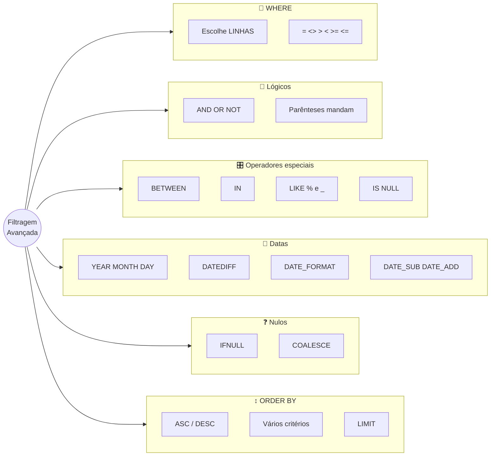
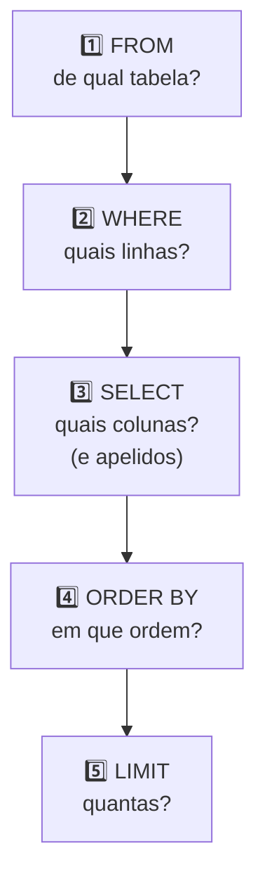

# Tópico 08 — Filtragem Avançada: WHERE e ORDER BY

**Disciplina:** Banco de Dados e Aplicações (IBD951)  
**Professor:** Ronan Adriel Zenatti · ronan.zenatti@cps.sp.gov.br  
**Fatec Jahu — 2º Semestre/2026**

---

## 🎯 Objetivos da Aula

Ao final desta aula você deverá ser capaz de:

- Escolher **quais linhas** aparecem no resultado usando a cláusula `WHERE` com operadores de comparação
- Combinar condições com os operadores lógicos `AND`, `OR` e `NOT`, usando parênteses para controlar a ordem de avaliação
- Aplicar os operadores especiais `BETWEEN`, `IN`, `LIKE` e `IS NULL` / `IS NOT NULL`
- Filtrar e calcular com datas usando as funções `YEAR`, `MONTH`, `DATEDIFF`, `DATE_FORMAT`, `DATE_SUB` e `DATE_ADD`
- Tratar valores nulos com `IFNULL` e `COALESCE`
- Ordenar o resultado com `ORDER BY` (crescente, decrescente e por mais de um critério) e limitar a quantidade de linhas com `LIMIT`
- Reconhecer e corrigir os erros mais comuns ao filtrar dados

---

## 🗺️ Mapa Mental da Aula



---

## 1. A cláusula WHERE: escolhendo as linhas

No Tópico 07 você aprendeu a escolher **colunas** (projeção). Mas toda consulta devolveu **todas as linhas** da tabela. Na vida real, ninguém quer a lista inteira: quer *"os produtos que acabaram"*, *"os pedidos de outubro"*, *"os clientes sem telefone"*.

O **`WHERE`** (em português, *"onde"*) é o **filtro das linhas**: para cada linha da tabela, o banco avalia uma **condição** e só deixa passar as linhas em que a condição é **verdadeira**.

> 💡 **Do dia a dia:** o `WHERE` é o **porteiro da festa**. A lista de convidados (a tabela) tem todo mundo, mas na porta o porteiro confere cada pessoa: *"Tem convite? Está de maior?"*. Quem cumpre a regra entra no resultado; quem não cumpre fica de fora. E repare: o porteiro **não rasga o nome** de quem barrou — a lista original continua intacta, só o resultado muda.

Lembrando o que você viu no Tópico 07: **colunas = `SELECT`; linhas = `WHERE`**. A cláusula vai logo depois do `FROM`:

```sql
SELECT colunas
FROM tabela
WHERE condição;
```

> 📌 Você já usou o `WHERE` no Tópico 06, dentro do `UPDATE` e do `DELETE`, para dizer *quais linhas* alterar ou apagar. Aqui ele funciona do mesmo jeito — só que dentro de um `SELECT`, que apenas lê. Por isso é o lugar perfeito para **treinar** o `WHERE` sem risco.

---

## 2. Preparando o ambiente

Vamos usar a mesma carga de dados do Tópico 07. Se o seu banco `loja_virtual` está como ficou no fim daquele tópico, **não precisa fazer nada** — apenas selecione o banco:

```sql
USE loja_virtual;
```

Se você mexeu nos dados (nos exercícios do Tópico 06, por exemplo) e quer que seus resultados batam com os desta aula, refaça os dois passos da **Seção 2 do [Tópico 07](Topico_07_SQL_DQL.md)**: o script completo da Seção 11 do [Tópico 05](Aula_06_SQL_DDL.md) e depois o script de carga.

Como lembrete, estes são os dados com que vamos trabalhar:

| Tabela | Linhas | O que tem |
|---|---|---|
| `categorias` | 6 | Padaria, Bebidas, Mercearia, Hortifruti, Limpeza, Frios |
| `clientes` | 6 | Ana, Bruno, Carla, Diego, Elisa e Fábio (Diego e Elisa **sem telefone**) |
| `produtos` | 11 | de Detergente (R$ 2,99) a Queijo mussarela (R$ 44,90); o Tomate está com estoque 0 |
| `pedidos` | 5 | um de cada status: entregue, enviado, confirmado, pendente e cancelado |
| `itens_pedidos` | 8 | itens dos 5 pedidos |

---

## 3. Operadores de comparação

Uma **condição** compara dois valores e o resultado é *verdadeiro* ou *falso*. Os operadores de comparação são:

| Operador | Significa | Exemplo |
|---|---|---|
| `=` | igual a | `estoque = 0` |
| `<>` ou `!=` | diferente de | `status <> 'cancelado'` |
| `>` | maior que | `preco > 20` |
| `<` | menor que | `preco < 10` |
| `>=` | maior ou igual a | `estoque >= 50` |
| `<=` | menor ou igual a | `preco <= 10` |

> ⚠️ **Atenção:** em SQL, um único `=` já significa "é igual a" (em muitas linguagens de programação seria `==`). E "diferente" pode ser escrito `<>` ou `!=` — os dois funcionam no MariaDB; nesta disciplina usamos `<>`, que é o padrão oficial do SQL.

Exemplos, um de cada vez:

```sql
-- produtos caros: preço maior que 20
SELECT nome, preco
FROM produtos
WHERE preco > 20;
```

```text
+-----------------------+-------+
| nome                  | preco |
+-----------------------+-------+
| Arroz 5kg             | 29.90 |
| Presunto fatiado (kg) | 39.90 |
| Queijo mussarela (kg) | 44.90 |
+-----------------------+-------+
```

```sql
-- produtos que acabaram: estoque igual a zero
SELECT nome, estoque
FROM produtos
WHERE estoque = 0;
```

```text
+-------------+---------+
| nome        | estoque |
+-------------+---------+
| Tomate (kg) |       0 |
+-------------+---------+
```

```sql
-- todos os clientes, exceto a Ana
SELECT nome, email
FROM clientes
WHERE nome <> 'Ana Souza';
```

```text
+-----------------+--------------------------+
| nome            | email                    |
+-----------------+--------------------------+
| Bruno Lima      | bruno.lima@email.com     |
| Carla Mendes    | carla.mendes@email.com   |
| Diego Alves     | diego.alves@email.com    |
| Elisa Rocha     | elisa.rocha@email.com    |
| Fábio Teixeira  | fabio.teixeira@email.com |
+-----------------+--------------------------+
```

```sql
-- preço menor ou igual a 10
SELECT nome, preco
FROM produtos
WHERE preco <= 10;
```

```text
+--------------------+-------+
| nome               | preco |
+--------------------+-------+
| Refrigerante 2L    |  9.99 |
| Suco de laranja 1L |  7.50 |
| Banana prata (kg)  |  6.90 |
| Tomate (kg)        |  8.90 |
| Detergente 500ml   |  2.99 |
+--------------------+-------+
```

Regras de escrita para **valores** dentro da condição (as mesmas do `INSERT`, Tópico 06):

- **Números** vão **sem aspas**, com **ponto** decimal: `preco > 20`, `preco <= 9.99`.
- **Textos** e **datas** vão **entre aspas simples**: `status = 'cancelado'`, `data_pedido = '2026-10-05'`.

> 💡 **Maiúsculas e minúsculas:** com a configuração do nosso banco (`utf8mb4_unicode_ci`), a comparação de textos **ignora maiúsculas/minúsculas e acentos**. `WHERE nome = 'ana souza'` encontra "Ana Souza". Isso ajuda, mas não conte com isso em outros bancos: o PostgreSQL, por exemplo, diferencia.

---

## 4. Operadores lógicos: AND, OR, NOT

Muitas perguntas têm **mais de uma regra**: *"produtos baratos **e** que ainda tenham estoque"*. Os operadores lógicos combinam condições:

| Operador | Quando a linha entra no resultado | Analogia |
|---|---|---|
| `AND` (e) | **as duas** condições são verdadeiras | *"Quero pão **e** leite"*: só vale se levou os dois |
| `OR` (ou) | **pelo menos uma** condição é verdadeira | *"Pode ser Pix **ou** cartão"*: qualquer um serve |
| `NOT` (não) | a condição é **falsa** (inverte) | *"Qualquer sabor, **menos** calabresa"* |

### 4.1 AND

```sql
-- baratos (menos de R$ 10) E que ainda têm estoque
SELECT nome, preco, estoque
FROM produtos
WHERE preco < 10 AND estoque > 0;
```

```text
+--------------------+-------+---------+
| nome               | preco | estoque |
+--------------------+-------+---------+
| Refrigerante 2L    |  9.99 |      24 |
| Suco de laranja 1L |  7.50 |      18 |
| Banana prata (kg)  |  6.90 |      35 |
| Detergente 500ml   |  2.99 |     100 |
+--------------------+-------+---------+
```

O Tomate (R$ 8,90) é barato, mas está com estoque 0 — por isso ficou de fora: o `AND` exige **as duas** condições.

### 4.2 OR

```sql
-- pedidos que não deram certo: cancelados OU ainda pendentes
SELECT id_pedido, cliente_id, status
FROM pedidos
WHERE status = 'cancelado' OR status = 'pendente';
```

```text
+-----------+------------+-----------+
| id_pedido | cliente_id | status    |
+-----------+------------+-----------+
|         4 |          3 | pendente  |
|         5 |          4 | cancelado |
+-----------+------------+-----------+
```

> ⚠️ **Erro clássico de iniciante:** escrever `WHERE status = 'cancelado' OR 'pendente'`. Cada lado do `OR` precisa ser uma condição **completa** (`status = ...`). Veremos um jeito mais curto de escrever isso, o `IN`, na Seção 5.2.

### 4.3 NOT

```sql
-- todos os pedidos que NÃO foram cancelados
SELECT id_pedido, status
FROM pedidos
WHERE NOT status = 'cancelado';
```

```text
+-----------+------------+
| id_pedido | status     |
+-----------+------------+
|         1 | entregue   |
|         2 | enviado    |
|         3 | confirmado |
|         4 | pendente   |
+-----------+------------+
```

Isso é o mesmo que `WHERE status <> 'cancelado'`. O `NOT` fica mais útil combinado com outros operadores, como veremos em `NOT LIKE`, `NOT IN` e `IS NOT NULL`.

### 4.4 Parênteses: quem é avaliado primeiro?

Quando você mistura `AND` e `OR` na mesma condição, o banco segue uma ordem de prioridade: **o `AND` é avaliado antes do `OR`** — exatamente como, na matemática, a multiplicação é feita antes da soma (`2 + 3 × 4` dá 14, não 20).

> 💡 **Do dia a dia:** é a diferença entre *"quero pão **ou** bolo, **e** quente"* e *"quero pão, **ou** bolo quente"*. Com a vírgula e o "e" em lugares diferentes, o pedido muda completamente. Em SQL, quem faz o papel da vírgula e das pausas são os **parênteses**.

Veja o mesmo desejo escrito de duas formas. Queremos *"produtos das categorias 1 (Padaria) ou 2 (Bebidas) **com estoque abaixo de 20**"*:

```sql
-- SEM parênteses: o AND acontece primeiro
SELECT nome, categoria_id, estoque
FROM produtos
WHERE categoria_id = 1 OR categoria_id = 2 AND estoque < 20;
```

```text
+--------------------+--------------+---------+
| nome               | categoria_id | estoque |
+--------------------+--------------+---------+
| Pão francês (kg)   |            1 |      50 |
| Bolo de fubá       |            1 |      12 |
| Suco de laranja 1L |            2 |      18 |
+--------------------+--------------+---------+
```

O banco leu assim: *"categoria 1 (qualquer estoque)"* **ou** *"categoria 2 com estoque < 20"*. O Pão francês, com 50 no estoque, entrou — não era o que queríamos!

```sql
-- COM parênteses: o OR acontece primeiro, depois o AND
SELECT nome, categoria_id, estoque
FROM produtos
WHERE (categoria_id = 1 OR categoria_id = 2) AND estoque < 20;
```

```text
+--------------------+--------------+---------+
| nome               | categoria_id | estoque |
+--------------------+--------------+---------+
| Bolo de fubá       |            1 |      12 |
| Suco de laranja 1L |            2 |      18 |
+--------------------+--------------+---------+
```

> ⚠️ **Regra de ouro:** sempre que usar `AND` e `OR` juntos, **escreva os parênteses**, mesmo quando "daria certo sem". O banco não reclama da versão sem parênteses — ele devolve um resultado diferente do que você queria, e ninguém avisa.

!!! example "🔍 Checkpoint 1 — Comparações e lógica"
    Escreva as consultas a seguir:
    (a) o **nome** e o **estoque** dos produtos com estoque **menor que 20**;
    (b) o **nome**, o **preço** e o **estoque** dos produtos com preço **menor que 10 e** estoque **maior que 20**;
    (c) o **nome** de todos os clientes, **exceto** o Bruno Lima.

    🔑 Resolução no [Gabarito do Tópico 08](Topico_08_Gabarito.md#checkpoint-1) — tente resolver antes de conferir.

---

## 5. Operadores especiais

O SQL oferece operadores que deixam filtros comuns **mais curtos e mais fáceis de ler**. Vamos conhecer quatro.

### 5.1 `BETWEEN` — dentro de um intervalo

`BETWEEN valor1 AND valor2` (em português, *"entre"*) escolhe os valores dentro de um intervalo, **incluindo as duas pontas**. É o mesmo que `>= valor1 AND <= valor2`.

> 💡 **Do dia a dia:** é a faixa de preço na feira — *"quero uma melancia que custe **entre** R$ 10 e R$ 20"*. Se a melancia custar exatamente R$ 20, ela ainda serve.

```sql
SELECT nome, preco
FROM produtos
WHERE preco BETWEEN 9.99 AND 18;
```

```text
+--------------------+-------+
| nome               | preco |
+--------------------+-------+
| Pão francês (kg)   | 14.90 |
| Bolo de fubá       | 18.00 |
| Café torrado 500g  | 17.50 |
| Refrigerante 2L    |  9.99 |
+--------------------+-------+
```

O Refrigerante (9.99) e o Bolo de fubá (18.00) estão exatamente nas pontas, e **entraram**. Funciona também com datas:

```sql
SELECT id_pedido, data_pedido
FROM pedidos
WHERE data_pedido BETWEEN '2026-10-01' AND '2026-10-05';
```

```text
+-----------+-------------+
| id_pedido | data_pedido |
+-----------+-------------+
|         1 | 2026-10-01  |
|         2 | 2026-10-02  |
|         3 | 2026-10-05  |
+-----------+-------------+
```

> ⚠️ **A ordem importa:** o valor **menor** vem primeiro. `BETWEEN 18 AND 9.99` não dá erro, mas devolve **zero linhas**, porque nenhum preço é ao mesmo tempo maior que 18 e menor que 9.99.

### 5.2 `IN` — uma lista de valores permitidos

`IN (valor1, valor2, ...)` (em português, *"em"*) escolhe as linhas cujo valor é **um dos itens da lista**. É uma forma mais limpa de escrever vários `OR` seguidos.

> 💡 **Do dia a dia:** é a **lista de compras**. Você não pergunta "é pão? é leite? é ovo?" um por um — entrega a lista e o atendente separa tudo que está nela.

```sql
-- escrito com vários OR:
-- WHERE status = 'confirmado' OR status = 'enviado' OR status = 'entregue'
-- escrito com IN (mesmo resultado, bem mais curto):
SELECT id_pedido, status
FROM pedidos
WHERE status IN ('confirmado', 'enviado', 'entregue');
```

```text
+-----------+------------+
| id_pedido | status     |
+-----------+------------+
|         1 | entregue   |
|         2 | enviado    |
|         3 | confirmado |
+-----------+------------+
```

Com números, a lista não leva aspas: `WHERE categoria_id IN (1, 3)` devolve os produtos das categorias Padaria e Mercearia. E o contrário é `NOT IN`:

```sql
SELECT nome, categoria_id
FROM produtos
WHERE categoria_id NOT IN (1, 2, 3);
```

```text
+-----------------------+--------------+
| nome                  | categoria_id |
+-----------------------+--------------+
| Banana prata (kg)     |            4 |
| Tomate (kg)           |            4 |
| Detergente 500ml      |            5 |
| Presunto fatiado (kg) |            6 |
| Queijo mussarela (kg) |            6 |
+-----------------------+--------------+
```

### 5.3 `LIKE` — busca por padrão em texto

O `=` só encontra texto **idêntico**. Mas e se você lembra apenas o *começo* do nome? O **`LIKE`** (em português, *"parecido com"*) procura um **padrão**, usando dois caracteres curinga:

| Curinga | Significa | Exemplo | Encontra |
|---|---|---|---|
| `%` | **zero ou mais** caracteres quaisquer | `'Ana%'` | começa com "Ana" |
| `_` | **exatamente um** caractere qualquer | `'_ão%'` | qualquer letra + "ão" no começo |

> 💡 **Do dia a dia:** é procurar um contato na **agenda do celular**. Você digita "Fab" e aparece "Fábio Teixeira" — não precisou saber o nome inteiro. O `%` é o "e o que mais vier depois".

```sql
-- nomes que COMEÇAM com A
SELECT nome FROM clientes WHERE nome LIKE 'A%';
```

```text
+-----------+
| nome      |
+-----------+
| Ana Souza |
+-----------+
```

```sql
-- nomes que CONTÊM "kg" em qualquer posição
SELECT nome FROM produtos WHERE nome LIKE '%kg%';
```

```text
+-----------------------+
| nome                  |
+-----------------------+
| Pão francês (kg)      |
| Arroz 5kg             |
| Banana prata (kg)     |
| Tomate (kg)           |
| Presunto fatiado (kg) |
| Queijo mussarela (kg) |
+-----------------------+
```

```sql
-- nomes que TERMINAM com "kg)" (note: o Arroz 5kg não tem parêntese, ficou de fora)
SELECT nome FROM produtos WHERE nome LIKE '%kg)';
```

```text
+-----------------------+
| nome                  |
+-----------------------+
| Pão francês (kg)      |
| Banana prata (kg)     |
| Tomate (kg)           |
| Presunto fatiado (kg) |
| Queijo mussarela (kg) |
+-----------------------+
```

```sql
-- o "_" vale por UMA letra qualquer: qualquer letra seguida de "ão"
SELECT nome FROM produtos WHERE nome LIKE '_ão%';
```

```text
+--------------------+
| nome               |
+--------------------+
| Pão francês (kg)   |
+--------------------+
```

Resumo de onde colocar o `%`:

| Padrão | Procura textos que... |
|---|---|
| `'Ana%'` | **começam** com Ana |
| `'%souza'` | **terminam** com souza |
| `'%souza%'` | **contêm** souza em qualquer lugar |

Assim como `IN`, o `LIKE` pode ser invertido com o `NOT`: `WHERE nome NOT LIKE 'A%'` (ou `WHERE NOT nome LIKE 'A%'`, que dá o mesmo resultado) devolve todos os clientes cujo nome **não** começa com A.

```text
+-----------------+
| nome            |
+-----------------+
| Bruno Lima      |
| Carla Mendes    |
| Diego Alves     |
| Elisa Rocha     |
| Fábio Teixeira  |
+-----------------+
```

> 💡 **Sem acento e sem maiúscula:** como a comparação do nosso banco ignora acentos e maiúsculas, `WHERE nome LIKE 'fabio%'` encontra "Fábio Teixeira".

### 5.4 `IS NULL` — procurando o que está em branco

No Tópico 07 você viu que `NULL` significa **ausência de valor** e que ele "contamina" os cálculos. Agora a pergunta é outra: *como filtrar as linhas em que a coluna está em branco?* A resposta intuitiva está **errada**:

```sql
SELECT nome, telefone
FROM clientes
WHERE telefone = NULL;
```

O resultado: **zero linhas**, sem nenhuma mensagem de erro — mesmo havendo dois clientes sem telefone! Isso acontece porque `NULL` não é um valor: é a *falta* de um valor. Comparar qualquer coisa com "falta de valor" não tem resposta *verdadeira* nem *falsa*; tem resposta *desconhecida* (que o banco representa como `NULL`) — e o `WHERE` só deixa passar linhas **verdadeiras**. Veja você mesmo:

```sql
SELECT NULL = NULL, NULL IS NULL, 1 = NULL;
```

```text
+-------------+--------------+----------+
| NULL = NULL | NULL IS NULL | 1 = NULL |
+-------------+--------------+----------+
|        NULL |            1 |     NULL |
+-------------+--------------+----------+
```

> 💡 **Do dia a dia:** imagine duas fichas de cadastro com o campo "telefone" em branco. Perguntar "o telefone da ficha A é igual ao da ficha B?" não tem resposta — ninguém sabe qual era o telefone de nenhuma das duas! Já perguntar "esta ficha está com o campo em branco?" tem resposta clara. É essa pergunta que o `IS NULL` faz.

Para testar se a coluna está em branco, use **`IS NULL`**; para testar se está preenchida, **`IS NOT NULL`**:

```sql
SELECT nome, telefone
FROM clientes
WHERE telefone IS NULL;
```

```text
+-------------+----------+
| nome        | telefone |
+-------------+----------+
| Diego Alves | NULL     |
| Elisa Rocha | NULL     |
+-------------+----------+
```

```sql
SELECT nome, telefone
FROM clientes
WHERE telefone IS NOT NULL;
```

```text
+-----------------+-------------+
| nome            | telefone    |
+-----------------+-------------+
| Ana Souza       | 14991234567 |
| Bruno Lima      | 14998887766 |
| Carla Mendes    | 14997654321 |
| Fábio Teixeira  | 14996543210 |
+-----------------+-------------+
```

!!! example "🔍 Checkpoint 2 — Operadores especiais"
    Escreva as consultas a seguir:
    (a) o **nome** e o **preço** dos produtos com preço **entre 10 e 30**;
    (b) o **id** e o **status** dos pedidos que estão `'pendente'` **ou** `'confirmado'`, usando `IN`;
    (c) o **nome** e o **e-mail** dos clientes cujo e-mail **contém** `souza`;
    (d) o **nome** de todos os clientes cujo nome **termina** com a letra `s`.

    🔑 Resolução no [Gabarito do Tópico 08](Topico_08_Gabarito.md#checkpoint-2) — tente resolver antes de conferir.

---

## 6. Filtrando por datas

Datas pedem atenção especial. O MariaDB guarda as datas no formato `AAAA-MM-DD` (ano-mês-dia), como em `2026-10-05`. Mas, no dia a dia, as perguntas são do tipo *"pedidos de outubro"*, *"clientes que fazem aniversário neste mês"*, *"pedidos parados há mais de 25 dias"*. Para isso o banco tem **funções de data** — pequenas "máquinas" prontas, como o `ROUND` e o `UPPER` do tópico anterior.

> 📅 **Sobre a data de "hoje":** funções como `CURDATE()` (a data de hoje) e `NOW()` (data e hora de agora) devolvem o que o **relógio do seu computador** marcar na hora em que você rodar a consulta. Isso é ótimo no dia a dia, mas atrapalha uma aula: o resultado de hoje não bate com o de amanhã. Por isso, nos exemplos a seguir **vamos fingir que hoje é 31/10/2026**, escrevendo a data fixa `'2026-10-31'` no lugar de `CURDATE()`. Em um sistema de verdade, você trocaria `'2026-10-31'` por `CURDATE()` e a consulta se manteria sempre atual.

### 6.1 Extraindo partes da data: `YEAR`, `MONTH`, `DAY`

Estas funções recebem uma data e devolvem **um pedaço** dela, como número:

```sql
SELECT nome,
       data_nascimento,
       YEAR(data_nascimento)  AS ano,
       MONTH(data_nascimento) AS mes,
       DAY(data_nascimento)   AS dia
FROM clientes;
```

```text
+-----------------+-----------------+------+------+------+
| nome            | data_nascimento | ano  | mes  | dia  |
+-----------------+-----------------+------+------+------+
| Ana Souza       | 1990-05-14      | 1990 |    5 |   14 |
| Bruno Lima      | 1988-02-20      | 1988 |    2 |   20 |
| Carla Mendes    | 1992-09-03      | 1992 |    9 |    3 |
| Diego Alves     | 1985-11-30      | 1985 |   11 |   30 |
| Elisa Rocha     | 1995-07-09      | 1995 |    7 |    9 |
| Fábio Teixeira  | 1979-01-25      | 1979 |    1 |   25 |
+-----------------+-----------------+------+------+------+
```

Dentro do `WHERE`, elas servem para filtrar por ano, mês ou dia:

```sql
-- pedidos feitos em 2026
SELECT id_pedido, data_pedido
FROM pedidos
WHERE YEAR(data_pedido) = 2026;
```

```text
+-----------+-------------+
| id_pedido | data_pedido |
+-----------+-------------+
|         1 | 2026-10-01  |
|         2 | 2026-10-02  |
|         3 | 2026-10-05  |
|         4 | 2026-10-07  |
|         5 | 2026-10-08  |
+-----------+-------------+
```

```sql
-- clientes que fazem aniversário em novembro (mês 11), seja qual for o ano
SELECT nome, data_nascimento
FROM clientes
WHERE MONTH(data_nascimento) = 11;
```

```text
+-------------+-----------------+
| nome        | data_nascimento |
+-------------+-----------------+
| Diego Alves | 1985-11-30      |
+-------------+-----------------+
```

Para listar os **aniversariantes do mês atual**, em vez de fixar o 11 você compara com o mês de hoje:

```sql
SELECT nome, data_nascimento
FROM clientes
WHERE MONTH(data_nascimento) = MONTH(CURDATE());
```

(O resultado depende do mês em que você rodar — por isso não mostramos a saída.)

Para um campo `DATETIME` (data **e hora**), como o `criado_em` de todas as tabelas, a função **`DATE()`** descarta a hora e deixa só a data. Por exemplo, "quais clientes foram cadastrados hoje":

```sql
SELECT nome
FROM clientes
WHERE DATE(criado_em) = CURDATE();
```

Se você rodou o script de carga hoje, os seis clientes aparecem; se foi em outro dia, nenhum. Compare com o `data_pedido`, que é um campo `DATE` (só data): ali o `DATE()` não é necessário.

### 6.2 Comparando e calculando diferenças entre datas

Datas podem ser comparadas com os mesmos operadores `<`, `>`, `=`, `BETWEEN` — como números, mas escritas entre aspas. Um exemplo clássico no mercado é achar o que **venceu**: se a tabela tivesse a data de validade, bastaria `WHERE data_validade < CURDATE()`. Na nossa tabela de pedidos:

```sql
-- pedidos feitos antes de 06/10/2026
SELECT id_pedido, data_pedido
FROM pedidos
WHERE data_pedido < '2026-10-06';
```

```text
+-----------+-------------+
| id_pedido | data_pedido |
+-----------+-------------+
|         1 | 2026-10-01  |
|         2 | 2026-10-02  |
|         3 | 2026-10-05  |
+-----------+-------------+
```

Para saber **quantos dias** separam duas datas, use **`DATEDIFF(data_final, data_inicial)`**:

> 💡 **Do dia a dia:** é contar no calendário da parede quantos dias faltam (ou passaram) entre duas datas — por exemplo, *"quantos dias faz que a conta de luz venceu?"*.

```sql
SELECT id_pedido,
       status,
       data_pedido,
       DATEDIFF('2026-10-31', data_pedido) AS dias_desde_o_pedido
FROM pedidos;
```

```text
+-----------+------------+-------------+---------------------+
| id_pedido | status     | data_pedido | dias_desde_o_pedido |
+-----------+------------+-------------+---------------------+
|         1 | entregue   | 2026-10-01  |                  30 |
|         2 | enviado    | 2026-10-02  |                  29 |
|         3 | confirmado | 2026-10-05  |                  26 |
|         4 | pendente   | 2026-10-07  |                  24 |
|         5 | cancelado  | 2026-10-08  |                  23 |
+-----------+------------+-------------+---------------------+
```

Isso permite perguntas do tipo *"pedidos ainda em andamento há mais de 25 dias"*. Combine `DATEDIFF`, `AND` e `NOT IN`:

```sql
SELECT id_pedido, status, data_pedido
FROM pedidos
WHERE DATEDIFF('2026-10-31', data_pedido) > 25
  AND status NOT IN ('entregue', 'cancelado');
```

```text
+-----------+------------+-------------+
| id_pedido | status     | data_pedido |
+-----------+------------+-------------+
|         2 | enviado    | 2026-10-02  |
|         3 | confirmado | 2026-10-05  |
+-----------+------------+-------------+
```

São os pedidos "esquecidos": passou mais de 25 dias e eles ainda não foram nem entregues nem cancelados.

### 6.3 Formatando datas para exibição: `DATE_FORMAT`

O banco entrega a data como `2026-10-05`, mas um brasileiro lê `05/10/2026`. A função **`DATE_FORMAT(data, 'formato')`** monta o texto da data do jeito que você pedir. O formato usa códigos que começam com `%`:

| Código | Significa | Exemplo (para `2026-10-05 14:35:09`) |
|---|---|---|
| `%d` | dia com 2 dígitos | 05 |
| `%m` | mês com 2 dígitos | 10 |
| `%Y` | ano com 4 dígitos | 2026 |
| `%y` | ano com 2 dígitos | 26 |
| `%H` | hora (00 a 23) | 14 |
| `%i` | minutos | 35 |
| `%s` | segundos | 09 |
| `%M` | nome do mês | October (em inglês, por padrão) |
| `%W` | nome do dia da semana | Monday (em inglês, por padrão) |

```sql
SELECT nome,
       data_nascimento,
       DATE_FORMAT(data_nascimento, '%d/%m/%Y') AS nascimento_br
FROM clientes;
```

```text
+-----------------+-----------------+---------------+
| nome            | data_nascimento | nascimento_br |
+-----------------+-----------------+---------------+
| Ana Souza       | 1990-05-14      | 14/05/1990    |
| Bruno Lima      | 1988-02-20      | 20/02/1988    |
| Carla Mendes    | 1992-09-03      | 03/09/1992    |
| Diego Alves     | 1985-11-30      | 30/11/1985    |
| Elisa Rocha     | 1995-07-09      | 09/07/1995    |
| Fábio Teixeira  | 1979-01-25      | 25/01/1979    |
+-----------------+-----------------+---------------+
```

Para um `DATETIME`, o formato pode incluir hora e minuto: `DATE_FORMAT(criado_em, '%d/%m/%Y às %H:%i')` devolve algo como `28/10/2026 às 18:45`.

Os nomes de mês e dia saem em inglês, a menos que você mude o idioma **da sua sessão** antes:

```sql
SET lc_time_names = 'pt_BR';

SELECT DATE_FORMAT('2026-10-05', '%M') AS mes_pt,
       DATE_FORMAT('2026-10-05', '%W') AS dia_pt;
```

```text
+---------+---------+
| mes_pt  | dia_pt  |
+---------+---------+
| outubro | segunda |
+---------+---------+
```

> 📐 **Formato é só para exibir:** o `DATE_FORMAT` devolve um **texto**, e não uma data. Filtre e ordene sempre com a data original (`data_pedido`), e use o `DATE_FORMAT` apenas no `SELECT`, para exibir. Ordenar pelo texto `05/10/2026` colocaria "05/10" antes de "20/09", porque o dia vem primeiro.

### 6.4 Intervalos relativos: `DATE_SUB` e `DATE_ADD`

Para perguntas como *"pedidos dos últimos 25 dias"* ou *"o que vence nos próximos 30 dias"*, você precisa **subtrair** ou **somar** um tempo a uma data:

- `DATE_SUB(data, INTERVAL n unidade)` — **volta** no tempo (*subtract*, "subtrair")
- `DATE_ADD(data, INTERVAL n unidade)` — **avança** no tempo (*add*, "somar")

As unidades mais comuns são `DAY` (dia), `MONTH` (mês) e `YEAR` (ano).

```sql
SELECT DATE_SUB('2026-10-31', INTERVAL 25 DAY) AS voltando_25_dias,
       DATE_ADD('2026-10-31', INTERVAL 30 DAY) AS avancando_30_dias;
```

```text
+------------------+-------------------+
| voltando_25_dias | avancando_30_dias |
+------------------+-------------------+
| 2026-10-06       | 2026-11-30        |
+------------------+-------------------+
```

```sql
-- pedidos dos últimos 25 dias (contando a partir de 31/10/2026)
SELECT id_pedido, data_pedido
FROM pedidos
WHERE data_pedido >= DATE_SUB('2026-10-31', INTERVAL 25 DAY);
```

```text
+-----------+-------------+
| id_pedido | data_pedido |
+-----------+-------------+
|         4 | 2026-10-07  |
|         5 | 2026-10-08  |
+-----------+-------------+
```

Em um sistema real, o ponto de partida é `CURDATE()`: `WHERE data_pedido >= DATE_SUB(CURDATE(), INTERVAL 7 DAY)` traz os pedidos da última semana, sempre atualizado. Também dá para usar dentro de um `BETWEEN` — por exemplo, contratos que vencem nos próximos 30 dias (a `loja_virtual` não tem tabela de contratos; é só para ilustrar a forma da consulta):

```sql
SELECT * FROM contratos
WHERE data_vencimento BETWEEN CURDATE()
                          AND DATE_ADD(CURDATE(), INTERVAL 30 DAY);
```

!!! example "🔍 Checkpoint 3 — Datas"
    Considere que hoje é **31/10/2026**.
    (a) Mostre o **nome** e a **data de nascimento** dos clientes nascidos em **1990 ou depois**.
    (b) Mostre o **id** e a data do pedido, **formatada como dia/mês/ano** (apelido `data_br`), dos pedidos feitos **entre 03/10/2026 e 07/10/2026**.
    (c) Para os pedidos que **não foram cancelados**, mostre o `id_pedido`, o `status` e quantos dias se passaram desde o pedido (apelido `dias`).

    🔑 Resolução no [Gabarito do Tópico 08](Topico_08_Gabarito.md#checkpoint-3) — tente resolver antes de conferir.

---

## 7. Tratamento de valores nulos na exibição

No Tópico 07, você conheceu o `IFNULL(valor, reserva)`: "se `valor` for `NULL`, use `reserva`". Ele continua valendo, inclusive dentro de consultas com `WHERE`:

```sql
SELECT id_pedido,
       IFNULL(observacoes, 'sem observação') AS observacao
FROM pedidos;
```

```text
+-----------+-----------------------+
| id_pedido | observacao            |
+-----------+-----------------------+
|         1 | sem observação        |
|         2 | Entregar após as 18h  |
|         3 | sem observação        |
|         4 | sem observação        |
|         5 | Cliente desistiu      |
+-----------+-----------------------+
```

O `IFNULL` aceita **uma** reserva. E se você tem **várias alternativas**? Aí entra o **`COALESCE(valor1, valor2, valor3, ...)`**, que devolve **o primeiro valor da lista que não seja `NULL`**.

> 💡 **Do dia a dia:** é quando o atendente do cartório precisa falar com você e tenta, **em ordem**: *"o celular — não tem; então o telefone fixo — não tem; então o e-mail — tem!"*. Para na primeira opção que existir.

```sql
-- contato do cliente: telefone, se não houver o e-mail, se não houver "sem contato"
SELECT nome,
       COALESCE(telefone, email, 'sem contato') AS contato
FROM clientes;
```

```text
+-----------------+-----------------------+
| nome            | contato               |
+-----------------+-----------------------+
| Ana Souza       | 14991234567           |
| Bruno Lima      | 14998887766           |
| Carla Mendes    | 14997654321           |
| Diego Alves     | diego.alves@email.com |
| Elisa Rocha     | elisa.rocha@email.com |
| Fábio Teixeira  | 14996543210           |
+-----------------+-----------------------+
```

Diego e Elisa não têm telefone, então o `COALESCE` passou para o e-mail. (Como o e-mail é obrigatório nesta tabela, o `'sem contato'` nunca aparece — mas é uma boa "rede de segurança" caso a regra mude no futuro.)

O `COALESCE` também funciona dentro do `WHERE`, para **filtrar linhas que tenham pelo menos uma informação preenchida**:

```sql
-- pedidos que têm observação OU atendente registrado
SELECT id_pedido, observacoes, funcionario_id
FROM pedidos
WHERE COALESCE(observacoes, funcionario_id) IS NOT NULL;
```

```text
+-----------+-----------------------+----------------+
| id_pedido | observacoes           | funcionario_id |
+-----------+-----------------------+----------------+
|         2 | Entregar após as 18h  |           NULL |
|         5 | Cliente desistiu      |           NULL |
+-----------+-----------------------+----------------+
```

> 📌 O `IFNULL` é específico do MySQL/MariaDB; o `COALESCE` faz parte do padrão SQL e funciona em praticamente todos os bancos. Para código que precisa ser portátil, prefira o `COALESCE`.

---

## 8. `ORDER BY` — ordenando o resultado

No Tópico 07 vimos que, **sem instrução, o banco não garante nenhuma ordem** nas linhas. Quando a ordem importa, você precisa pedi-la com a cláusula **`ORDER BY`** (em português, *"ordenar por"*), sempre **no final** da consulta.

> 💡 **Do dia a dia:** é a **fila do banco**: a fila comum anda por ordem de chegada, mas a fila preferencial passa na frente os idosos e gestantes. A ordem não é do acaso — existe um critério. O `ORDER BY` é você dizendo qual é o critério.

| Palavra | Significa | Efeito |
|---|---|---|
| `ASC` (*ascending*) | crescente | do menor para o maior; de A a Z; da data mais antiga à mais recente. É o **padrão** — pode omitir |
| `DESC` (*descending*) | decrescente | do maior para o menor; de Z a A; da data mais recente à mais antiga |

```sql
SELECT nome, preco
FROM produtos
ORDER BY preco ASC;
```

```text
+-----------------------+-------+
| nome                  | preco |
+-----------------------+-------+
| Detergente 500ml      |  2.99 |
| Banana prata (kg)     |  6.90 |
| Suco de laranja 1L    |  7.50 |
| Tomate (kg)           |  8.90 |
| Refrigerante 2L       |  9.99 |
| Pão francês (kg)      | 14.90 |
| Café torrado 500g     | 17.50 |
| Bolo de fubá          | 18.00 |
| Arroz 5kg             | 29.90 |
| Presunto fatiado (kg) | 39.90 |
| Queijo mussarela (kg) | 44.90 |
+-----------------------+-------+
```

Trocando para `DESC`, a lista inverte (do mais caro ao mais barato):

```sql
SELECT nome, preco
FROM produtos
ORDER BY preco DESC;
```

```text
+-----------------------+-------+
| nome                  | preco |
+-----------------------+-------+
| Queijo mussarela (kg) | 44.90 |
| Presunto fatiado (kg) | 39.90 |
| Arroz 5kg             | 29.90 |
| Bolo de fubá          | 18.00 |
| Café torrado 500g     | 17.50 |
| Pão francês (kg)      | 14.90 |
| Refrigerante 2L       |  9.99 |
| Tomate (kg)           |  8.90 |
| Suco de laranja 1L    |  7.50 |
| Banana prata (kg)     |  6.90 |
| Detergente 500ml      |  2.99 |
+-----------------------+-------+
```

Para ordenar pela **data mais recente primeiro**, é `DESC`:

```sql
SELECT id_pedido, cliente_id, data_pedido, status
FROM pedidos
ORDER BY data_pedido DESC;
```

```text
+-----------+------------+-------------+------------+
| id_pedido | cliente_id | data_pedido | status     |
+-----------+------------+-------------+------------+
|         5 |          4 | 2026-10-08  | cancelado  |
|         4 |          3 | 2026-10-07  | pendente   |
|         3 |          1 | 2026-10-05  | confirmado |
|         2 |          2 | 2026-10-02  | enviado    |
|         1 |          1 | 2026-10-01  | entregue   |
+-----------+------------+-------------+------------+
```

### 8.1 Mais de um critério

E se duas linhas empatarem no primeiro critério? Você pode listar **vários critérios, separados por vírgula**: o segundo só desempata o primeiro, o terceiro desempata o segundo, e assim por diante. Cada critério tem seu próprio `ASC` ou `DESC`.

```sql
-- agrupa por categoria (crescente); dentro de cada categoria, do mais caro ao mais barato
SELECT nome, categoria_id, preco
FROM produtos
ORDER BY categoria_id ASC, preco DESC;
```

```text
+-----------------------+--------------+-------+
| nome                  | categoria_id | preco |
+-----------------------+--------------+-------+
| Bolo de fubá          |            1 | 18.00 |
| Pão francês (kg)      |            1 | 14.90 |
| Refrigerante 2L       |            2 |  9.99 |
| Suco de laranja 1L    |            2 |  7.50 |
| Arroz 5kg             |            3 | 29.90 |
| Café torrado 500g     |            3 | 17.50 |
| Tomate (kg)           |            4 |  8.90 |
| Banana prata (kg)     |            4 |  6.90 |
| Detergente 500ml      |            5 |  2.99 |
| Queijo mussarela (kg) |            6 | 44.90 |
| Presunto fatiado (kg) |            6 | 39.90 |
+-----------------------+--------------+-------+
```

> 💡 **Do dia a dia:** é a **lista de chamada** da escola: primeiro por turma e, dentro de cada turma, por ordem alfabética. A turma é o 1º critério; o nome, o 2º.

### 8.2 `ORDER BY` e os valores `NULL`

No `ORDER BY`, o `NULL` é tratado como o **menor valor possível**: vem **primeiro** em `ASC` e **por último** em `DESC`.

```sql
SELECT nome, telefone
FROM clientes
ORDER BY telefone ASC;
```

```text
+-----------------+-------------+
| nome            | telefone    |
+-----------------+-------------+
| Diego Alves     | NULL        |
| Elisa Rocha     | NULL        |
| Ana Souza       | 14991234567 |
| Fábio Teixeira  | 14996543210 |
| Carla Mendes    | 14997654321 |
| Bruno Lima      | 14998887766 |
+-----------------+-------------+
```

### 8.3 `LIMIT` — só as primeiras linhas

Para as perguntas do tipo *"os 3 produtos mais caros"*, combine `ORDER BY` com **`LIMIT n`** (em português, *"limite"*), que corta o resultado nas `n` primeiras linhas. É sempre a **última** cláusula.

> 💡 **Do dia a dia:** é o **pódio** de uma corrida. Ordenar é chegar ao fim da prova com todos em ordem; o `LIMIT 3` é premiar só os três primeiros.

```sql
SELECT nome, preco
FROM produtos
ORDER BY preco DESC
LIMIT 3;
```

```text
+-----------------------+-------+
| nome                  | preco |
+-----------------------+-------+
| Queijo mussarela (kg) | 44.90 |
| Presunto fatiado (kg) | 39.90 |
| Arroz 5kg             | 29.90 |
+-----------------------+-------+
```

Com `OFFSET` (em português, *"deslocamento"*) você **pula** linhas antes de começar a contar — útil para "páginas" de resultado, como num site com 3 produtos por página:

```sql
-- "segunda página": pula as 3 primeiras e mostra as 3 seguintes
SELECT nome, preco
FROM produtos
ORDER BY preco DESC
LIMIT 3 OFFSET 3;
```

```text
+--------------------+-------+
| nome               | preco |
+--------------------+-------+
| Bolo de fubá       | 18.00 |
| Café torrado 500g  | 17.50 |
| Pão francês (kg)   | 14.90 |
+--------------------+-------+
```

> ⚠️ **`LIMIT` sem `ORDER BY` não faz sentido:** sem critério de ordem, os "3 primeiros" seriam quaisquer 3 — o banco escolheria. Use sempre os dois juntos.

### 8.4 Cuidado: ordenar uma coluna `ENUM`

A coluna `status` da tabela `pedidos` foi criada como `ENUM` (Tópico 05), com os valores na ordem `'pendente'`, `'confirmado'`, `'em_separacao'`, `'enviado'`, `'entregue'`, `'cancelado'`. Ao ordenar por ela, o MariaDB **não usa a ordem alfabética**: usa a **ordem em que os valores foram declarados** na criação da tabela.

```sql
SELECT id_pedido, status
FROM pedidos
ORDER BY status;
```

```text
+-----------+------------+
| id_pedido | status     |
+-----------+------------+
|         4 | pendente   |
|         3 | confirmado |
|         2 | enviado    |
|         1 | entregue   |
|         5 | cancelado  |
+-----------+------------+
```

Pode ser até útil (os status ficam na ordem do "ciclo de vida" do pedido), mas se você quiser alfabética, converta o valor para texto: `ORDER BY CAST(status AS CHAR)`.

### 8.5 A ordem em que o banco lê a consulta

Você escreve `SELECT` primeiro, mas o banco **lê a consulta em outra ordem**. Entender isso explica vários erros:



Consequência prática: o apelido criado no `SELECT` (passo 3) **ainda não existe** quando o `WHERE` (passo 2) é executado. Por isso o `ORDER BY` **consegue** usar um apelido, mas o `WHERE` **não**:

```sql
-- funciona: o ORDER BY roda depois do SELECT e conhece o apelido
SELECT nome, estoque * preco AS valor_em_estoque
FROM produtos
ORDER BY valor_em_estoque DESC
LIMIT 4;
```

```text
+-----------------------+------------------+
| nome                  | valor_em_estoque |
+-----------------------+------------------+
| Arroz 5kg             |           897.00 |
| Pão francês (kg)      |           745.00 |
| Café torrado 500g     |           700.00 |
| Presunto fatiado (kg) |           319.20 |
+-----------------------+------------------+
```

```sql
-- ERRO: o WHERE roda antes do SELECT e não conhece o apelido
SELECT nome, estoque * preco AS valor_em_estoque
FROM produtos
WHERE valor_em_estoque > 500;
```

```text
ERROR 1054 (42S22): Unknown column 'valor_em_estoque' in 'where clause'
```

A correção é repetir a expressão no `WHERE`: `WHERE estoque * preco > 500`.

!!! example "🔍 Checkpoint 4 — Ordenação"
    (a) Mostre o **nome** e o **preço** dos **3 produtos mais baratos**.
    (b) Mostre o **nome** de todos os clientes em **ordem alfabética**.
    (c) Mostre o **nome** e o **preço** dos produtos das categorias **3 e 6**, do **mais caro ao mais barato**.

    🔑 Resolução no [Gabarito do Tópico 08](Topico_08_Gabarito.md#checkpoint-4) — tente resolver antes de conferir.

---

## 9. Juntando tudo: um relatório de pedidos em andamento

Vamos montar uma consulta que usa quase tudo o que você aprendeu neste tópico. Pergunta do gerente: *"Quais pedidos ainda estão em andamento, do mais antigo ao mais novo, com data em formato brasileiro, quantos dias se passaram e a observação (se houver)?"* (considerando hoje = 31/10/2026).

```sql
SELECT id_pedido                                      AS pedido,
       DATE_FORMAT(data_pedido, '%d/%m/%Y')           AS data_br,
       DATEDIFF('2026-10-31', data_pedido)            AS dias_aguardando,
       IFNULL(observacoes, 'sem observação')          AS observacao,
       status
FROM pedidos
WHERE status NOT IN ('entregue', 'cancelado')
  AND data_pedido >= DATE_SUB('2026-10-31', INTERVAL 90 DAY)
ORDER BY data_pedido ASC
LIMIT 20;
```

```text
+--------+------------+-----------------+-----------------------+------------+
| pedido | data_br    | dias_aguardando | observacao            | status     |
+--------+------------+-----------------+-----------------------+------------+
|      2 | 02/10/2026 |              29 | Entregar após as 18h  | enviado    |
|      3 | 05/10/2026 |              26 | sem observação        | confirmado |
|      4 | 07/10/2026 |              24 | sem observação        | pendente   |
+--------+------------+-----------------+-----------------------+------------+
```

Leia cada cláusula na ordem que o banco lê: `FROM` (tabela `pedidos`) → `WHERE` (nem entregue nem cancelado, e dos últimos 90 dias) → `SELECT` (colunas com apelidos, data formatada e `IFNULL`) → `ORDER BY` (mais antigo primeiro) → `LIMIT` (no máximo 20 linhas).

> 📌 Esse relatório ainda não mostra o **nome do cliente**, só o número dele — porque o nome está em **outra tabela** (`clientes`), e para juntar duas tabelas precisamos do `JOIN`. Esse é exatamente o assunto do Tópico 10, onde reaproveitaremos este mesmo relatório, agora com o nome do cliente.

---

## 10. Erros comuns ao filtrar

Os erros de filtragem têm uma característica perigosa: muitos **não geram mensagem nenhuma** — o banco devolve um resultado, só que o resultado errado. Por isso a conferência fica por sua conta.

| Sintoma | Causa típica | Correção |
|---|---|---|
| **Erro 1054** `Unknown column 'pendente' in 'where clause'` | Faltaram as **aspas** em um texto: `WHERE status = pendente`. O banco acha que `pendente` é uma coluna | `WHERE status = 'pendente'` |
| **Erro 1054** `Unknown column 'valor_em_estoque' in 'where clause'` | Usou um **apelido** do `SELECT` dentro do `WHERE` (Seção 8.5) | Repetir a expressão no `WHERE` |
| **Zero linhas**, sem erro | Usou `= NULL` em vez de `IS NULL` (Seção 5.4) | `WHERE coluna IS NULL` |
| **Zero linhas**, sem erro | `BETWEEN` com valores invertidos: `BETWEEN 18 AND 9.99` (Seção 5.1) | O menor valor vem primeiro |
| **Linhas a mais**, sem erro | `AND` e `OR` misturados **sem parênteses** (Seção 4.4) | Escrever os parênteses |
| `LIKE 'Ana'` não encontra "Ana Souza" | `LIKE` sem `%` funciona como `=`: exige o texto inteiro | `LIKE 'Ana%'` |
| Resultados em ordem estranha | Faltou o `ORDER BY`, ou a coluna é `ENUM` (Seção 8.4) | Declarar o `ORDER BY`; usar `CAST` se precisar de ordem alfabética |

---

## 📝 Exercícios de Fixação

### Exemplo Resolvido — Identifique os erros

O estagiário escreveu as consultas abaixo para responder a perguntas do gerente. Antes de olhar a resposta, tente descobrir o que há de errado em cada uma — e lembre-se: **nem todo erro faz o banco reclamar**:

```sql
-- Pergunta 1: "Quais clientes não têm telefone?"
SELECT nome FROM clientes WHERE telefone = NULL;

-- Pergunta 2: "Produtos da Padaria ou das Bebidas que custam menos de R$ 10."
SELECT nome, preco FROM produtos
WHERE categoria_id = 1 OR categoria_id = 2 AND preco < 10;

-- Pergunta 3: "Pedidos pendentes ou cancelados."
SELECT id_pedido FROM pedidos WHERE status = pendente OR cancelado;

-- Pergunta 4: "Os produtos entre R$ 20 e R$ 10."
SELECT nome FROM produtos WHERE preco BETWEEN 20 AND 10;
```

??? question "🔍 Ver a resolução"
    **Consulta 1:** `= NULL` nunca é verdadeiro — a consulta devolve **zero linhas** sem avisar. O certo é `WHERE telefone IS NULL` (devolveria Diego e Elisa).

    **Consulta 2:** o `AND` é avaliado antes do `OR`. O banco leu *"categoria 1 (qualquer preço) **ou** (categoria 2 e preço < 10)"*, então o Pão francês (R$ 14,90) e o Bolo de fubá (R$ 18,00) entram, mesmo caros. A versão correta tem parênteses: `WHERE (categoria_id = 1 OR categoria_id = 2) AND preco < 10`.

    **Consulta 3:** dois erros. `pendente` está **sem aspas** (o banco acha que é uma coluna — erro 1054) e `OR cancelado` não é uma condição completa. Correto: `WHERE status = 'pendente' OR status = 'cancelado'` ou, mais curto, `WHERE status IN ('pendente', 'cancelado')`.

    **Consulta 4:** `BETWEEN 20 AND 10` tem o intervalo **invertido** — não dá erro, mas devolve zero linhas. O menor valor vem primeiro: `BETWEEN 10 AND 20`.

    Versões corrigidas:

    ```sql
    SELECT nome FROM clientes WHERE telefone IS NULL;

    SELECT nome, preco FROM produtos
    WHERE (categoria_id = 1 OR categoria_id = 2) AND preco < 10;

    SELECT id_pedido FROM pedidos WHERE status IN ('pendente', 'cancelado');

    SELECT nome FROM produtos WHERE preco BETWEEN 10 AND 20;
    ```

---

## 🃏 Flashcards de Revisão

??? question "Em `WHERE categoria_id = 1 OR categoria_id = 2 AND estoque < 20`, qual condição é avaliada primeiro e como evitar a confusão?"
    O `AND` é avaliado antes do `OR`. Para evitar confusão, escreva parênteses: `WHERE (categoria_id = 1 OR categoria_id = 2) AND estoque < 20`.

??? question "O que significa `BETWEEN 10 AND 20` e as pontas entram no resultado?"
    Significa "maior ou igual a 10 **e** menor ou igual a 20" — as duas pontas **entram**. O menor valor deve vir primeiro, senão o resultado é vazio.

??? question "Qual a diferença entre `%` e `_` no `LIKE`?"
    `%` vale por **zero ou mais** caracteres quaisquer; `_` vale por **exatamente um** caractere. `'Ana%'` = começa com Ana; `'_ão%'` = qualquer letra seguida de "ão".

??? question "Por que `WHERE telefone = NULL` não encontra nenhum cliente sem telefone, e qual a forma correta?"
    `NULL` é a **ausência** de valor, e comparar algo com ausência de valor não é verdadeiro nem falso, mas desconhecido. A forma correta é `WHERE telefone IS NULL` (ou `IS NOT NULL` para o contrário).

??? question "Qual a diferença entre `IFNULL` e `COALESCE`?"
    `IFNULL(valor, reserva)` tem uma única reserva e é específico do MySQL/MariaDB. `COALESCE(v1, v2, v3, ...)` devolve o primeiro valor **não nulo** de uma lista de qualquer tamanho e faz parte do padrão SQL.

??? question "Por que não dá para usar um apelido do `SELECT` dentro do `WHERE`, mas dá para usar no `ORDER BY`?"
    Porque o banco lê a consulta na ordem `FROM` → `WHERE` → `SELECT` → `ORDER BY` → `LIMIT`. Quando o `WHERE` roda, o apelido ainda não foi criado; quando o `ORDER BY` roda, já foi.

---

## ✅ Quiz de Fixação

<quiz>
Qual consulta devolve os clientes que **não têm telefone cadastrado**?
- [ ] `SELECT nome FROM clientes WHERE telefone = NULL;`
- [ ] `SELECT nome FROM clientes WHERE telefone = '';`
- [x] `SELECT nome FROM clientes WHERE telefone IS NULL;`
- [ ] `SELECT nome FROM clientes WHERE telefone <> NULL;`

`NULL` é ausência de valor e não pode ser comparado com `=` ou `<>`: essas consultas devolvem zero linhas, sem erro. Só `IS NULL` (e `IS NOT NULL`) funciona. A opção com `''` procura telefones vazios (texto de tamanho zero), que é outra coisa.
</quiz>

<quiz>
Quais linhas entram no resultado de `WHERE preco BETWEEN 10 AND 20`? (selecione todas as corretas)
- [x] Um produto de R$ 10,00
- [x] Um produto de R$ 14,90
- [x] Um produto de R$ 20,00
- [ ] Um produto de R$ 20,01

O `BETWEEN` inclui as duas pontas: equivale a `preco >= 10 AND preco <= 20`. Só R$ 20,01 fica de fora.
</quiz>

<quiz>
A consulta `SELECT nome FROM clientes WHERE nome LIKE '%a_';` busca nomes que...
- [ ] terminam com a letra "a"
- [ ] começam com "a" seguida de qualquer coisa
- [x] têm um "a" na penúltima posição (seguido de exatamente um caractere)
- [ ] contêm "a_" literalmente, com o sublinhado

O `%` vale por qualquer quantidade de caracteres e o `_` por exatamente um. Então `'%a_'` exige que o "a" seja o penúltimo caractere. Para nomes que terminam em "a", o padrão é `'%a'`.
</quiz>

<quiz>
Qual consulta lista os 3 produtos mais caros, do mais caro ao mais barato?
- [ ] `SELECT nome, preco FROM produtos LIMIT 3 ORDER BY preco DESC;`
- [ ] `SELECT nome, preco FROM produtos ORDER BY preco ASC LIMIT 3;`
- [x] `SELECT nome, preco FROM produtos ORDER BY preco DESC LIMIT 3;`
- [ ] `SELECT nome, preco FROM produtos LIMIT 3;`

O `ORDER BY` vem antes do `LIMIT` (que é sempre a última cláusula), e `DESC` coloca os maiores primeiro. A versão com `ASC` traria os 3 mais baratos; a sem `ORDER BY` traria 3 produtos quaisquer.
</quiz>

<quiz>
Por que a consulta `SELECT nome, preco * 2 AS dobro FROM produtos WHERE dobro > 40;` dá erro?
- [ ] Porque `preco * 2` não é permitido dentro do `SELECT`
- [x] Porque o `WHERE` é executado antes do `SELECT`, e o apelido `dobro` ainda não existe nessa etapa
- [ ] Porque o `AS` só funciona junto com o `ORDER BY`
- [ ] Porque `dobro` é uma palavra reservada do SQL

O banco lê `FROM` → `WHERE` → `SELECT`. Como o apelido só nasce no `SELECT`, o `WHERE` não o conhece (erro 1054). A correção é repetir a expressão: `WHERE preco * 2 > 40`.
</quiz>

---

## 📝 Resumo

Neste tópico você aprendeu a escolher **quais linhas** aparecem no resultado: o `WHERE` filtra com operadores de comparação (`=`, `<>`, `>`, `<`, `>=`, `<=`); `AND`, `OR` e `NOT` combinam condições — e os parênteses garantem a ordem de avaliação que você quer. Os operadores especiais deixam o filtro mais curto: `BETWEEN` para intervalos (com as pontas incluídas), `IN` para listas, `LIKE` com os curingas `%` e `_` para padrões de texto e `IS NULL` para o que está em branco. Com as funções de data (`YEAR`, `MONTH`, `DATEDIFF`, `DATE_FORMAT`, `DATE_SUB`, `DATE_ADD`) você filtra e exibe datas, e com `IFNULL` e `COALESCE` você troca valores nulos por alternativas. Por fim, `ORDER BY` (com `ASC`, `DESC` e vários critérios) e `LIMIT` ordenam e cortam o resultado. Lembre-se também da ordem em que o banco lê a consulta — `FROM`, `WHERE`, `SELECT`, `ORDER BY`, `LIMIT` — que explica por que apelidos só funcionam do `ORDER BY` em diante. No próximo tópico, a **agregação** vai permitir responder perguntas como *"quantos?"*, *"qual o total?"* e *"qual a média?"*.

---

## 🏆 Conquista da Aula

!!! success "Selo desbloqueado: 🎯 Filtrador(a) de Precisão"
    Você aprendeu a pedir ao banco exatamente as linhas que importam, na ordem
    que importa: filtrou por valor, por padrão, por data e por ausência de dado.
    Quem sabe filtrar não se afoga em milhares de linhas. A próxima parada da Trilha
    do(a) Consultor(a) SQL: contar, somar e tirar médias — transformar linhas em números.

---

## 📚 Referências

- ELMASRI, R.; NAVATHE, S. B. *Sistemas de Banco de Dados*. 7 ed. Cap. 6 — SQL Básico. São Paulo: Pearson, 2018.
- BEIGHLEY, L. *Use a Cabeça SQL*. Alta Books, 2008.
- Documentação oficial do MariaDB — [SELECT](https://mariadb.com/kb/en/select/)
- Documentação oficial do MariaDB — [Date and Time Functions](https://mariadb.com/kb/en/date-time-functions/)
- Documentação oficial do MariaDB — [Control Flow Functions (IFNULL, COALESCE, CASE)](https://mariadb.com/kb/en/control-flow-functions/)
- Documentação oficial do MariaDB — [LIKE](https://mariadb.com/kb/en/like/)

---

## 🔗 Navegação

⬅️ [Tópico 07 — Consultas Básicas (DQL)](Topico_07_SQL_DQL.md) · ➡️ [Tópico 09 — Agregação de Dados](Topico_09_Agregacao_Dados.md)

---

*Fatec Jahu · IBD951 · Prof. Ronan Adriel Zenatti · 2026*
