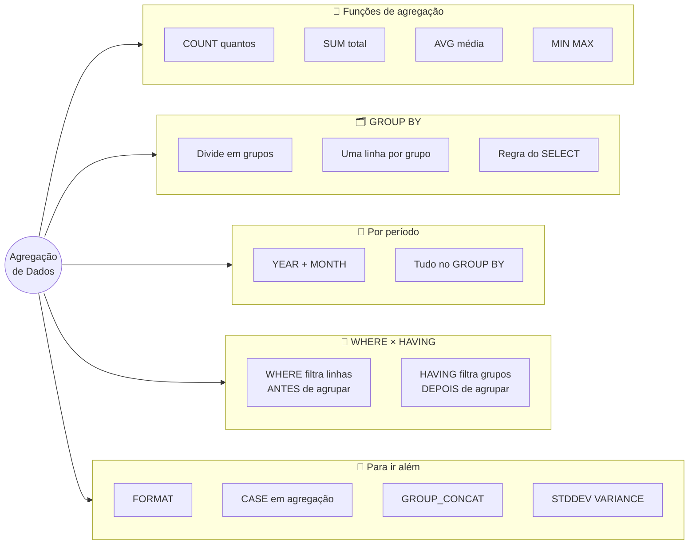
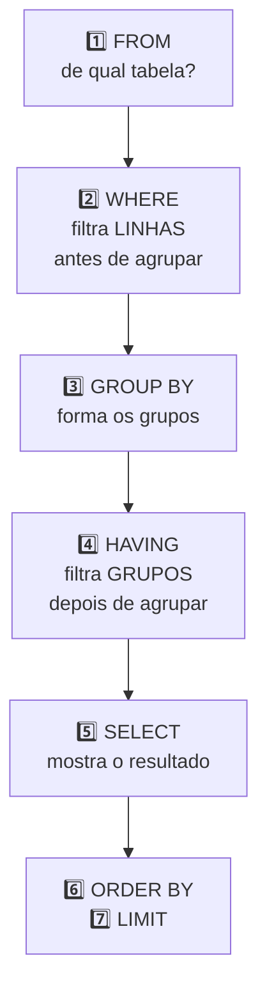

# Tópico 09 — Agregação de Dados: GROUP BY e Funções de Grupo

**Disciplina:** Banco de Dados e Aplicações (IBD951)  
**Professor:** Ronan Adriel Zenatti · ronan.zenatti@cps.sp.gov.br  
**Fatec Jahu — 2º Semestre/2026**

---

## 🎯 Objetivos da Aula

Ao final desta aula você deverá ser capaz de:

- Explicar o que é uma **função de agregação** e por que ela devolve **uma única linha** a partir de muitas
- Usar `COUNT`, `SUM`, `AVG`, `MIN` e `MAX` para responder perguntas do tipo *"quantos?"*, *"qual o total?"*, *"qual a média?"*, *"qual o maior/menor?"*
- Explicar a diferença entre `COUNT(*)`, `COUNT(coluna)` e `COUNT(DISTINCT coluna)`
- Agrupar resultados com `GROUP BY` e saber quais colunas podem aparecer no `SELECT`
- Agrupar por períodos de tempo (ano e mês) combinando `GROUP BY` com `YEAR` e `MONTH`
- Filtrar **grupos** com `HAVING` e explicar a diferença entre `WHERE` e `HAVING`
- *(Para ir além)* Conhecer `FORMAT`, `CASE` dentro de agregações, `GROUP_CONCAT` e `STDDEV`/`VARIANCE`

---

## 🗺️ Mapa Mental da Aula



---

## 1. De muitas linhas para um número

Até aqui, toda consulta que você escreveu devolveu **linhas da tabela**: uma linha de resultado para cada linha encontrada. Mas, no trabalho, as perguntas importantes costumam ser outras:

- *"**Quantos** clientes temos cadastrados?"*
- *"**Quanto** vendemos em setembro?"*
- *"Qual o **preço médio** dos nossos produtos?"*
- *"Qual o produto **mais caro**?"*

Repare que a resposta de cada uma é **um número só** — e não uma lista. Para isso existem as **funções de agregação** (ou **funções de grupo**): elas pegam **várias linhas** e as **resumem em um único valor**.

> 💡 **Do dia a dia:** é o **fechamento do caixa** no fim do dia. O dono do mercado não quer reler as 300 notinhas uma por uma — quer saber *quantas* foram, *quanto* entrou no total, *qual o valor médio* por cliente e *qual foi a maior* compra. Agregar é isso: resumir muitos registros em poucos números que ajudam a decidir.

As funções de agregação são **só de leitura**, como tudo no `SELECT`: nenhum dado da tabela muda.

---

## 2. Preparando o ambiente

Para ter dados suficientes para somar, contar e agrupar, vamos usar a carga do Tópico 07 **mais uma carga complementar** que acrescenta 8 pedidos novos (de agosto, setembro e outubro) e os itens deles. Faça, **nesta ordem**:

**Passo 1.** Rode o **script completo da Seção 11 do [Tópico 05](Aula_06_SQL_DDL.md)** (recria o banco `loja_virtual`, vazio).

**Passo 2.** Rode o **script de carga da Seção 2 do [Tópico 07](Topico_07_SQL_DQL.md)** (cadastra categorias, clientes, produtos, 5 pedidos e 8 itens).

**Passo 3.** Rode a **carga complementar** abaixo:

??? note "📦 Carga complementar do Tópico 09 (clique para abrir)"
    ```sql
    USE loja_virtual;

    INSERT INTO pedidos (cliente_id, funcionario_id, data_pedido, status, valor_total, observacoes) VALUES
        (2, 5,    '2026-08-12', 'entregue',  74.60, NULL),
        (1, 5,    '2026-08-25', 'entregue',  44.99, NULL),
        (3, 6,    '2026-09-03', 'entregue',  44.97, NULL),
        (1, NULL, '2026-09-14', 'cancelado', 15.00, 'Pagamento recusado'),
        (2, 6,    '2026-09-20', 'entregue',  48.48, NULL),
        (4, NULL, '2026-09-28', 'entregue',  77.30, NULL),
        (1, 5,    '2026-10-10', 'enviado',   74.94, NULL),
        (3, NULL, '2026-10-12', 'pendente',  50.50, NULL);

    INSERT INTO itens_pedidos (pedido_id, produto_id, quantidade, preco_unitario) VALUES
        ( 6, 1, 3, 14.90),
        ( 6, 4, 1, 29.90),
        ( 7, 3, 2, 17.50),
        ( 7, 5, 1,  9.99),
        ( 8, 2, 2, 18.00),
        ( 8, 9, 3,  2.99),
        ( 9, 6, 2,  7.50),
        (10, 1, 1, 14.90),
        (10, 7, 4,  6.90),
        (10, 9, 2,  2.99),
        (11, 4, 2, 29.90),
        (11, 3, 1, 17.50),
        (12, 5, 6,  9.99),
        (12, 6, 2,  7.50),
        (13, 7, 3,  6.90),
        (13, 1, 2, 14.90);
    ```

Depois da carga, o banco tem: **6 clientes**, **11 produtos**, **13 pedidos** (de agosto a outubro de 2026) e **24 itens de pedido**. Repare em duas coisas, que vão ser úteis nos próximos tópicos: os clientes 5 (Elisa) e 6 (Fábio) **nunca fizeram pedido** — eles aparecem nos novos pedidos apenas no papel de **atendente** (`funcionario_id`) — e três produtos (Tomate, Presunto e Queijo) **nunca foram vendidos**.

```sql
USE loja_virtual;
```

> 📐 **Nesta aula, os grupos são identificados por números** (`categoria_id`, `cliente_id`, `produto_id`), e não pelos nomes. Isso acontece porque os nomes estão em **outras tabelas** (`categorias`, `clientes`, `produtos`), e juntar tabelas exige o `JOIN` — assunto do Tópico 10. Lá voltaremos a vários destes exemplos mostrando o nome em vez do número.

---

## 3. As funções de agregação

### 3.1 `COUNT` — contar

`COUNT` responde *"quantos?"*. Ele tem três jeitos de uso, com resultados diferentes:

| Forma | O que conta |
|---|---|
| `COUNT(*)` | **todas as linhas**, sem olhar o conteúdo delas |
| `COUNT(coluna)` | só as linhas em que aquela coluna **não é `NULL`** |
| `COUNT(DISTINCT coluna)` | só os valores **diferentes** (sem repetição) e não nulos |

```sql
SELECT COUNT(*) AS total_clientes FROM clientes;
```

```text
+----------------+
| total_clientes |
+----------------+
|              6 |
+----------------+
```

Compare com a contagem de uma coluna que pode estar vazia — o telefone:

```sql
SELECT COUNT(*)        AS total_clientes,
       COUNT(telefone) AS com_telefone,
       COUNT(*) - COUNT(telefone) AS sem_telefone
FROM clientes;
```

```text
+----------------+--------------+--------------+
| total_clientes | com_telefone | sem_telefone |
+----------------+--------------+--------------+
|              6 |            4 |            2 |
+----------------+--------------+--------------+
```

O `COUNT(telefone)` **ignorou os dois `NULL`** (Diego e Elisa). Truque útil: subtraindo, você descobre quantos estão em branco.

E o `DISTINCT` (que você conheceu no Tópico 07) também funciona dentro do `COUNT`. Quantos pedidos existem, e quantos clientes **diferentes** fizeram esses pedidos?

```sql
SELECT COUNT(*)                   AS total_pedidos,
       COUNT(DISTINCT cliente_id) AS clientes_que_compraram
FROM pedidos;
```

```text
+---------------+------------------------+
| total_pedidos | clientes_que_compraram |
+---------------+------------------------+
|            13 |                      4 |
+---------------+------------------------+
```

São 13 pedidos, feitos por apenas 4 pessoas (a Ana, por exemplo, fez vários).

> 💡 **Do dia a dia:** `COUNT(*)` é contar quantas **fichas** existem na gaveta. `COUNT(telefone)` é contar só as fichas em que o campo "telefone" foi preenchido. `COUNT(DISTINCT cliente_id)` é contar quantas **pessoas diferentes** assinaram a lista de presença, mesmo que alguém tenha assinado duas vezes.

### 3.2 `SUM` — somar

`SUM(expressão)` soma os valores de todas as linhas. A expressão pode ser uma coluna ou um cálculo (como você viu no Tópico 07). Quanto dinheiro está "parado" no estoque da loja?

```sql
SELECT SUM(estoque * preco) AS valor_total_estoque
FROM produtos;
```

```text
+---------------------+
| valor_total_estoque |
+---------------------+
|             4061.86 |
+---------------------+
```

Primeiro o banco calcula `estoque * preco` **linha por linha** (como no Tópico 07) e depois soma tudo. É o inventário do mercado: quantidade × preço de cada prateleira, somado no final.

### 3.3 `AVG` — média

`AVG(coluna)` calcula a **média aritmética** (soma dos valores ÷ quantidade de valores). Qual o preço médio dos produtos?

```sql
SELECT AVG(preco) AS preco_medio
FROM produtos;
```

```text
+-------------+
| preco_medio |
+-------------+
|   18.307273 |
+-------------+
```

A média quase nunca "fecha" em duas casas. Como um preço em reais tem centavos, use o `ROUND` que você já conhece (Tópico 07):

```sql
SELECT ROUND(AVG(preco), 2) AS preco_medio
FROM produtos;
```

```text
+-------------+
| preco_medio |
+-------------+
|       18.31 |
+-------------+
```

> ⚠️ **O `AVG` ignora os `NULL`**, assim como o `COUNT(coluna)`. Se uma coluna tem 10 linhas mas só 8 preenchidas, a média é calculada **sobre as 8**. É como a média da turma na prova: só entram na conta quem fez a prova.

### 3.4 `MIN` e `MAX` — menor e maior

`MIN(coluna)` devolve o **menor** valor e `MAX(coluna)` o **maior**. Funcionam com números, textos (ordem alfabética) e datas (mais antiga/mais recente):

```sql
SELECT MIN(preco) AS mais_barato,
       MAX(preco) AS mais_caro
FROM produtos;
```

```text
+-------------+-----------+
| mais_barato | mais_caro |
+-------------+-----------+
|        2.99 |     44.90 |
+-------------+-----------+
```

```sql
SELECT MIN(data_nascimento) AS cliente_mais_velho,
       MAX(data_nascimento) AS cliente_mais_novo
FROM clientes;
```

```text
+--------------------+-------------------+
| cliente_mais_velho | cliente_mais_novo |
+--------------------+-------------------+
| 1979-01-25         | 1995-07-09        |
+--------------------+-------------------+
```

> 📌 O `MIN` e o `MAX` devolvem o **valor**, não a linha inteira. Eles dizem que o menor preço é `2.99`, mas **não** dizem qual produto é esse. Para descobrir o nome do produto mais barato, use o que você já sabe: `ORDER BY preco ASC LIMIT 1` (Tópico 08).

### 3.5 Agregação depois do filtro: `WHERE` + função

O `WHERE` continua funcionando: o banco **primeiro filtra as linhas** e **depois agrega** o que sobrou. Quantos pedidos foram entregues, quanto isso somou e qual o valor médio?

```sql
SELECT COUNT(*)                  AS qtd,
       SUM(valor_total)          AS total,
       ROUND(AVG(valor_total),2) AS media
FROM pedidos
WHERE status = 'entregue';
```

```text
+-----+--------+-------+
| qtd | total  | media |
+-----+--------+-------+
|   6 | 337.64 | 56.27 |
+-----+--------+-------+
```

### 3.6 O que acontece quando não há linhas

Se o `WHERE` não deixa nenhuma linha passar, o `COUNT` devolve `0`, mas as outras funções devolvem `NULL` (não existe soma, média, menor ou maior de "nada"):

```sql
SELECT COUNT(*), SUM(preco), AVG(preco), MAX(preco), MIN(preco)
FROM produtos
WHERE preco > 1000;
```

```text
+----------+------------+------------+------------+------------+
| COUNT(*) | SUM(preco) | AVG(preco) | MAX(preco) | MIN(preco) |
+----------+------------+------------+------------+------------+
|        0 |       NULL |       NULL |       NULL |       NULL |
+----------+------------+------------+------------+------------+
```

(Se precisar de `0` no lugar do `NULL`, lembre do `IFNULL`: `IFNULL(SUM(preco), 0)`.)

### 3.7 A armadilha de misturar coluna comum com função de agregação

Tente pedir o nome do cliente **junto com** a contagem de clientes:

```sql
SELECT nome, COUNT(*)
FROM clientes;
```

```text
+-----------+----------+
| nome      | COUNT(*) |
+-----------+----------+
| Ana Souza |        6 |
+-----------+----------+
```

O banco **não reclama**, mas o resultado não faz sentido: a função resume as 6 linhas em uma só, e então "qual nome mostrar?" — ele simplesmente pegou um (o da primeira linha). Pior: esse resultado parece válido. Em outros bancos (e em outras configurações do MariaDB) isso dá erro, e é o comportamento correto. **Regra:** uma consulta sem `GROUP BY` ou tem **só funções de agregação** no `SELECT`, ou nenhuma. Quando você precisa dos dois, a solução é o `GROUP BY`, na próxima seção.

!!! example "🔍 Checkpoint 1 — Funções de agregação"
    Escreva as consultas a seguir:
    (a) quantos **produtos** estão cadastrados (apelido `total_produtos`);
    (b) a **soma** de todo o `estoque` (apelido `unidades_em_estoque`);
    (c) o **preço médio** dos produtos, arredondado para 2 casas (apelido `preco_medio`);
    (d) o **menor** e o **maior** `valor_total` entre os pedidos **entregues**, com os apelidos `menor_pedido` e `maior_pedido`.

    🔑 Resolução no [Gabarito do Tópico 09](Topico_09_Gabarito.md#checkpoint-1) — tente resolver antes de conferir.

---

## 4. `GROUP BY` — resumir por grupo

Saber que a loja tem 13 pedidos é útil. Mas o gerente quer saber: *"**quantos pedidos de cada tipo** (entregue, cancelado, pendente...)?"*. Ou seja, ele quer a **contagem separada por grupo**.

O **`GROUP BY`** (em português, *"agrupar por"*) **divide as linhas em grupos** — uma linha para cada valor diferente da coluna indicada — e aplica a função de agregação **em cada grupo separadamente**.

> 💡 **Do dia a dia:** no fechamento do caixa, você separa as notinhas em montinhos **por forma de pagamento**: um montinho de Pix, um de cartão, um de dinheiro. Depois conta e soma cada montinho **separadamente**. Cada montinho é um *grupo*; o resultado tem uma linha por montinho.

```sql
SELECT status, COUNT(*) AS quantidade
FROM pedidos
GROUP BY status;
```

```text
+------------+------------+
| status     | quantidade |
+------------+------------+
| pendente   |          2 |
| confirmado |          1 |
| enviado    |          2 |
| entregue   |          6 |
| cancelado  |          2 |
+------------+------------+
```

O banco formou 5 grupos (um para cada status) e contou as linhas de cada um. A soma das quantidades dá 13, o total de pedidos.

Você pode usar **várias funções ao mesmo tempo** no mesmo `GROUP BY`:

```sql
SELECT status,
       COUNT(*)         AS quantidade,
       SUM(valor_total) AS total
FROM pedidos
GROUP BY status;
```

```text
+------------+------------+--------+
| status     | quantidade | total  |
+------------+------------+--------+
| pendente   |          2 |  76.26 |
| confirmado |          1 |  22.50 |
| enviado    |          2 | 124.82 |
| entregue   |          6 | 337.64 |
| cancelado  |          2 |  33.00 |
+------------+------------+--------+
```

E, como você aprendeu no Tópico 08, o `ORDER BY` organiza o resultado. Ele pode usar o apelido da função (o `ORDER BY` roda depois do `SELECT`):

```sql
SELECT status, COUNT(*) AS quantidade
FROM pedidos
GROUP BY status
ORDER BY quantidade DESC;
```

```text
+------------+------------+
| status     | quantidade |
+------------+------------+
| entregue   |          6 |
| enviado    |          2 |
| pendente   |          2 |
| cancelado  |          2 |
| confirmado |          1 |
+------------+------------+
```

> 📐 **Sobre a ordem dos grupos:** na prática, o MariaDB costuma devolver os grupos já ordenados pela coluna do `GROUP BY` (no exemplo anterior, na ordem do `ENUM`, como visto no Tópico 08). Mas isso é um efeito colateral, e não uma garantia. Se a ordem importa, peça com `ORDER BY`.

Outro exemplo, agora por categoria — quantos produtos, preço médio, menor e maior preço em cada categoria:

```sql
SELECT categoria_id,
       COUNT(*)              AS qtd_produtos,
       ROUND(AVG(preco), 2)  AS preco_medio,
       MIN(preco)            AS menor,
       MAX(preco)            AS maior
FROM produtos
GROUP BY categoria_id;
```

```text
+--------------+--------------+-------------+-------+-------+
| categoria_id | qtd_produtos | preco_medio | menor | maior |
+--------------+--------------+-------------+-------+-------+
|            1 |            2 |       16.45 | 14.90 | 18.00 |
|            2 |            2 |        8.75 |  7.50 |  9.99 |
|            3 |            2 |       23.70 | 17.50 | 29.90 |
|            4 |            2 |        7.90 |  6.90 |  8.90 |
|            5 |            1 |        2.99 |  2.99 |  2.99 |
|            6 |            2 |       42.40 | 39.90 | 44.90 |
+--------------+--------------+-------------+-------+-------+
```

E quanto cada cliente comprou ao longo do tempo?

```sql
SELECT cliente_id,
       COUNT(*)         AS qtd_pedidos,
       SUM(valor_total) AS total_gasto
FROM pedidos
GROUP BY cliente_id;
```

```text
+------------+-------------+-------------+
| cliente_id | qtd_pedidos | total_gasto |
+------------+-------------+-------------+
|          1 |           5 |      204.73 |
|          2 |           3 |      172.96 |
|          3 |           3 |      121.23 |
|          4 |           2 |       95.30 |
+------------+-------------+-------------+
```

Os clientes 5 e 6 (Elisa e Fábio) **não aparecem**: o `GROUP BY` só forma grupos a partir das linhas que existem em `pedidos`, e eles não têm nenhum pedido. (Mostrar também quem tem zero é trabalho do `LEFT JOIN`, no Tópico 11.)

### 4.1 A regra de ouro do `SELECT` com `GROUP BY`

> **Toda coluna que aparece no `SELECT` e que não é uma função de agregação precisa estar no `GROUP BY`.**

Pense assim: cada grupo vira **uma** linha no resultado. Se você pede `status` e `COUNT(*)`, cada grupo tem um único `status` (por isso pode mostrá-lo) e uma única contagem. Mas se você pedisse `status` e `id_pedido`, o grupo "entregue" tem 6 `id_pedido` diferentes — qual mostrar? Não dá para escolher, e o banco (dependendo da configuração) pode escolher um qualquer sem avisar.

### 4.2 Agrupando por mais de uma coluna

Você pode agrupar por **mais de uma coluna**: cada **combinação** diferente vira um grupo. Veja quantos pedidos cada cliente tem em cada status:

```sql
SELECT cliente_id, status, COUNT(*) AS qtd
FROM pedidos
GROUP BY cliente_id, status
ORDER BY cliente_id, status;
```

```text
+------------+------------+-----+
| cliente_id | status     | qtd |
+------------+------------+-----+
|          1 | confirmado |   1 |
|          1 | enviado    |   1 |
|          1 | entregue   |   2 |
|          1 | cancelado  |   1 |
|          2 | enviado    |   1 |
|          2 | entregue   |   2 |
|          3 | pendente   |   2 |
|          3 | entregue   |   1 |
|          4 | entregue   |   1 |
|          4 | cancelado  |   1 |
+------------+------------+-----+
```

A cliente 1 (Ana) tem 4 combinações distintas, portanto 4 linhas. (Reparou na ordem dos status dentro de cada cliente? É a ordem do `ENUM`, não a alfabética — Tópico 08.)

### 4.3 Agregando a tabela de itens

Na tabela `itens_pedidos`, cada linha é um produto dentro de um pedido. Quantas unidades de cada produto foram vendidas, do mais vendido para o menos vendido?

```sql
SELECT produto_id,
       SUM(quantidade) AS unidades_vendidas
FROM itens_pedidos
GROUP BY produto_id
ORDER BY unidades_vendidas DESC;
```

```text
+------------+-------------------+
| produto_id | unidades_vendidas |
+------------+-------------------+
|          5 |                 9 |
|          7 |                 9 |
|          9 |                 9 |
|          1 |                 8 |
|          6 |                 7 |
|          3 |                 4 |
|          4 |                 4 |
|          2 |                 3 |
+------------+-------------------+
```

Os produtos 8, 10 e 11 (Tomate, Presunto e Queijo) não aparecem porque nunca foram vendidos. E o total de cada pedido, recalculado a partir dos itens:

```sql
SELECT pedido_id,
       COUNT(*)                        AS qtd_itens,
       SUM(quantidade * preco_unitario) AS total_calculado
FROM itens_pedidos
GROUP BY pedido_id;
```

```text
+-----------+-----------+-----------------+
| pedido_id | qtd_itens | total_calculado |
+-----------+-----------+-----------------+
|         1 |         2 |           47.30 |
|         2 |         2 |           49.88 |
|         3 |         1 |           22.50 |
|         4 |         2 |           25.76 |
|         5 |         1 |           18.00 |
|         6 |         2 |           74.60 |
|         7 |         2 |           44.99 |
|         8 |         2 |           44.97 |
|         9 |         1 |           15.00 |
|        10 |         3 |           48.48 |
|        11 |         2 |           77.30 |
|        12 |         2 |           74.94 |
|        13 |         2 |           50.50 |
+-----------+-----------+-----------------+
```

Os valores batem com a coluna `valor_total` da tabela `pedidos` — um bom jeito de conferir se os dados estão consistentes.

---

## 5. Agrupando por períodos de tempo

Relatórios gerenciais quase sempre pedem *"por mês"* ou *"por ano"*. Para isso, combine o `GROUP BY` com as funções de data que você viu no Tópico 08 (`YEAR`, `MONTH`). O gerente pergunta: *"Quanto vendemos por mês, sem contar os pedidos cancelados?"*

```sql
SELECT YEAR(data_pedido)  AS ano,
       MONTH(data_pedido) AS mes,
       COUNT(*)           AS pedidos,
       SUM(valor_total)   AS total
FROM pedidos
WHERE status <> 'cancelado'
GROUP BY YEAR(data_pedido), MONTH(data_pedido)
ORDER BY ano, mes;
```

```text
+------+------+---------+--------+
| ano  | mes  | pedidos | total  |
+------+------+---------+--------+
| 2026 |    8 |       2 | 119.59 |
| 2026 |    9 |       3 | 170.75 |
| 2026 |   10 |       6 | 270.88 |
+------+------+---------+--------+
```

Note a ordem das ações do banco: primeiro o `WHERE` descartou os 2 pedidos cancelados; depois o `GROUP BY` separou o que sobrou em 3 grupos (agosto, setembro e outubro); por fim, a contagem e a soma foram calculadas em cada grupo.

Se você quiser exibir o período como `08/2026`, junte com o `DATE_FORMAT`:

```sql
SELECT DATE_FORMAT(data_pedido, '%m/%Y') AS periodo,
       COUNT(*)                          AS pedidos
FROM pedidos
GROUP BY YEAR(data_pedido), MONTH(data_pedido), DATE_FORMAT(data_pedido, '%m/%Y')
ORDER BY YEAR(data_pedido), MONTH(data_pedido);
```

```text
+---------+---------+
| periodo | pedidos |
+---------+---------+
| 08/2026 |       2 |
| 09/2026 |       4 |
| 10/2026 |       7 |
+---------+---------+
```

(Aqui os cancelados entram, por isso setembro e outubro têm mais pedidos que no exemplo anterior. Repare também que o `ORDER BY` usa `YEAR` e `MONTH`: ordenar pelo texto `08/2026` colocaria os meses em ordem errada quando houvesse mais de um ano.)

Outro exemplo clássico — quantos clientes nasceram em cada ano:

```sql
SELECT YEAR(data_nascimento) AS ano_nascimento,
       COUNT(*)              AS clientes
FROM clientes
GROUP BY YEAR(data_nascimento)
ORDER BY ano_nascimento;
```

```text
+----------------+----------+
| ano_nascimento | clientes |
+----------------+----------+
|           1979 |        1 |
|           1985 |        1 |
|           1988 |        1 |
|           1990 |        1 |
|           1992 |        1 |
|           1995 |        1 |
+----------------+----------+
```

(Com só 6 clientes, cada ano tem um só; numa tabela real, com milhares de clientes, os números variariam.)

> ⚠️ **Todas as partes da data que aparecem no `SELECT` precisam estar no `GROUP BY`.** Se você mostra `YEAR` e `MONTH`, agrupe por `YEAR` **e** `MONTH`. O que acontece quando se esquece o mês? Veja:
>
> ```sql
> SELECT YEAR(data_pedido) AS ano,
>        MONTH(data_pedido) AS mes,
>        SUM(valor_total)
> FROM pedidos
> GROUP BY YEAR(data_pedido);
> ```
>
> ```text
> +------+------+------------------+
> | ano  | mes  | SUM(valor_total) |
> +------+------+------------------+
> | 2026 |   10 |           594.22 |
> +------+------+------------------+
> ```
>
> Uma única linha, somando **o ano inteiro** (594,22), e com o mês `10` aparecendo como se o total fosse só de outubro. Sem mensagem de erro e com resultado enganoso.

!!! example "🔍 Checkpoint 2 — GROUP BY"
    Escreva as consultas a seguir:
    (a) a **quantidade de produtos** de cada `categoria_id` (apelido `qtd_produtos`);
    (b) o **total gasto** (`SUM(valor_total)`) por `cliente_id`, considerando **somente pedidos entregues**, ordenado do maior para o menor total (apelido `total_gasto`);
    (c) a **quantidade de pedidos por mês** (mostre `MONTH(data_pedido)` com o apelido `mes` e a contagem com o apelido `pedidos`), em ordem de mês.

    🔑 Resolução no [Gabarito do Tópico 09](Topico_09_Gabarito.md#checkpoint-2) — tente resolver antes de conferir.

---

## 6. `HAVING` — filtrando grupos

Suponha que o gerente agora peça: *"Mostre só os clientes que fizeram **mais de 2 pedidos**."* A tentativa natural é usar o `WHERE`:

```sql
SELECT cliente_id, COUNT(*) AS qtd_pedidos
FROM pedidos
WHERE COUNT(*) > 2
GROUP BY cliente_id;
```

```text
ERROR 1111 (HY000): Invalid use of group function
```

O `WHERE` não aceita funções de agregação. O motivo: ele roda **antes** de os grupos serem formados, e portanto ainda não existe "a contagem do grupo" para comparar. Para filtrar **depois** de agrupar, existe o **`HAVING`** (em português, *"tendo"*, no sentido de "tendo como condição...").

```sql
SELECT cliente_id, COUNT(*) AS total_pedidos
FROM pedidos
GROUP BY cliente_id
HAVING COUNT(*) > 2;
```

```text
+------------+---------------+
| cliente_id | total_pedidos |
+------------+---------------+
|          1 |             5 |
|          2 |             3 |
|          3 |             3 |
+------------+---------------+
```

O cliente 4 (2 pedidos) ficou de fora, pois o seu grupo não passou na condição.

### 6.1 `WHERE` × `HAVING`: a diferença crucial

> 💡 **Do dia a dia:** no fechamento do caixa, o **`WHERE`** é jogar fora as notinhas **canceladas** *antes* de somar. O **`HAVING`** é, depois de somar cada montinho, dizer *"só me mostre as formas de pagamento que passaram de R$ 100"*. Um filtra o material de entrada; o outro filtra o resultado já resumido.



| | `WHERE` | `HAVING` |
|---|---|---|
| Filtra | **linhas** individuais | **grupos** inteiros |
| Quando | **antes** de agrupar | **depois** de agrupar |
| Aceita função de agregação? | ❌ Não | ✅ Sim |

**Dica prática:** se a condição pode ser escrita *sem* `COUNT`, `SUM`, `AVG`, `MIN` ou `MAX`, use `WHERE` (que também é mais rápido, pois descarta linhas cedo). Se envolve uma função de agregação, use `HAVING`.

Os dois podem aparecer juntos na mesma consulta. *"Quais clientes gastaram **mais de R$ 100 em pedidos entregues**?"*

```sql
SELECT cliente_id,
       SUM(valor_total) AS total_gasto
FROM pedidos
WHERE status = 'entregue'                 -- WHERE filtra linhas: só pedidos entregues
GROUP BY cliente_id
HAVING SUM(valor_total) > 100             -- HAVING filtra grupos: só quem passou de R$ 100
ORDER BY total_gasto DESC;
```

```text
+------------+-------------+
| cliente_id | total_gasto |
+------------+-------------+
|          2 |      123.08 |
+------------+-------------+
```

Passo a passo: o `WHERE` deixou só os 6 pedidos entregues; o `GROUP BY` os separou por cliente (4 grupos); o `SUM` somou cada grupo (Ana 92,29; Bruno 123,08; Carla 44,97; Diego 77,30); o `HAVING` manteve apenas os grupos acima de 100 — só o Bruno.

> 📐 **Apelido no `HAVING`:** o MariaDB deixa você escrever `HAVING total_pedidos > 2` usando o apelido, mas isso é uma facilidade do MariaDB/MySQL, não é padrão em todos os bancos. Nesta disciplina, **repita a função** (`HAVING COUNT(*) > 2`): funciona em qualquer banco.

!!! example "🔍 Checkpoint 3 — HAVING"
    Escreva as consultas a seguir:
    (a) as `categoria_id` que têm **mais de 1 produto** cadastrado (mostre a categoria e a contagem com o apelido `qtd_produtos`);
    (b) os `produto_id` que venderam **mais de 5 unidades** no total, em `itens_pedidos`, do mais para o menos vendido (apelido `unidades_vendidas`);
    (c) para os pedidos **não cancelados**, o `cliente_id` e o total gasto (`SUM(valor_total)`, apelido `total_gasto`) dos clientes que gastaram **mais de R$ 150**.

    🔑 Resolução no [Gabarito do Tópico 09](Topico_09_Gabarito.md#checkpoint-3) — tente resolver antes de conferir.

---

## 7. 🚀 Para ir além

!!! tip "Seção de aprofundamento"
    Daqui em diante, o conteúdo é **complementar**: são recursos úteis que aparecem em relatórios de verdade, mas que **não são cobrados nos checkpoints nem no quiz** deste tópico. Domine primeiro as seções 3 a 6. Volte aqui quando se sentir confortável com `COUNT`, `SUM`, `GROUP BY` e `HAVING`.

### 7.1 `FORMAT` — números prontos para leitura

Resultados numéricos podem (e devem) ser formatados para leitura humana. A função `FORMAT(número, casas, 'idioma')` arredonda e usa o separador decimal do idioma indicado. No Brasil, a vírgula:

```sql
SELECT FORMAT(SUM(preco * estoque), 2, 'pt_BR') AS valor_em_estoque,
       FORMAT(AVG(preco), 2, 'pt_BR')           AS preco_medio
FROM produtos
WHERE ativo = 1;
```

```text
+------------------+-------------+
| valor_em_estoque | preco_medio |
+------------------+-------------+
| 4061,86          | 18,31       |
+------------------+-------------+
```

Sem o terceiro argumento, o resultado sai no padrão americano, com vírgula de milhar e ponto decimal:

```sql
SELECT FORMAT(1234567.891, 2)          AS padrao_en,
       FORMAT(1234567.891, 2, 'pt_BR') AS padrao_br;
```

```text
+--------------+------------+
| padrao_en    | padrao_br  |
+--------------+------------+
| 1,234,567.89 | 1234567,89 |
+--------------+------------+
```

> ⚠️ O `FORMAT` devolve **texto**, não número — não dá para somar nem comparar o resultado. Formate apenas no último passo, na hora de exibir. Note também que o `pt_BR` do MariaDB troca o ponto decimal por vírgula, mas **não coloca o ponto de milhar** (`1234567,89` em vez de `1.234.567,89`).

### 7.2 `CASE` dentro de uma agregação

O `CASE` é o "se... então... senão" do SQL: avalia condições e devolve um valor conforme a que for verdadeira (veremos mais usos dele adiante). Dentro de uma agregação, ele permite **contar ou somar só as linhas que cumprem uma condição**, e colocar vários resultados lado a lado em colunas — uma espécie de "tabela dinâmica".

> 💡 **Do dia a dia:** é ter, no fechamento do caixa, **colunas separadas** na mesma folha: uma para "quantos Pix", outra para "quantos cartão", outra para "quantos dinheiro". Em vez de um relatório por forma de pagamento, tudo numa linha só.

O `COUNT` ignora `NULL`, e `CASE WHEN condição THEN 1 END` devolve `1` quando a condição é verdadeira e `NULL` quando não é (não havendo `ELSE`). Resultado: o `COUNT` conta só as linhas que atendem à condição.

```sql
SELECT MONTH(data_pedido) AS mes,
       COUNT(*)                                          AS total,
       COUNT(CASE WHEN status = 'entregue'  THEN 1 END)  AS entregues,
       COUNT(CASE WHEN status = 'cancelado' THEN 1 END)  AS cancelados,
       SUM(CASE WHEN status = 'entregue' THEN valor_total ELSE 0 END) AS faturado
FROM pedidos
GROUP BY MONTH(data_pedido)
ORDER BY mes;
```

```text
+------+-------+-----------+------------+----------+
| mes  | total | entregues | cancelados | faturado |
+------+-------+-----------+------------+----------+
|    8 |     2 |         2 |          0 |   119.59 |
|    9 |     4 |         3 |          1 |   170.75 |
|   10 |     7 |         1 |          1 |    47.30 |
+------+-------+-----------+------------+----------+
```

Um segundo exemplo: o preço médio dos produtos de cada categoria, **separando os baratos (abaixo de R$ 15) dos caros**:

```sql
SELECT categoria_id,
       ROUND(AVG(CASE WHEN preco <  15 THEN preco END), 2) AS media_ate_15,
       ROUND(AVG(CASE WHEN preco >= 15 THEN preco END), 2) AS media_acima_15
FROM produtos
GROUP BY categoria_id;
```

```text
+--------------+--------------+----------------+
| categoria_id | media_ate_15 | media_acima_15 |
+--------------+--------------+----------------+
|            1 |        14.90 |          18.00 |
|            2 |         8.75 |           NULL |
|            3 |         NULL |          23.70 |
|            4 |         7.90 |           NULL |
|            5 |         2.99 |           NULL |
|            6 |         NULL |          42.40 |
+--------------+--------------+----------------+
```

Onde nenhum produto cai na faixa, o `AVG` não tem o que calcular e devolve `NULL`.

### 7.3 `GROUP_CONCAT` — juntando valores em uma linha só

Já pensou em mostrar, para cada categoria, **a lista dos nomes** dos produtos numa única célula? O **`GROUP_CONCAT`** junta os textos de cada grupo em um só, com o separador que você escolher.

```sql
SELECT categoria_id,
       GROUP_CONCAT(nome ORDER BY nome SEPARATOR ', ') AS produtos
FROM produtos
GROUP BY categoria_id;
```

```text
+--------------+----------------------------------------------+
| categoria_id | produtos                                     |
+--------------+----------------------------------------------+
|            1 | Bolo de fubá, Pão francês (kg)               |
|            2 | Refrigerante 2L, Suco de laranja 1L          |
|            3 | Arroz 5kg, Café torrado 500g                 |
|            4 | Banana prata (kg), Tomate (kg)               |
|            5 | Detergente 500ml                             |
|            6 | Presunto fatiado (kg), Queijo mussarela (kg) |
+--------------+----------------------------------------------+
```

Dentro do `GROUP_CONCAT` você pode definir a ordem (`ORDER BY`, inclusive `DESC`) e o `SEPARATOR`; e pode usar `DISTINCT` para eliminar repetidos:

```sql
SELECT cliente_id,
       GROUP_CONCAT(DISTINCT status ORDER BY status SEPARATOR ', ') AS status_distintos,
       GROUP_CONCAT(id_pedido)                                      AS pedidos
FROM pedidos
GROUP BY cliente_id;
```

```text
+------------+------------------------------------------+------------+
| cliente_id | status_distintos                         | pedidos    |
+------------+------------------------------------------+------------+
|          1 | confirmado, enviado, entregue, cancelado | 1,3,7,9,12 |
|          2 | enviado, entregue                        | 2,6,10     |
|          3 | pendente, entregue                       | 4,8,13     |
|          4 | entregue, cancelado                      | 5,11       |
+------------+------------------------------------------+------------+
```

> 📌 Há um limite de tamanho para o texto resultante, controlado pela configuração `group_concat_max_len` (no nosso servidor, cerca de 1 milhão de caracteres — mais que suficiente para a aula; em outros servidores o padrão pode ser bem menor, e o texto é cortado sem aviso).

### 7.4 Estatística: `STDDEV` e `VARIANCE`

Além da média, o MariaDB calcula medidas de **dispersão** — o quanto os valores se espalham ao redor da média. O **desvio padrão** (`STDDEV`) e a **variância** (`VARIANCE`) são as mais usadas. Desvio padrão pequeno = preços parecidos entre si; grande = preços muito diferentes.

```sql
SELECT categoria_id,
       ROUND(AVG(preco), 2)      AS media,
       ROUND(STDDEV(preco), 2)   AS desvio_padrao,
       ROUND(VARIANCE(preco), 2) AS variancia
FROM produtos
GROUP BY categoria_id
ORDER BY desvio_padrao DESC;
```

```text
+--------------+-------+---------------+-----------+
| categoria_id | media | desvio_padrao | variancia |
+--------------+-------+---------------+-----------+
|            3 | 23.70 |          6.20 |     38.44 |
|            6 | 42.40 |          2.50 |      6.25 |
|            1 | 16.45 |          1.55 |      2.40 |
|            2 |  8.75 |          1.25 |      1.55 |
|            4 |  7.90 |          1.00 |      1.00 |
|            5 |  2.99 |          0.00 |      0.00 |
+--------------+-------+---------------+-----------+
```

A categoria 3 (Mercearia: Café a R$ 17,50 e Arroz a R$ 29,90) é a mais "espalhada"; a 5, com um produto só, tem desvio zero. Existem também `VAR_POP` e `VAR_SAMP` (variância populacional e amostral) e `STD`, sinônimo de `STDDEV`.

### 7.5 O que fica para o Tópico 10

Vários exemplos clássicos de relatório precisam de **dados de mais de uma tabela** — por exemplo, *"faturamento por **nome** de categoria"* ou *"lista dos produtos de cada **pedido**"*. Eles dependem do `JOIN` e, por isso, ficam na **Seção 8 do Tópico 10**, depois que você aprender a juntar tabelas: faturamento por categoria, `HAVING` com faturamento, `GROUP_CONCAT` com itens do pedido, `CASE` por categoria e estatísticas por categoria com o nome dela.

---

## 8. Erros comuns com agregação

| Sintoma | Causa típica | Correção |
|---|---|---|
| **Erro 1111** `Invalid use of group function` | Usou `COUNT`/`SUM`/`AVG`... dentro do `WHERE` | Mover a condição para o `HAVING` |
| Resultado com **uma linha só** e valor estranho | Coluna comum + função no `SELECT` **sem** `GROUP BY` (Seção 3.7) | Acrescentar o `GROUP BY` da coluna |
| Valores "misturados" (ex.: mês errado) | Faltou uma coluna no `GROUP BY` (Seção 5) | Colocar **toda** coluna não agregada do `SELECT` no `GROUP BY` |
| `COUNT(coluna)` menor que o esperado | `COUNT(coluna)` ignora `NULL` | Use `COUNT(*)` se quer contar linhas |
| `AVG` diferente da média "de cabeça" | `AVG` ignora `NULL` (divide só pelas linhas preenchidas) | Conferir os `NULL` (ex.: `COUNT(*)` × `COUNT(coluna)`) |
| `SUM` devolve `NULL` | Nenhuma linha passou no `WHERE` ou todos os valores são `NULL` | `IFNULL(SUM(...), 0)` |
| Média com 6 casas decimais | `AVG` devolve mais casas que o necessário | `ROUND(AVG(...), 2)` |

---

## 📝 Exercícios de Fixação

### Exemplo Resolvido — Identifique os erros

O estagiário escreveu as consultas abaixo para o relatório do gerente. Antes de olhar a resposta, tente descobrir o que há de errado em cada uma — e lembre-se: **nem todo erro faz o banco reclamar**:

```sql
-- Pergunta 1: "Quantos pedidos de cada status?"
SELECT status, id_pedido, COUNT(*) FROM pedidos GROUP BY status;

-- Pergunta 2: "Quais status têm mais de 1 pedido?"
SELECT status, COUNT(*) AS qtd FROM pedidos WHERE COUNT(*) > 1 GROUP BY status;

-- Pergunta 3: "Total vendido por mês."
SELECT YEAR(data_pedido), MONTH(data_pedido), SUM(valor_total)
FROM pedidos GROUP BY MONTH(data_pedido);

-- Pergunta 4: "Quantos clientes têm telefone cadastrado?"
SELECT COUNT(*) FROM clientes;
```

??? question "🔍 Ver a resolução"
    **Consulta 1:** `id_pedido` está no `SELECT`, mas não é função de agregação nem está no `GROUP BY`. Cada grupo de status tem vários pedidos; o banco mostra um qualquer **sem avisar**. Se a ideia era uma lista dos pedidos de cada status, o recurso certo é o `GROUP_CONCAT(id_pedido)` (Seção 7.3). Se não, basta tirar o `id_pedido`.

    **Consulta 2:** função de agregação no `WHERE` — erro 1111. A condição sobre a contagem vai no `HAVING`: `GROUP BY status HAVING COUNT(*) > 1`.

    **Consulta 3:** o `SELECT` mostra `YEAR` e `MONTH`, mas o `GROUP BY` só tem `MONTH`. Em uma tabela com mais de um ano, agosto de 2026 e agosto de 2027 cairiam no mesmo grupo. O correto é `GROUP BY YEAR(data_pedido), MONTH(data_pedido)`.

    **Consulta 4:** `COUNT(*)` conta **todas** as linhas (6), inclusive quem não tem telefone. Para contar só quem tem telefone, é `COUNT(telefone)` (4).

    Versões corrigidas:

    ```sql
    SELECT status, COUNT(*) AS qtd FROM pedidos GROUP BY status;

    SELECT status, COUNT(*) AS qtd FROM pedidos GROUP BY status HAVING COUNT(*) > 1;

    SELECT YEAR(data_pedido) AS ano, MONTH(data_pedido) AS mes, SUM(valor_total) AS total
    FROM pedidos
    GROUP BY YEAR(data_pedido), MONTH(data_pedido);

    SELECT COUNT(telefone) AS clientes_com_telefone FROM clientes;
    ```

---

## 🃏 Flashcards de Revisão

??? question "O que uma função de agregação faz com as linhas da tabela?"
    Resume **várias linhas em um único valor** (um total, uma média, uma contagem, o maior ou o menor). Exemplos: `COUNT`, `SUM`, `AVG`, `MIN`, `MAX`.

??? question "Qual a diferença entre `COUNT(*)` e `COUNT(telefone)`?"
    `COUNT(*)` conta todas as linhas; `COUNT(telefone)` conta só as linhas em que `telefone` **não é `NULL`**. Com 6 clientes, 2 sem telefone: `COUNT(*)` = 6 e `COUNT(telefone)` = 4.

??? question "O que o `GROUP BY` faz e qual a regra de ouro do `SELECT` quando ele aparece?"
    Divide as linhas em grupos (um por valor diferente da coluna) e aplica a função de agregação em cada grupo. Toda coluna do `SELECT` que **não** é função de agregação precisa estar no `GROUP BY`.

??? question "Qual a diferença entre `WHERE` e `HAVING`?"
    `WHERE` filtra **linhas** antes de agrupar e não aceita funções de agregação. `HAVING` filtra **grupos** depois de agrupar e aceita funções de agregação (`HAVING COUNT(*) > 2`).

??? question "Por que se agrupa por `YEAR(data)` **e** `MONTH(data)`, e não só pelo mês?"
    Porque só o mês misturaria anos diferentes (agosto de 2026 com agosto de 2027) no mesmo grupo. Toda parte da data mostrada no `SELECT` deve estar no `GROUP BY`.

??? question "Pegadinha: o que `SELECT nome, COUNT(*) FROM clientes;` devolve no MariaDB e por que é perigoso?"
    Devolve **uma linha** com um nome qualquer (o da primeira linha) e a contagem total, **sem dar erro**. O resultado parece válido, mas o nome não tem relação com a contagem. Misture coluna e função só com `GROUP BY`.

---

## ✅ Quiz de Fixação

<quiz>
A tabela `clientes` tem 6 linhas e 2 delas têm `telefone` igual a `NULL`. O que devolvem, respectivamente, `COUNT(*)` e `COUNT(telefone)`?
- [ ] 6 e 6
- [ ] 4 e 4
- [ ] 4 e 6
- [x] 6 e 4

`COUNT(*)` conta todas as linhas (6); `COUNT(telefone)` ignora os `NULL` e conta só as 4 linhas preenchidas.
</quiz>

<quiz>
Qual consulta mostra a **quantidade de pedidos de cada cliente**?
- [ ] `SELECT cliente_id, COUNT(*) FROM pedidos;`
- [x] `SELECT cliente_id, COUNT(*) FROM pedidos GROUP BY cliente_id;`
- [ ] `SELECT COUNT(*) FROM pedidos GROUP BY cliente_id, status;`
- [ ] `SELECT cliente_id FROM pedidos GROUP BY COUNT(*);`

Para ter uma contagem **por cliente**, o `GROUP BY cliente_id` forma um grupo para cada cliente. A primeira opção mistura coluna e função sem `GROUP BY`; a terceira agrupa por cliente **e** status e não mostra qual é o cliente; a quarta é inválida, pois não se agrupa por uma função de agregação.
</quiz>

<quiz>
Qual consulta mostra apenas os `cliente_id` que têm **mais de 2 pedidos**?
- [ ] `SELECT cliente_id FROM pedidos WHERE COUNT(*) > 2 GROUP BY cliente_id;`
- [ ] `SELECT cliente_id FROM pedidos GROUP BY cliente_id WHERE COUNT(*) > 2;`
- [x] `SELECT cliente_id FROM pedidos GROUP BY cliente_id HAVING COUNT(*) > 2;`
- [ ] `SELECT cliente_id FROM pedidos HAVING COUNT(*) > 2;`

A condição sobre uma função de agregação deve ser feita **depois** de agrupar, com o `HAVING`, que vem logo após o `GROUP BY`. O `WHERE` não aceita funções de agregação (erro 1111), e a quarta opção não tem `GROUP BY`, então o `HAVING` aplicaria a condição a um único grupo com a tabela inteira.
</quiz>

<quiz>
Sobre as funções de agregação, quais afirmações são verdadeiras? (selecione todas as corretas)
- [x] `AVG`, `SUM` e `COUNT(coluna)` ignoram os valores `NULL`
- [x] `MIN` e `MAX` funcionam com números, textos e datas
- [x] Sem nenhuma linha, `COUNT(*)` devolve 0 e `SUM` devolve `NULL`
- [ ] `MIN(preco)` devolve o nome do produto mais barato

As três primeiras estão corretas. O `MIN` devolve o **valor** (por exemplo, `2.99`), e não a linha ou o nome do produto — para isso é preciso `ORDER BY preco ASC LIMIT 1`.
</quiz>

<quiz>
Na consulta abaixo, em que ordem o banco executa as etapas?

`SELECT status, COUNT(*) FROM pedidos WHERE data_pedido >= '2026-09-01' GROUP BY status HAVING COUNT(*) > 1;`
- [ ] `HAVING` → `GROUP BY` → `WHERE` → `SELECT`
- [ ] `GROUP BY` → `WHERE` → `HAVING` → `SELECT`
- [x] `WHERE` → `GROUP BY` → `HAVING` → `SELECT`
- [ ] `SELECT` → `WHERE` → `GROUP BY` → `HAVING`

O banco primeiro descarta as linhas com o `WHERE`, depois forma os grupos (`GROUP BY`), depois descarta grupos com o `HAVING` e, por fim, monta as colunas do resultado com o `SELECT`.
</quiz>

---

## 📝 Resumo

Neste tópico você aprendeu a **transformar muitas linhas em poucos números**. As funções de agregação resumem várias linhas em um valor só: `COUNT` conta (e `COUNT(coluna)` ignora `NULL`), `SUM` soma, `AVG` tira a média, `MIN` e `MAX` acham o menor e o maior. O `GROUP BY` divide a tabela em grupos e aplica a função em cada um deles — com a regra de que toda coluna não agregada do `SELECT` deve estar no `GROUP BY`, inclusive todas as partes de uma data (`YEAR` e `MONTH`). O `WHERE` filtra as **linhas antes** de agrupar, e o `HAVING` filtra os **grupos depois** de agrupar, o único que aceita funções de agregação. Na seção de aprofundamento, você conheceu o `FORMAT`, o `CASE` dentro de agregações, o `GROUP_CONCAT` e as medidas `STDDEV`/`VARIANCE`. No próximo tópico, o `JOIN` vai permitir mostrar o **nome** do cliente ou da categoria em vez de um número solto — juntando dados de várias tabelas.

---

## 🏆 Conquista da Aula

!!! success "Selo desbloqueado: 📊 Analista de Indicadores"
    Você deixou de olhar linha por linha e passou a enxergar o conjunto: contou,
    somou, tirou médias e dividiu os dados em grupos para responder perguntas de
    gerente. É assim que nascem os relatórios. A próxima parada da Trilha do(a)
    Consultor(a) SQL: juntar tabelas com o `INNER JOIN`, para que os números ganhem nome.

---

## 📚 Referências

- ELMASRI, R.; NAVATHE, S. B. *Sistemas de Banco de Dados*. 7 ed. Cap. 7 — SQL Avançado (agregação e agrupamento). São Paulo: Pearson, 2018.
- BEIGHLEY, L. *Use a Cabeça SQL*. Alta Books, 2008.
- Documentação oficial do MariaDB — [Aggregate Functions](https://mariadb.com/kb/en/aggregate-functions/)
- Documentação oficial do MariaDB — [GROUP BY](https://mariadb.com/kb/en/group-by/)
- Documentação oficial do MariaDB — [GROUP_CONCAT](https://mariadb.com/kb/en/group_concat/)
- Documentação oficial do MariaDB — [FORMAT](https://mariadb.com/kb/en/format/)

---

## 🔗 Navegação

⬅️ [Tópico 08 — Filtragem Avançada](Topico_08_Filtragem_Avancada.md) · ➡️ [Tópico 10 — Junção de Tabelas (Inner Join)](Topico_10_Inner_Join.md)

---

*Fatec Jahu · IBD951 · Prof. Ronan Adriel Zenatti · 2026*
