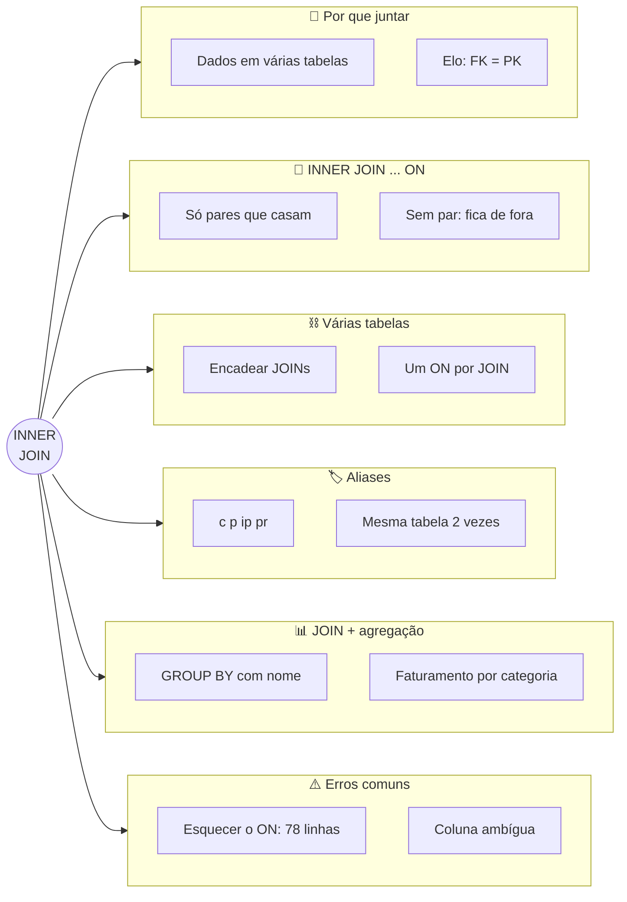
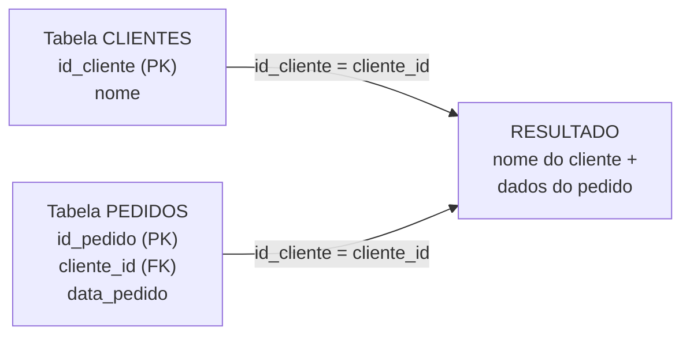
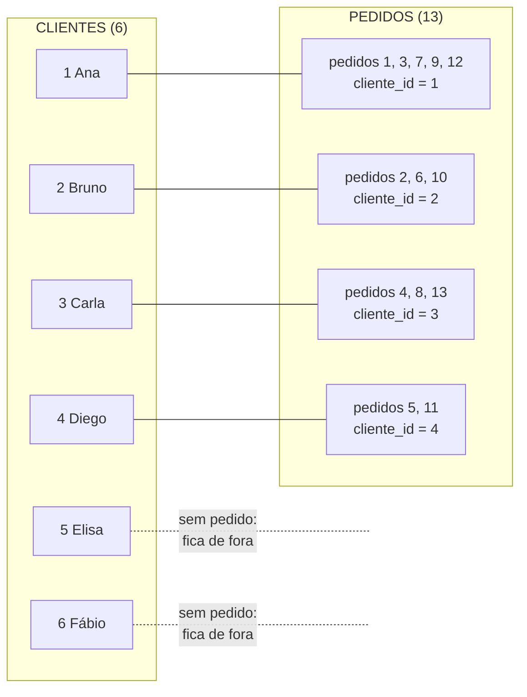
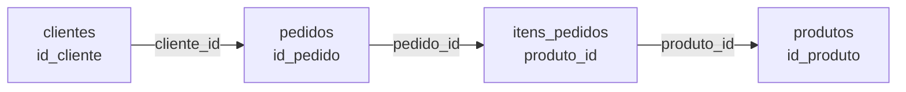

# Tópico 10 — Junção de Tabelas: INNER JOIN

**Disciplina:** Banco de Dados e Aplicações (IBD951)  
**Professor:** Ronan Adriel Zenatti · ronan.zenatti@cps.sp.gov.br  
**Fatec Jahu — 2º Semestre/2026**

---

## 🎯 Objetivos da Aula

Ao final desta aula você deverá ser capaz de:

- Explicar por que os dados ficam espalhados em várias tabelas e como o `JOIN` os reúne usando a ligação entre chave primária (PK) e chave estrangeira (FK)
- Escrever consultas com `INNER JOIN ... ON` combinando duas ou mais tabelas
- Interpretar o resultado de um `INNER JOIN`: quais linhas entram e quais ficam de fora
- Usar apelidos de tabela (*aliases*) e saber quando eles são obrigatórios (a mesma tabela duas vezes)
- Combinar `JOIN` com `WHERE`, `ORDER BY`, `GROUP BY` e funções de agregação para montar relatórios com **nomes** em vez de números
- Reconhecer e corrigir os erros mais comuns ao escrever um `JOIN`

---

## 🗺️ Mapa Mental da Aula



---

## 1. Por que usar JOINs?

No Tópico 04 (Normalização) você aprendeu que um banco bem projetado **divide os dados em várias tabelas** para não repetir informação: o nome do cliente fica só na tabela `clientes`, e a tabela `pedidos` guarda apenas o **número** do cliente (a chave estrangeira). Isso evita desperdício e erros, mas cria um problema de leitura. Olhe a tabela `pedidos`:

```sql
SELECT id_pedido, cliente_id, data_pedido, status
FROM pedidos
ORDER BY id_pedido
LIMIT 5;
```

```text
+-----------+------------+-------------+------------+
| id_pedido | cliente_id | data_pedido | status     |
+-----------+------------+-------------+------------+
|         1 |          1 | 2026-10-01  | entregue   |
|         2 |          2 | 2026-10-02  | enviado    |
|         3 |          1 | 2026-10-05  | confirmado |
|         4 |          3 | 2026-10-07  | pendente   |
|         5 |          4 | 2026-10-08  | cancelado  |
+-----------+------------+-------------+------------+
```

*"O pedido 1 é do cliente número 1."* E quem é o cliente 1? O nome dele **não está aqui** — está na tabela `clientes`. Para o gerente, um relatório com "cliente 3" não serve; ele quer ler *"Carla Mendes"*.

> 💡 **Do dia a dia:** é a **comanda da padaria**. Na comanda está escrito só *"mesa 7"*. O nome de quem está na mesa 7 fica na **lista de reservas**, que é outro papel. Para saber "quem pediu o quê", o garçom precisa **olhar os dois papéis juntos**, ligando-os pelo número da mesa. O `JOIN` faz esse "olhar junto".

O **`JOIN`** (em português, *"junção"*, "juntar") é o comando que **reúne, em uma só consulta, dados de tabelas diferentes**, usando o elo entre elas: a **chave estrangeira (FK)** de uma tabela aponta para a **chave primária (PK)** da outra. Lembrando o que você viu no Tópico 03:

- **Chave primária (PK):** a coluna que identifica cada linha de forma única — como o CPF identifica uma pessoa. Em `clientes`, é `id_cliente`.
- **Chave estrangeira (FK):** a coluna que guarda o número da PK de *outra* tabela, criando a ligação — em `pedidos`, é `cliente_id`, que aponta para `clientes.id_cliente`.



---

## 2. Preparando o ambiente

Vamos usar o mesmo banco do Tópico 09: a carga do Tópico 07 **mais** a carga complementar do Tópico 09 (13 pedidos e 24 itens). Se o seu banco já está assim, apenas selecione-o:

```sql
USE loja_virtual;
```

Se você não tem certeza do estado do seu banco, refaça, **nesta ordem**: (1) o script completo da Seção 11 do [Tópico 05](Aula_06_SQL_DDL.md); (2) o script de carga da Seção 2 do [Tópico 07](Topico_07_SQL_DQL.md); (3) a carga complementar da Seção 2 do [Tópico 09](Topico_09_Agregacao_Dados.md).

Dois fatos sobre os dados que vão aparecer ao longo da aula (conferem com o que você viu no Tópico 09):

- **Elisa** e **Fábio** (clientes 5 e 6) **nunca fizeram pedido** — só aparecem como atendentes (`funcionario_id`) em alguns pedidos.
- **Tomate**, **Presunto** e **Queijo** nunca foram vendidos (não aparecem em `itens_pedidos`).

---

## 3. INNER JOIN — apenas o que existe nos dois lados

O **`INNER JOIN`** (*inner* = "interno") junta duas tabelas e devolve **somente as linhas em que existe correspondência dos dois lados**. A sintaxe tem duas partes novas: o `INNER JOIN` (qual tabela juntar) e o `ON` (em inglês, *"sobre/em"*: a **regra de ligação**, dizendo qual coluna de uma tabela deve ser igual a qual coluna da outra).

```sql
SELECT colunas
FROM tabela_a
INNER JOIN tabela_b ON tabela_a.chave = tabela_b.chave;
```

Aplicando ao nosso problema — mostrar o **nome** do cliente em cada pedido:

```sql
SELECT c.nome         AS cliente,
       p.id_pedido    AS pedido,
       p.data_pedido,
       p.status
FROM clientes c
INNER JOIN pedidos p ON c.id_cliente = p.cliente_id
ORDER BY p.id_pedido;
```

```text
+--------------+--------+-------------+------------+
| cliente      | pedido | data_pedido | status     |
+--------------+--------+-------------+------------+
| Ana Souza    |      1 | 2026-10-01  | entregue   |
| Bruno Lima   |      2 | 2026-10-02  | enviado    |
| Ana Souza    |      3 | 2026-10-05  | confirmado |
| Carla Mendes |      4 | 2026-10-07  | pendente   |
| Diego Alves  |      5 | 2026-10-08  | cancelado  |
| Bruno Lima   |      6 | 2026-08-12  | entregue   |
| Ana Souza    |      7 | 2026-08-25  | entregue   |
| Carla Mendes |      8 | 2026-09-03  | entregue   |
| Ana Souza    |      9 | 2026-09-14  | cancelado  |
| Bruno Lima   |     10 | 2026-09-20  | entregue   |
| Diego Alves  |     11 | 2026-09-28  | entregue   |
| Ana Souza    |     12 | 2026-10-10  | enviado    |
| Carla Mendes |     13 | 2026-10-12  | pendente   |
+--------------+--------+-------------+------------+
```

Agora o relatório diz *quem* comprou. Como ler a consulta, de cima para baixo:

1. **`FROM clientes c`** — comece pela tabela `clientes` (e chame-a de `c`, veja a Seção 5).
2. **`INNER JOIN pedidos p`** — junte com a tabela `pedidos` (apelido `p`).
3. **`ON c.id_cliente = p.cliente_id`** — ligue cada cliente aos pedidos cujo `cliente_id` seja igual ao seu `id_cliente` (PK = FK).
4. **`SELECT c.nome, p.id_pedido, ...`** — escolha as colunas que quiser, de qualquer uma das duas tabelas.

> 💡 **Do dia a dia:** é a fila do **cartório**: o escrevente pega a ficha do cidadão (`clientes`), olha o número do documento e vai buscar, na pasta de requerimentos (`pedidos`), todos os papéis que têm aquele mesmo número. Para cada "casamento" de número, ele monta uma linha no relatório.

### 3.1 Como o `JOIN` "pensa"

Conceitualmente, o banco compara **cada cliente com cada pedido** e só mantém os pares em que a regra do `ON` é verdadeira. Se você esquecesse o `ON`, o banco combinaria **todos com todos** — o chamado **produto cartesiano**:

```sql
SELECT COUNT(*) AS combinacoes
FROM clientes
CROSS JOIN pedidos;
```

```text
+-------------+
| combinacoes |
+-------------+
|          78 |
+-------------+
```

São 6 clientes × 13 pedidos = 78 combinações — a maioria sem sentido (o pedido da Ana "casado" com o Diego, por exemplo). É o `ON` que filtra os 78 pares possíveis até sobrarem os **13 pares verdadeiros**.

### 3.2 Quem fica de fora?

Repare que, no resultado, só aparecem **Ana, Bruno, Carla e Diego**. A Elisa e o Fábio **sumiram**: como eles não têm pedido, não existe nenhuma linha em `pedidos` que case com eles, e o `INNER JOIN` só devolve o que casa **dos dois lados**.



Resumo do que o `INNER JOIN` faz: **fica só com a interseção**. Se uma linha de qualquer um dos lados não tem par, ela não aparece. Se você precisa que ela apareça mesmo sem par (por exemplo, listar *todos* os clientes, inclusive os que nunca compraram), isso é trabalho do `LEFT JOIN`, no Tópico 11.

Outra observação: o resultado tem **uma linha para cada par**, e não uma linha por cliente. A Ana aparece 5 vezes porque tem 5 pedidos; a Carla aparece duas vezes na consulta abaixo porque tem dois pedidos pendentes:

```sql
SELECT c.nome
FROM clientes c
INNER JOIN pedidos p ON c.id_cliente = p.cliente_id
WHERE p.status = 'pendente';
```

```text
+--------------+
| nome         |
+--------------+
| Carla Mendes |
| Carla Mendes |
+--------------+
```

### 3.3 `JOIN` com `WHERE` e `ORDER BY`

Tudo o que você aprendeu nos tópicos anteriores continua valendo: o `WHERE` filtra as linhas do resultado da junção e o `ORDER BY` ordena. Todos os pedidos da Ana, do mais antigo ao mais novo:

```sql
SELECT c.nome, p.id_pedido, p.data_pedido, p.status
FROM clientes c
JOIN pedidos p ON c.id_cliente = p.cliente_id
WHERE c.nome = 'Ana Souza'
ORDER BY p.data_pedido;
```

```text
+-----------+-----------+-------------+------------+
| nome      | id_pedido | data_pedido | status     |
+-----------+-----------+-------------+------------+
| Ana Souza |         7 | 2026-08-25  | entregue   |
| Ana Souza |         9 | 2026-09-14  | cancelado  |
| Ana Souza |         1 | 2026-10-01  | entregue   |
| Ana Souza |         3 | 2026-10-05  | confirmado |
| Ana Souza |        12 | 2026-10-10  | enviado    |
+-----------+-----------+-------------+------------+
```

> 📌 **`JOIN` = `INNER JOIN`:** escrever apenas `JOIN` é a mesma coisa que `INNER JOIN` — o `INNER` é opcional. Nesta disciplina vamos escrever `INNER JOIN` por extenso, para deixar claro qual tipo de junção estamos usando (no próximo tópico aparecem outros tipos).

> 📐 **A ordem das tabelas não muda quais linhas aparecem.** `FROM pedidos p INNER JOIN clientes c ON ...` devolve exatamente os mesmos 13 pares que `FROM clientes c INNER JOIN pedidos p ON ...`. No `INNER JOIN` os dois lados são tratados igualmente. (Isso muda nos JOINs externos do Tópico 11.)

### 3.4 `ON` ou `USING`?

Existe um jeito mais curto de escrever a ligação — `USING (coluna)` — mas ele **só funciona quando a coluna tem exatamente o mesmo nome nas duas tabelas**. Com a nossa convenção, a PK é `id_cliente` e a FK é `cliente_id`: **nomes diferentes**. Tentar o `USING` dá erro:

```sql
SELECT c.nome, p.id_pedido
FROM clientes c
INNER JOIN pedidos p USING (cliente_id);
```

```text
ERROR 1054 (42S22): Unknown column 'cliente_id' in 'from clause'
```

Por isso, nesta disciplina, **use sempre o `ON`**.

!!! example "🔍 Checkpoint 1 — INNER JOIN com duas tabelas"
    Escreva as consultas a seguir (use `INNER JOIN ... ON` e apelidos de tabela):
    (a) o **nome do produto** e o **nome da categoria** de cada produto, ordenado por categoria e depois por produto (apelidos `produto` e `categoria`);
    (b) o **nome do cliente** e o `id_pedido` de todos os pedidos com status `'enviado'`;
    (c) o **nome do produto** e o **preço** dos produtos da categoria **Bebidas** (filtre pelo **nome** da categoria, não pelo número), do mais caro ao mais barato.

    🔑 Resolução no [Gabarito do Tópico 10](Topico_10_Gabarito.md#checkpoint-1) — tente resolver antes de conferir.

---

## 4. JOIN com múltiplas tabelas

Uma consulta pode juntar **quantas tabelas forem necessárias**: basta acrescentar um `INNER JOIN ... ON ...` para cada tabela nova. Para saber **quem comprou o quê**, precisamos percorrer um caminho de quatro tabelas:



```sql
SELECT c.nome                              AS cliente,
       p.id_pedido,
       p.data_pedido,
       pr.nome                             AS produto,
       ip.quantidade,
       ip.preco_unitario,
       ip.quantidade * ip.preco_unitario   AS subtotal
FROM clientes c
INNER JOIN pedidos       p  ON c.id_cliente  = p.cliente_id
INNER JOIN itens_pedidos ip ON p.id_pedido   = ip.pedido_id
INNER JOIN produtos      pr ON ip.produto_id = pr.id_produto
WHERE p.status = 'entregue'
ORDER BY c.nome, p.data_pedido;
```

```text
+--------------+-----------+-------------+--------------------+------------+----------------+----------+
| cliente      | id_pedido | data_pedido | produto            | quantidade | preco_unitario | subtotal |
+--------------+-----------+-------------+--------------------+------------+----------------+----------+
| Ana Souza    |         7 | 2026-08-25  | Café torrado 500g  |          2 |          17.50 |    35.00 |
| Ana Souza    |         7 | 2026-08-25  | Refrigerante 2L    |          1 |           9.99 |     9.99 |
| Ana Souza    |         1 | 2026-10-01  | Pão francês (kg)   |          2 |          14.90 |    29.80 |
| Ana Souza    |         1 | 2026-10-01  | Café torrado 500g  |          1 |          17.50 |    17.50 |
| Bruno Lima   |         6 | 2026-08-12  | Arroz 5kg          |          1 |          29.90 |    29.90 |
| Bruno Lima   |         6 | 2026-08-12  | Pão francês (kg)   |          3 |          14.90 |    44.70 |
| Bruno Lima   |        10 | 2026-09-20  | Pão francês (kg)   |          1 |          14.90 |    14.90 |
| Bruno Lima   |        10 | 2026-09-20  | Banana prata (kg)  |          4 |           6.90 |    27.60 |
| Bruno Lima   |        10 | 2026-09-20  | Detergente 500ml   |          2 |           2.99 |     5.98 |
| Carla Mendes |         8 | 2026-09-03  | Bolo de fubá       |          2 |          18.00 |    36.00 |
| Carla Mendes |         8 | 2026-09-03  | Detergente 500ml   |          3 |           2.99 |     8.97 |
| Diego Alves  |        11 | 2026-09-28  | Café torrado 500g  |          1 |          17.50 |    17.50 |
| Diego Alves  |        11 | 2026-09-28  | Arroz 5kg          |          2 |          29.90 |    59.80 |
+--------------+-----------+-------------+--------------------+------------+----------------+----------+
```

Leitura, passo a passo: começa em `clientes`; liga cada cliente a seus `pedidos` (via `cliente_id`); liga cada pedido a seus `itens_pedidos` (via `pedido_id`); liga cada item ao seu `produto` (via `produto_id`). O `WHERE` fica só com os pedidos entregues, e o `ORDER BY` organiza por cliente e data.

Veja como o `JOIN` transformou números soltos (`cliente_id = 1`, `produto_id = 3`) em informação legível: *"a Ana comprou 2 Cafés torrados em 25/08"*.

> 💡 **Dica de leitura:** cada `ON` liga a tabela **nova** (a que acabou de entrar) com uma tabela que **já estava** na consulta. Se você se perder, desenhe o caminho num papel: cada seta do desenho vira um `INNER JOIN ... ON`.

---

## 5. Alias de tabela

Nos exemplos acima você viu `c`, `p`, `ip` e `pr` depois dos nomes das tabelas. São **apelidos de tabela** (*aliases*): nomes curtos, válidos só dentro daquela consulta. Servem para:

1. **Deixar a consulta mais legível** — `ip.quantidade` é mais curto que `itens_pedidos.quantidade`.
2. **Eliminar ambiguidades** — quando duas tabelas têm uma coluna com o mesmo nome (`nome`, `criado_em`), o apelido diz de qual das duas você está falando.
3. **Permitir usar a mesma tabela mais de uma vez** na mesma consulta — nesse caso o apelido é **obrigatório**.

> 💡 **Do dia a dia:** é como chamar a Maria Aparecida dos Santos de "Cida" na roda de amigos. O nome completo continua no documento (a tabela), mas na conversa (a consulta) o apelido basta. E, se há duas Marias na sala, o apelido (Cida e Maria José) é o que diz de quem você está falando.

A sintaxe é escrever o apelido logo depois do nome da tabela (`clientes c`) — ou, com a palavra `AS`, `clientes AS c`; as duas formas são equivalentes. Depois de dar um apelido, **use sempre o apelido** na consulta. Usar o nome original dá erro:

```sql
SELECT clientes.nome, p.id_pedido
FROM clientes c
INNER JOIN pedidos p ON c.id_cliente = p.cliente_id;
```

```text
ERROR 1054 (42S22): Unknown column 'clientes.nome' in 'field list'
```

### 5.1 Quando a coluna existe nas duas tabelas

As tabelas `produtos` e `categorias` têm ambas uma coluna chamada `nome`. Se você escrever só `nome`, o banco não sabe de qual falar:

```sql
SELECT nome
FROM produtos pr
INNER JOIN categorias cat ON cat.id_categoria = pr.categoria_id;
```

```text
ERROR 1052 (23000): Column 'nome' in field list is ambiguous
```

(*Ambiguous* = "ambíguo": que pode ser interpretado de duas formas.) A correção é **qualificar** a coluna, escrevendo `apelido.coluna`:

```sql
SELECT pr.nome  AS produto,
       cat.nome AS categoria,
       pr.preco
FROM produtos pr
INNER JOIN categorias cat ON cat.id_categoria = pr.categoria_id
ORDER BY cat.nome, pr.nome;
```

```text
+-----------------------+------------+-------+
| produto               | categoria  | preco |
+-----------------------+------------+-------+
| Refrigerante 2L       | Bebidas    |  9.99 |
| Suco de laranja 1L    | Bebidas    |  7.50 |
| Presunto fatiado (kg) | Frios      | 39.90 |
| Queijo mussarela (kg) | Frios      | 44.90 |
| Banana prata (kg)     | Hortifruti |  6.90 |
| Tomate (kg)           | Hortifruti |  8.90 |
| Detergente 500ml      | Limpeza    |  2.99 |
| Arroz 5kg             | Mercearia  | 29.90 |
| Café torrado 500g     | Mercearia  | 17.50 |
| Bolo de fubá          | Padaria    | 18.00 |
| Pão francês (kg)      | Padaria    | 14.90 |
+-----------------------+------------+-------+
```

> 📌 **Boa prática:** mesmo quando a coluna só existe em uma das tabelas (e portanto não daria erro), **sempre qualifique** com o apelido (`c.nome`, `p.status`). O leitor entende de relance de qual tabela vem cada coluna, e a consulta não quebra se alguém criar, no futuro, uma coluna com o mesmo nome na outra tabela. Foi o que fizemos em todos os exemplos.

### 5.2 A mesma tabela duas vezes

Na `loja_virtual`, a tabela `pedidos` tem **duas** colunas que apontam para `clientes`: `cliente_id` (quem comprou) e `funcionario_id` (quem atendeu). Para mostrar o **nome** das duas pessoas, é preciso juntar a tabela `clientes` **duas vezes** — e, para o banco saber qual é qual, cada uma ganha um apelido diferente:

```sql
SELECT p.id_pedido,
       c.nome AS cliente,
       a.nome AS atendente
FROM pedidos p
INNER JOIN clientes c ON c.id_cliente = p.cliente_id
INNER JOIN clientes a ON a.id_cliente = p.funcionario_id
ORDER BY p.id_pedido;
```

```text
+-----------+--------------+-----------------+
| id_pedido | cliente      | atendente       |
+-----------+--------------+-----------------+
|         6 | Bruno Lima   | Elisa Rocha     |
|         7 | Ana Souza    | Elisa Rocha     |
|         8 | Carla Mendes | Fábio Teixeira  |
|        10 | Bruno Lima   | Fábio Teixeira  |
|        12 | Ana Souza    | Elisa Rocha     |
+-----------+--------------+-----------------+
```

Aqui `c` é a "cópia" de `clientes` no papel de comprador e `a` é a "cópia" no papel de atendente. Sem os apelidos, as duas cópias teriam o mesmo nome, e o banco não saberia distingui-las.

Note também que só **5 dos 13 pedidos** apareceram. Os outros 8 têm `funcionario_id` igual a `NULL` (sem atendente), e o `INNER JOIN` descarta tudo o que não tem par — mais um exemplo do que o `INNER JOIN` deixa de fora, que o `LEFT JOIN` do próximo tópico resolve.

### 5.3 Auto-junção (*self join*)

Juntar uma tabela com **ela mesma** é chamado de **auto-junção** (*self join*, em inglês). O caso clássico é uma tabela em que uma coluna aponta para a *própria* tabela — como uma tabela de funcionários em que cada um tem um supervisor, que também é funcionário. O exemplo abaixo é **ilustrativo**: a `loja_virtual` não tem uma tabela `funcionarios`, então não há saída para mostrar, mas a forma da consulta é a mesma da Seção 5.2:

```sql
-- Exemplo ilustrativo (tabela fictícia): funcionário e seu supervisor
SELECT f.nome AS funcionario,
       s.nome AS supervisor
FROM funcionarios f
INNER JOIN funcionarios s ON f.supervisor_id = s.id_funcionario;
```

!!! example "🔍 Checkpoint 2 — Várias tabelas e aliases"
    Escreva as consultas a seguir:
    (a) para cada **item** dos pedidos da cliente **Ana Souza**, mostre o `id_pedido`, o **nome do produto** e a `quantidade` (junte `clientes`, `pedidos`, `itens_pedidos` e `produtos`), ordenado por `id_pedido`;
    (b) o `id_pedido`, o **nome do cliente** (apelido `cliente`) e o **nome do atendente** (apelido `atendente`) dos pedidos com status `'entregue'` que **têm** atendente;
    (c) para o **pedido 10**, o **nome do produto**, a `quantidade` e o **subtotal** (`quantidade * preco_unitario`, apelido `subtotal`) de cada item.

    🔑 Resolução no [Gabarito do Tópico 10](Topico_10_Gabarito.md#checkpoint-2) — tente resolver antes de conferir.

---

## 6. Revisitando o relatório de pedidos em andamento

No Tópico 08, você montou um relatório dos pedidos em andamento e ficou com um aviso: faltava o **nome do cliente**, porque ele está em outra tabela. Agora você tem a ferramenta para completar. É a mesma consulta, com um `INNER JOIN` a mais (e, de novo, considerando hoje = 31/10/2026):

```sql
SELECT p.id_pedido                              AS pedido,
       c.nome                                   AS cliente,
       DATE_FORMAT(p.data_pedido, '%d/%m/%Y')   AS data_br,
       DATEDIFF('2026-10-31', p.data_pedido)    AS dias_aguardando,
       IFNULL(p.observacoes, 'sem observação')  AS observacao,
       p.status
FROM pedidos p
INNER JOIN clientes c ON c.id_cliente = p.cliente_id
WHERE p.status NOT IN ('entregue', 'cancelado')
  AND p.data_pedido >= DATE_SUB('2026-10-31', INTERVAL 90 DAY)
ORDER BY p.data_pedido ASC
LIMIT 20;
```

```text
+--------+--------------+------------+-----------------+-----------------------+------------+
| pedido | cliente      | data_br    | dias_aguardando | observacao            | status     |
+--------+--------------+------------+-----------------+-----------------------+------------+
|      2 | Bruno Lima   | 02/10/2026 |              29 | Entregar após as 18h  | enviado    |
|      3 | Ana Souza    | 05/10/2026 |              26 | sem observação        | confirmado |
|      4 | Carla Mendes | 07/10/2026 |              24 | sem observação        | pendente   |
|     12 | Ana Souza    | 10/10/2026 |              21 | sem observação        | enviado    |
|     13 | Carla Mendes | 12/10/2026 |              19 | sem observação        | pendente   |
+--------+--------------+------------+-----------------+-----------------------+------------+
```

Essa consulta junta quase tudo o que você aprendeu desde o Tópico 07: projeção, apelidos, funções de texto, data e nulos, `WHERE` com `NOT IN` e datas, `ORDER BY`, `LIMIT` — e agora o `INNER JOIN`. (O resultado tem 5 linhas e não 3 porque, desde o Tópico 09, há mais pedidos no banco.)

---

## 7. Erros comuns com JOIN

Como nos tópicos anteriores, alguns erros param o banco com uma mensagem; outros são mais perigosos, pois **o banco devolve um resultado errado sem avisar**.

| Sintoma | Causa típica | Correção |
|---|---|---|
| **Erro 1052** `Column 'nome' in field list is ambiguous` | A coluna existe em mais de uma tabela do `JOIN` e você não disse de qual (Seção 5.1) | Qualificar: `pr.nome`, `cat.nome` |
| **Erro 1054** `Unknown column 'clientes.nome'` | Deu apelido à tabela, mas depois usou o nome original (Seção 5) | Usar sempre o apelido: `c.nome` |
| **Erro 1054** `Unknown column 'cliente_id' in 'from clause'` | Usou `USING` com colunas de nomes diferentes (Seção 3.4) | Usar `ON c.id_cliente = p.cliente_id` |
| **Erro 1064** (sintaxe) | Cláusulas fora de ordem, como o `WHERE` escrito **antes** do `INNER JOIN`, ou `ORDER BY` antes do `WHERE` | Ordem: `FROM` → `INNER JOIN ... ON ...` → `WHERE` → `GROUP BY` → `HAVING` → `ORDER BY` → `LIMIT` |
| **Resultado enorme** (78 linhas em vez de 13), **sem erro** | Esqueceu o `ON`: o MariaDB aceita e gera todas as combinações (produto cartesiano) | Conferir se cada `JOIN` tem seu `ON` |
| **Resultado sem sentido, sem erro** | `ON` ligando colunas erradas (ex.: `c.id_cliente = p.id_pedido`) | Ligar PK com a FK correspondente |
| **Faltam linhas** (clientes, produtos...) | `INNER JOIN` descarta o que não tem par (Seção 3.2) | Se precisa mantê-los, use `LEFT JOIN` (Tópico 11) |
| **Contagem inflada** | Cada par do `JOIN` vira uma linha; contar linhas conta pares, e não pedidos | `COUNT(DISTINCT p.id_pedido)` (Seção 8.4) |

Veja o caso do `ON` ligado às colunas erradas. O banco **não reclama**, e o resultado parece uma lista normal — mas está errado:

```sql
SELECT c.nome, p.id_pedido
FROM clientes c
INNER JOIN pedidos p ON c.id_cliente = p.id_pedido;
```

```text
+-----------------+-----------+
| nome            | id_pedido |
+-----------------+-----------+
| Ana Souza       |         1 |
| Bruno Lima      |         2 |
| Carla Mendes    |         3 |
| Diego Alves     |         4 |
| Elisa Rocha     |         5 |
| Fábio Teixeira  |         6 |
+-----------------+-----------+
```

Aqui ele casou o **cliente número N com o pedido número N** — como se o pedido 3 fosse da Carla. Mas, na verdade, o pedido 3 é da Ana. Perigo real: o resultado tem cara de relatório válido. Sempre confira os resultados com alguns exemplos que você conhece.

---

## 8. JOIN + agregação: relatórios com nomes

No Tópico 09 você aprendeu `COUNT`, `SUM`, `GROUP BY` e `HAVING`, mas os grupos eram identificados por **números** (`cliente_id`, `categoria_id`). Agora que você sabe juntar tabelas, os mesmos relatórios ganham **nomes**. Esta seção traz os exemplos que, no Tópico 09, dependiam do `JOIN`.

> 📌 **Regra de ouro do `GROUP BY` (Tópico 09):** toda coluna do `SELECT` que não é função de agregação deve estar no `GROUP BY`. Com `JOIN`, costumamos agrupar por **chave e nome**: `GROUP BY c.id_cliente, c.nome`. Agrupar pela chave garante que duas pessoas com o mesmo nome sejam tratadas como grupos separados.

### 8.1 Quanto cada cliente comprou

```sql
SELECT c.nome             AS cliente,
       COUNT(p.id_pedido) AS total_pedidos,
       SUM(p.valor_total) AS total_gasto
FROM clientes c
INNER JOIN pedidos p ON p.cliente_id = c.id_cliente
GROUP BY c.id_cliente, c.nome
ORDER BY total_gasto DESC;
```

```text
+--------------+---------------+-------------+
| cliente      | total_pedidos | total_gasto |
+--------------+---------------+-------------+
| Ana Souza    |             5 |      204.73 |
| Bruno Lima   |             3 |      172.96 |
| Carla Mendes |             3 |      121.23 |
| Diego Alves  |             2 |       95.30 |
+--------------+---------------+-------------+
```

É o mesmo relatório do Tópico 09, só que agora lemos *"Ana Souza"* em vez de *"cliente 1"*. Com `HAVING`, mantemos só os clientes com **mais de 2 pedidos** (o desempate por nome no `ORDER BY` deixa a ordem previsível):

```sql
SELECT c.nome             AS cliente,
       COUNT(p.id_pedido) AS total_pedidos
FROM clientes c
INNER JOIN pedidos p ON p.cliente_id = c.id_cliente
GROUP BY c.id_cliente, c.nome
HAVING COUNT(p.id_pedido) > 2
ORDER BY total_pedidos DESC, c.nome;
```

```text
+--------------+---------------+
| cliente      | total_pedidos |
+--------------+---------------+
| Ana Souza    |             5 |
| Bruno Lima   |             3 |
| Carla Mendes |             3 |
+--------------+---------------+
```

E o exemplo do `WHERE` × `HAVING` do tópico anterior — clientes que gastaram **mais de R$ 100 em pedidos entregues**:

```sql
SELECT c.nome             AS cliente,
       SUM(p.valor_total) AS total_gasto
FROM clientes c
INNER JOIN pedidos p ON p.cliente_id = c.id_cliente
WHERE p.status = 'entregue'          -- WHERE filtra linhas, antes de agrupar
GROUP BY c.id_cliente, c.nome
HAVING SUM(p.valor_total) > 100      -- HAVING filtra grupos, depois de agrupar
ORDER BY total_gasto DESC;
```

```text
+------------+-------------+
| cliente    | total_gasto |
+------------+-------------+
| Bruno Lima |      123.08 |
+------------+-------------+
```

### 8.2 Faturamento por categoria

Quanto cada categoria faturou? O caminho passa por três tabelas: `categorias` → `produtos` → `itens_pedidos`. O faturamento de uma categoria é a soma de `quantidade × preco_unitario` de todos os itens vendidos de produtos dela:

```sql
SELECT cat.nome                                  AS categoria,
       COUNT(DISTINCT pr.id_produto)             AS produtos_vendidos,
       SUM(ip.quantidade * ip.preco_unitario)    AS faturamento
FROM categorias cat
INNER JOIN produtos pr       ON pr.categoria_id = cat.id_categoria
INNER JOIN itens_pedidos ip  ON ip.produto_id   = pr.id_produto
GROUP BY cat.id_categoria, cat.nome
ORDER BY faturamento DESC;
```

```text
+------------+-------------------+-------------+
| categoria  | produtos_vendidos | faturamento |
+------------+-------------------+-------------+
| Mercearia  |                 2 |      189.60 |
| Padaria    |                 2 |      173.20 |
| Bebidas    |                 2 |      142.41 |
| Hortifruti |                 1 |       62.10 |
| Limpeza    |                 1 |       26.91 |
+------------+-------------------+-------------+
```

Repare: a categoria **Frios não aparece**. Os produtos dela (Presunto e Queijo) nunca foram vendidos, não existe nenhum item de pedido ligado a eles, e o `INNER JOIN` descarta o que não tem par. Se o gerente quer ver *todas* as categorias, inclusive as que faturaram zero, é um caso para o `LEFT JOIN` (Tópico 11).

Com `HAVING`, só as categorias com faturamento **acima de R$ 100**:

```sql
SELECT cat.nome                               AS categoria,
       SUM(ip.quantidade * ip.preco_unitario) AS faturamento
FROM categorias cat
INNER JOIN produtos pr       ON pr.categoria_id = cat.id_categoria
INNER JOIN itens_pedidos ip  ON ip.produto_id   = pr.id_produto
GROUP BY cat.id_categoria, cat.nome
HAVING SUM(ip.quantidade * ip.preco_unitario) > 100
ORDER BY faturamento DESC;
```

```text
+-----------+-------------+
| categoria | faturamento |
+-----------+-------------+
| Mercearia |      189.60 |
| Padaria   |      173.20 |
| Bebidas   |      142.41 |
+-----------+-------------+
```

!!! example "🔍 Checkpoint 3 — JOIN com agregação"
    Escreva as consultas a seguir:
    (a) o **nome de cada cliente** e o **total gasto** (`SUM(valor_total)`, apelido `total_gasto`) em pedidos **não cancelados**, do maior para o menor;
    (b) o **nome de cada categoria** e o total de **unidades vendidas** (`SUM(quantidade)`, apelido `unidades_vendidas`), da mais vendida para a menos vendida;
    (c) o **nome dos clientes** que fizeram **2 ou mais pedidos entregues**, com a quantidade (apelido `pedidos_entregues`).

    🔑 Resolução no [Gabarito do Tópico 10](Topico_10_Gabarito.md#checkpoint-3) — tente resolver antes de conferir.

### 8.3 🚀 Para ir além: `GROUP_CONCAT`, `CASE` e estatísticas com nomes

!!! tip "Seção de aprofundamento"
    Os exemplos a seguir completam a seção de aprofundamento do Tópico 09, agora com `JOIN`. **Não são cobrados nos checkpoints nem no quiz.**

**Itens de cada pedido em uma célula só** (`GROUP_CONCAT` com três tabelas):

```sql
SELECT p.id_pedido,
       DATE_FORMAT(p.data_pedido, '%d/%m/%Y')                   AS data_br,
       GROUP_CONCAT(pr.nome ORDER BY pr.nome SEPARATOR ', ')    AS itens_do_pedido,
       SUM(ip.preco_unitario * ip.quantidade)                   AS total
FROM pedidos p
INNER JOIN itens_pedidos ip ON ip.pedido_id  = p.id_pedido
INNER JOIN produtos pr      ON pr.id_produto = ip.produto_id
GROUP BY p.id_pedido, p.data_pedido
ORDER BY p.data_pedido DESC
LIMIT 5;
```

```text
+-----------+------------+---------------------------------------+-------+
| id_pedido | data_br    | itens_do_pedido                       | total |
+-----------+------------+---------------------------------------+-------+
|        13 | 12/10/2026 | Banana prata (kg), Pão francês (kg)   | 50.50 |
|        12 | 10/10/2026 | Refrigerante 2L, Suco de laranja 1L   | 74.94 |
|         5 | 08/10/2026 | Bolo de fubá                          | 18.00 |
|         4 | 07/10/2026 | Banana prata (kg), Detergente 500ml   | 25.76 |
|         3 | 05/10/2026 | Suco de laranja 1L                    | 22.50 |
+-----------+------------+---------------------------------------+-------+
```

**Produtos de cada categoria** (com o nome da categoria):

```sql
SELECT cat.nome                                              AS categoria,
       GROUP_CONCAT(pr.nome ORDER BY pr.nome SEPARATOR ' | ') AS produtos
FROM categorias cat
INNER JOIN produtos pr ON pr.categoria_id = cat.id_categoria
GROUP BY cat.id_categoria, cat.nome;
```

```text
+------------+-----------------------------------------------+
| categoria  | produtos                                      |
+------------+-----------------------------------------------+
| Padaria    | Bolo de fubá | Pão francês (kg)               |
| Bebidas    | Refrigerante 2L | Suco de laranja 1L          |
| Mercearia  | Arroz 5kg | Café torrado 500g                 |
| Hortifruti | Banana prata (kg) | Tomate (kg)               |
| Limpeza    | Detergente 500ml                              |
| Frios      | Presunto fatiado (kg) | Queijo mussarela (kg) |
+------------+-----------------------------------------------+
```

**`CASE` por categoria** — média dos produtos baratos (abaixo de R$ 15) e dos caros, lado a lado:

```sql
SELECT cat.nome AS categoria,
       ROUND(AVG(CASE WHEN pr.preco <  15 THEN pr.preco END), 2) AS media_ate_15,
       ROUND(AVG(CASE WHEN pr.preco >= 15 THEN pr.preco END), 2) AS media_acima_15
FROM categorias cat
INNER JOIN produtos pr ON pr.categoria_id = cat.id_categoria
GROUP BY cat.id_categoria, cat.nome;
```

```text
+------------+--------------+----------------+
| categoria  | media_ate_15 | media_acima_15 |
+------------+--------------+----------------+
| Padaria    |        14.90 |          18.00 |
| Bebidas    |         8.75 |           NULL |
| Mercearia  |         NULL |          23.70 |
| Hortifruti |         7.90 |           NULL |
| Limpeza    |         2.99 |           NULL |
| Frios      |         NULL |          42.40 |
+------------+--------------+----------------+
```

**Estatísticas de preço por categoria**, com desvio padrão:

```sql
SELECT cat.nome                  AS categoria,
       ROUND(AVG(pr.preco), 2)   AS media,
       MIN(pr.preco)             AS minimo,
       MAX(pr.preco)             AS maximo,
       ROUND(STDDEV(pr.preco), 2) AS desvio_padrao
FROM categorias cat
INNER JOIN produtos pr ON pr.categoria_id = cat.id_categoria
GROUP BY cat.id_categoria, cat.nome
ORDER BY desvio_padrao DESC;
```

```text
+------------+-------+--------+--------+---------------+
| categoria  | media | minimo | maximo | desvio_padrao |
+------------+-------+--------+--------+---------------+
| Mercearia  | 23.70 |  17.50 |  29.90 |          6.20 |
| Frios      | 42.40 |  39.90 |  44.90 |          2.50 |
| Padaria    | 16.45 |  14.90 |  18.00 |          1.55 |
| Bebidas    |  8.75 |   7.50 |   9.99 |          1.25 |
| Hortifruti |  7.90 |   6.90 |   8.90 |          1.00 |
| Limpeza    |  2.99 |   2.99 |   2.99 |          0.00 |
+------------+-------+--------+--------+---------------+
```

### 8.4 Cuidado: o `JOIN` multiplica linhas

Em um `INNER JOIN` de um-para-muitos, cada pedido aparece **uma vez para cada item**. Por isso, contar com `COUNT(*)` depois de juntar `pedidos` com `itens_pedidos` conta **itens**, e não pedidos. Para contar pedidos, use `COUNT(DISTINCT p.id_pedido)`:

```sql
SELECT YEAR(p.data_pedido)              AS ano,
       MONTH(p.data_pedido)             AS mes,
       DATE_FORMAT(p.data_pedido, '%m/%Y') AS periodo,
       COUNT(DISTINCT p.id_pedido)      AS pedidos,
       SUM(ip.preco_unitario * ip.quantidade) AS total
FROM pedidos p
INNER JOIN itens_pedidos ip ON ip.pedido_id = p.id_pedido
WHERE p.status = 'entregue'
GROUP BY YEAR(p.data_pedido), MONTH(p.data_pedido), DATE_FORMAT(p.data_pedido, '%m/%Y')
ORDER BY YEAR(p.data_pedido), MONTH(p.data_pedido);
```

```text
+------+------+---------+---------+--------+
| ano  | mes  | periodo | pedidos | total  |
+------+------+---------+---------+--------+
| 2026 |    8 | 08/2026 |       2 | 119.59 |
| 2026 |    9 | 09/2026 |       3 | 170.75 |
| 2026 |   10 | 10/2026 |       1 |  47.30 |
+------+------+---------+---------+--------+
```

Se tivesse usado `COUNT(*)`, agosto apareceria com **4** "pedidos" em vez de 2, pois cada um dos 2 pedidos de agosto tem 2 itens. Já a soma (`SUM`) não sofre esse problema, porque é feita sobre os itens, que é justamente o que queremos somar.

---

## 📝 Exercícios de Fixação

### Exemplo Resolvido — Identifique os erros

O estagiário escreveu as consultas abaixo. Antes de olhar a resposta, tente descobrir o que há de errado em cada uma — e lembre-se: **nem todo erro faz o banco reclamar**:

```sql
-- Pergunta 1: "Nome de cada produto e o nome da categoria dele."
SELECT nome, nome
FROM produtos pr
INNER JOIN categorias cat ON cat.id_categoria = pr.categoria_id;

-- Pergunta 2: "Nome do cliente e id de cada pedido dele."
SELECT c.nome, p.id_pedido
FROM clientes c
INNER JOIN pedidos p;

-- Pergunta 3: "Nome do cliente e id de cada pedido dele."
SELECT c.nome, p.id_pedido
FROM clientes c
INNER JOIN pedidos p ON c.id_cliente = p.id_pedido;

-- Pergunta 4: "Quantos pedidos tem cada cliente?"
SELECT c.nome, COUNT(*)
FROM clientes c
INNER JOIN pedidos p ON c.id_cliente = p.cliente_id
INNER JOIN itens_pedidos ip ON p.id_pedido = ip.pedido_id
GROUP BY c.id_cliente, c.nome;
```

??? question "🔍 Ver a resolução"
    **Consulta 1:** `nome` existe nas duas tabelas e está sem qualificação — erro 1052 (coluna ambígua). Além disso, pedir `nome` duas vezes não diferencia produto de categoria. Correto: `SELECT pr.nome AS produto, cat.nome AS categoria`.

    **Consulta 2:** faltou o `ON`. Em MariaDB, o `INNER JOIN` sem `ON` não dá erro e funciona como produto cartesiano: devolve **78 combinações** (6 × 13) de cliente e pedido, quase todas sem sentido. Correto: `INNER JOIN pedidos p ON c.id_cliente = p.cliente_id`.

    **Consulta 3:** o `ON` liga a PK do cliente com a **PK do pedido** (`p.id_pedido`), em vez da FK (`p.cliente_id`). Não dá erro e o resultado parece normal — mas casa o cliente 3 com o pedido 3, por coincidência de número. Correto: `ON c.id_cliente = p.cliente_id`.

    **Consulta 4:** como o `JOIN` com `itens_pedidos` multiplica as linhas (um pedido aparece uma vez para cada item), o `COUNT(*)` conta **itens**, e não pedidos. A Ana, por exemplo, apareceria com 8 (os itens dos pedidos dela) em vez de 5 pedidos. Correto: `COUNT(DISTINCT p.id_pedido)` — ou nem juntar `itens_pedidos`, se o que se quer é só contar pedidos.

    Versões corrigidas:

    ```sql
    SELECT pr.nome AS produto, cat.nome AS categoria
    FROM produtos pr
    INNER JOIN categorias cat ON cat.id_categoria = pr.categoria_id;

    SELECT c.nome, p.id_pedido
    FROM clientes c
    INNER JOIN pedidos p ON c.id_cliente = p.cliente_id;

    SELECT c.nome, COUNT(p.id_pedido) AS total_pedidos
    FROM clientes c
    INNER JOIN pedidos p ON c.id_cliente = p.cliente_id
    GROUP BY c.id_cliente, c.nome;
    ```

---

## 🃏 Flashcards de Revisão

??? question "Para que serve o `JOIN` e qual é o elo entre as tabelas?"
    Reúne, em uma só consulta, dados de tabelas diferentes. O elo é a **chave estrangeira (FK)** de uma tabela igual à **chave primária (PK)** da outra (ex.: `clientes.id_cliente = pedidos.cliente_id`).

??? question "O que o `INNER JOIN` devolve?"
    Apenas as linhas que têm **correspondência nos dois lados**. Quem não tem par (ex.: cliente sem nenhum pedido) fica de fora do resultado.

??? question "Qual a função do `ON` e o que acontece se você o esquecer?"
    O `ON` é a regra de ligação entre as tabelas. Sem ele, o banco combina cada linha de uma tabela com todas as da outra (produto cartesiano): 6 clientes × 13 pedidos = 78 linhas sem sentido.

??? question "Por que usar apelidos de tabela (`c`, `p`, `ip`) e quando eles são obrigatórios?"
    Deixam a consulta mais curta e resolvem ambiguidade entre colunas de mesmo nome (`c.nome` × `pr.nome`). São **obrigatórios** quando a mesma tabela aparece mais de uma vez na consulta (ex.: `clientes` como comprador e como atendente).

??? question "Por que não usar `USING` nesta disciplina?"
    O `USING (coluna)` só funciona quando a coluna tem o **mesmo nome** nas duas tabelas. Com a nossa convenção (`id_cliente` na PK e `cliente_id` na FK), os nomes são diferentes, então usamos sempre `ON`.

??? question "Pegadinha: por que `COUNT(*)` depois de juntar `pedidos` com `itens_pedidos` conta errado, e como corrigir?"
    Porque cada pedido aparece uma vez para cada item, então `COUNT(*)` conta itens. Para contar pedidos, use `COUNT(DISTINCT p.id_pedido)`.

---

## ✅ Quiz de Fixação

<quiz>
Os clientes Elisa e Fábio não têm nenhum pedido. O que acontece com eles em `SELECT c.nome, p.id_pedido FROM clientes c INNER JOIN pedidos p ON c.id_cliente = p.cliente_id;`?
- [ ] Aparecem com `id_pedido` igual a `NULL`
- [ ] Aparecem com `id_pedido` igual a 0
- [x] Não aparecem no resultado
- [ ] O banco devolve um erro

O `INNER JOIN` só devolve linhas com correspondência nos dois lados. Quem não tem pedido não tem par, então fica de fora. Para mostrá-los com `NULL`, seria preciso um `LEFT JOIN` (Tópico 11).
</quiz>

<quiz>
Qual é a condição de ligação correta para juntar `pedidos` (apelido `p`) com `clientes` (apelido `c`)?
- [ ] `ON c.id_cliente = p.id_pedido`
- [x] `ON c.id_cliente = p.cliente_id`
- [ ] `ON c.nome = p.cliente_id`
- [ ] `ON c.cliente_id = p.id_cliente`

A ligação é sempre **PK de uma tabela = FK da outra**: `clientes.id_cliente` (PK) com `pedidos.cliente_id` (FK). A primeira opção mistura duas PKs e a última inverte os nomes das colunas, que nem existem assim.
</quiz>

<quiz>
Uma consulta junta `produtos pr` e `categorias cat` e escreve `SELECT nome FROM ...`. O que acontece?
- [ ] Mostra o nome do produto
- [ ] Mostra o nome da categoria
- [x] Erro 1052: a coluna `nome` é ambígua
- [ ] Mostra os dois nomes em colunas separadas

As duas tabelas têm uma coluna `nome`, e o banco não pode adivinhar de qual você está falando. É preciso qualificar com o apelido: `pr.nome` ou `cat.nome`.
</quiz>

<quiz>
Sobre o `JOIN`, quais afirmações são verdadeiras? (selecione todas as corretas)
- [x] Escrever apenas `JOIN` é o mesmo que `INNER JOIN`
- [x] É possível juntar a mesma tabela duas vezes, desde que cada uma tenha um apelido diferente
- [x] Cada `JOIN` adicional precisa do seu próprio `ON`
- [ ] A ordem das tabelas no `FROM`/`INNER JOIN` muda quais linhas aparecem no resultado do `INNER JOIN`

No `INNER JOIN`, a ordem das tabelas não altera quais pares casam (só a ordem das colunas, se você usar `*`). As outras três afirmações estão corretas.
</quiz>

<quiz>
Ao juntar `pedidos` com `itens_pedidos`, qual expressão conta corretamente **quantos pedidos** existem em um grupo?
- [ ] `COUNT(*)`
- [ ] `COUNT(ip.id_item_pedido)`
- [x] `COUNT(DISTINCT p.id_pedido)`
- [ ] `SUM(ip.quantidade)`

Cada pedido aparece uma vez por item. `COUNT(*)` e `COUNT(ip.id_item_pedido)` contam itens, e `SUM(ip.quantidade)` conta unidades de produto. `COUNT(DISTINCT p.id_pedido)` conta cada pedido uma só vez.
</quiz>

---

## 📝 Resumo

Neste tópico você aprendeu a **juntar tabelas**. Como o banco normalizado espalha os dados (a tabela `pedidos` guarda só o número do cliente), o `JOIN` reúne tudo numa consulta usando o elo **FK = PK**. O `INNER JOIN ... ON` devolve apenas os pares que casam dos dois lados — quem não tem par, como os clientes sem pedido ou a categoria sem vendas, fica de fora; e o `ON` é indispensável, pois sem ele o banco gera o produto cartesiano (78 combinações em vez de 13). É possível encadear quantas tabelas forem necessárias, com um `ON` para cada, e os apelidos de tabela deixam a consulta legível, resolvem colunas de mesmo nome (`pr.nome` × `cat.nome`) e são obrigatórios quando a mesma tabela entra duas vezes (comprador e atendente). Por fim, combinando `JOIN` com `GROUP BY`, `SUM`, `COUNT` e `HAVING` você montou relatórios com **nomes** em vez de números — lembrando que o `JOIN` multiplica linhas e que, para contar pedidos, é preciso `COUNT(DISTINCT ...)`. No próximo tópico, o `LEFT JOIN` e o `RIGHT JOIN` vão manter na tela justamente o que o `INNER JOIN` descarta.

---

## 🏆 Conquista da Aula

!!! success "Selo desbloqueado: 🧩 Mestre dos Joins"
    Você aprendeu a ligar peças que estavam em tabelas separadas e a enxergar o
    caminho entre elas: cliente, pedido, item, produto. É a habilidade que mais
    separa quem só "sabe SQL básico" de quem consegue montar relatórios de verdade.
    A próxima parada da Trilha do(a) Consultor(a) SQL: descobrir o que o `INNER JOIN`
    deixou de fora — os clientes sem pedido e os produtos sem venda.

---

## 📚 Referências

- ELMASRI, R.; NAVATHE, S. B. *Sistemas de Banco de Dados*. 7 ed. Cap. 6 — SQL Básico (junção de tabelas). São Paulo: Pearson, 2018.
- BEIGHLEY, L. *Use a Cabeça SQL*. Alta Books, 2008.
- Documentação oficial do MariaDB — [JOIN syntax](https://mariadb.com/kb/en/join-syntax/)
- Documentação oficial do MariaDB — [Joins & Subqueries](https://mariadb.com/kb/en/joins-subqueries/)

---

## 🔗 Navegação

⬅️ [Tópico 09 — Agregação de Dados](Topico_09_Agregacao_Dados.md) · ➡️ [Tópico 11 — Junções Externas (Outer Join)](Topico_11_Outer_Join.md)

---

*Fatec Jahu · IBD951 · Prof. Ronan Adriel Zenatti · 2026*
