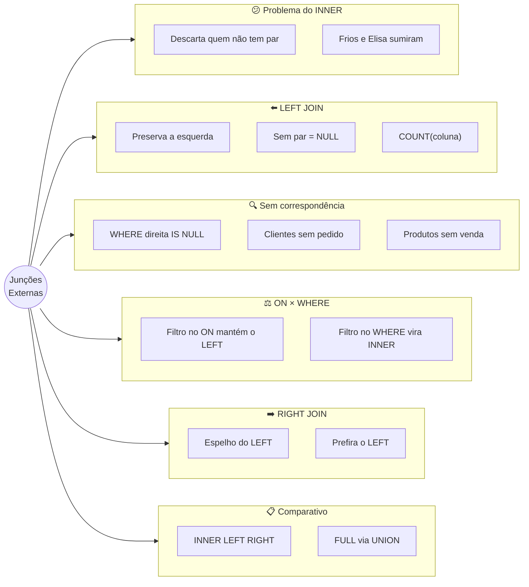
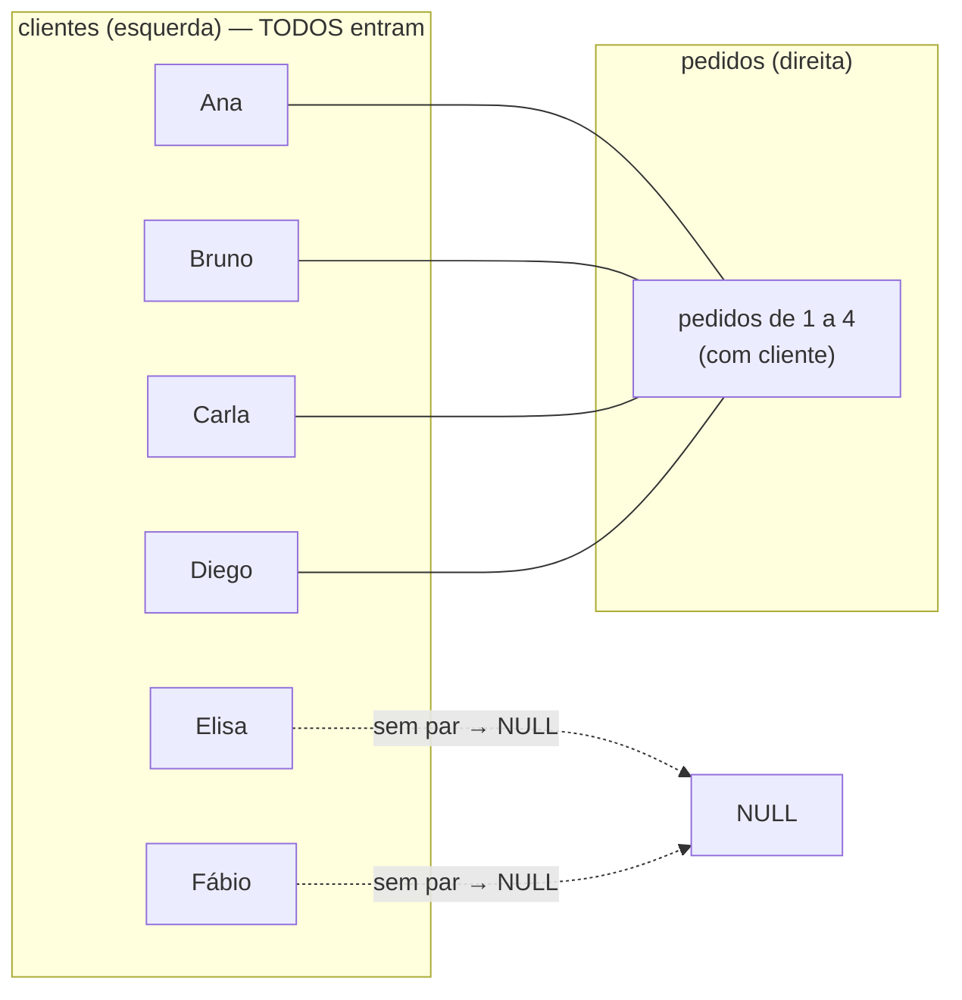

# Tópico 11 — Junções Externas: LEFT JOIN e RIGHT JOIN

**Disciplina:** Banco de Dados e Aplicações (IBD951)  
**Professor:** Ronan Adriel Zenatti · ronan.zenatti@cps.sp.gov.br  
**Fatec Jahu — 2º Semestre/2026**

---

## 🎯 Objetivos da Aula

Ao final desta aula você deverá ser capaz de:

- Explicar a diferença entre `INNER JOIN` (só quem tem par) e `OUTER JOIN` (preserva um dos lados mesmo sem par)
- Aplicar `LEFT JOIN` e `RIGHT JOIN` em consultas reais e interpretar os `NULL` que aparecem no resultado
- Encontrar registros **sem correspondência** (clientes que nunca compraram, produtos que nunca foram vendidos) com `LEFT JOIN ... WHERE ... IS NULL`
- Contar corretamente com `LEFT JOIN` (`COUNT(coluna)` em vez de `COUNT(*)`) e tratar totais vazios com `IFNULL`
- Explicar a diferença entre colocar uma condição no `ON` ou no `WHERE` de um `LEFT JOIN`
- Escolher o tipo de junção adequado a cada pergunta

---

## 🗺️ Mapa Mental da Aula



---

## 1. O problema do INNER JOIN

No Tópico 10 você viu que o `INNER JOIN` é **excludente**: só devolve linhas com correspondência nos dois lados. Isso trouxe duas surpresas, que passaram quase despercebidas:

- No relatório de pedidos por cliente, **Elisa e Fábio sumiram** (nunca fizeram pedido).
- No relatório de faturamento por categoria, a categoria **Frios sumiu** (seus produtos nunca foram vendidos).

Em muitos relatórios, o que **falta** é justamente a informação mais importante: *"Quais clientes nunca compraram? Vamos mandar uma promoção."* *"Quais produtos estão encalhados? Vamos fazer liquidação."* *"Quais categorias não venderam nada neste mês?"*

Para essas perguntas, usamos as **junções externas** (*outer joins*, em inglês), que **preservam** todas as linhas de um dos lados — mesmo quando não existe correspondência no outro.

> 💡 **Do dia a dia:** a **lista de presença** só mostra quem compareceu à aula — é o `INNER JOIN`. Já a **lista de chamada** traz *todos* os alunos matriculados, e ao lado de cada um aparece "P" (presente) ou fica em branco (faltou) — é o `LEFT JOIN`. Para descobrir **quem faltou**, você precisa da lista de chamada completa; a de presença sozinha não mostra ausentes.

---

## 2. Preparando o ambiente

Vamos usar o mesmo banco do Tópico 09 e do Tópico 10: a carga do Tópico 07 **mais** a carga complementar do Tópico 09. Se o seu banco já está assim, apenas selecione-o:

```sql
USE loja_virtual;
```

Se você não tem certeza do estado do seu banco, refaça, **nesta ordem**: (1) o script completo da Seção 11 do [Tópico 05](Aula_06_SQL_DDL.md); (2) o script de carga da Seção 2 do [Tópico 07](Topico_07_SQL_DQL.md); (3) a carga complementar da Seção 2 do [Tópico 09](Topico_09_Agregacao_Dados.md).

Os dados que mais vão importar nesta aula (já apareceram no Tópico 10):

- **Elisa** e **Fábio** nunca fizeram pedido.
- **Tomate**, **Presunto** e **Queijo** nunca foram vendidos — e, por isso, a categoria **Frios** (que só tem Presunto e Queijo) não tem nenhuma venda.
- Oito dos 13 pedidos **não têm atendente** (`funcionario_id` é `NULL`).

---

## 3. LEFT JOIN — preserva o lado esquerdo

O **`LEFT JOIN`** (*left* = "esquerda") devolve **todas as linhas da tabela da esquerda** — a que vem no `FROM` — e, para cada uma, as linhas correspondentes da tabela da direita. Quando **não há correspondência**, as colunas da tabela da direita vêm preenchidas com **`NULL`**.

A sintaxe é igual à do `INNER JOIN`; só troca a palavra:

```sql
SELECT colunas
FROM tabela_esquerda
LEFT JOIN tabela_direita ON tabela_esquerda.chave = tabela_direita.chave;
```

Veja o pedido de cada cliente — agora com **todos** os clientes:

```sql
SELECT c.nome      AS cliente,
       p.id_pedido,
       p.status
FROM clientes c
LEFT JOIN pedidos p ON c.id_cliente = p.cliente_id
ORDER BY c.nome, p.id_pedido;
```

```text
+-----------------+-----------+------------+
| cliente         | id_pedido | status     |
+-----------------+-----------+------------+
| Ana Souza       |         1 | entregue   |
| Ana Souza       |         3 | confirmado |
| Ana Souza       |         7 | entregue   |
| Ana Souza       |         9 | cancelado  |
| Ana Souza       |        12 | enviado    |
| Bruno Lima      |         2 | enviado    |
| Bruno Lima      |         6 | entregue   |
| Bruno Lima      |        10 | entregue   |
| Carla Mendes    |         4 | pendente   |
| Carla Mendes    |         8 | entregue   |
| Carla Mendes    |        13 | pendente   |
| Diego Alves     |         5 | cancelado  |
| Diego Alves     |        11 | entregue   |
| Elisa Rocha     |      NULL | NULL       |
| Fábio Teixeira  |      NULL | NULL       |
+-----------------+-----------+------------+
```

São 15 linhas: as mesmas 13 do `INNER JOIN` **mais** uma linha para a Elisa e outra para o Fábio, com `NULL` nas colunas que vêm de `pedidos`. O `NULL` aqui tem um significado preciso: *"não encontrei nada na tabela da direita para esta linha da esquerda"*.

Compare os três tipos de junção, linha a linha, para os nossos clientes e pedidos (✔ = aparece no resultado):

| | Ana | Bruno | Carla | Diego | Elisa | Fábio |
|---|:-:|:-:|:-:|:-:|:-:|:-:|
| `clientes INNER JOIN pedidos` | ✔ | ✔ | ✔ | ✔ | ✘ | ✘ |
| `clientes LEFT JOIN pedidos` | ✔ | ✔ | ✔ | ✔ | ✔ *(com NULL)* | ✔ *(com NULL)* |
| `clientes RIGHT JOIN pedidos` | ✔ | ✔ | ✔ | ✔ | ✘ | ✘ |



> 📌 **"Esquerda" e "direita" são sobre a posição no texto da consulta**: a tabela escrita **antes** do `LEFT JOIN` (no `FROM`) é a da esquerda; a escrita **depois** é a da direita. Se você inverter a ordem das tabelas, o resultado muda.

---

## 4. LEFT JOIN com contagens e somas

A combinação `LEFT JOIN` + `GROUP BY` resolve um problema clássico: *contar quantos pedidos cada cliente tem, **incluindo quem tem zero***. Com `INNER JOIN` isso é impossível (quem tem zero some). Com `LEFT JOIN`:

```sql
SELECT c.nome             AS cliente,
       COUNT(p.id_pedido) AS total_pedidos
FROM clientes c
LEFT JOIN pedidos p ON c.id_cliente = p.cliente_id
GROUP BY c.id_cliente, c.nome
ORDER BY total_pedidos ASC, c.nome;
```

```text
+-----------------+---------------+
| cliente         | total_pedidos |
+-----------------+---------------+
| Elisa Rocha     |             0 |
| Fábio Teixeira  |             0 |
| Diego Alves     |             2 |
| Bruno Lima      |             3 |
| Carla Mendes    |             3 |
| Ana Souza       |             5 |
+-----------------+---------------+
```

Elisa e Fábio aparecem com `total_pedidos = 0`. Mas repare no detalhe que faz toda a diferença: contamos **`COUNT(p.id_pedido)`**, uma coluna da tabela da **direita**. Lembre-se do Tópico 09: `COUNT(coluna)` **ignora os `NULL`**. Como o pedido da Elisa é `NULL`, ele não entra na contagem, e o resultado é 0.

### 4.1 A armadilha do `COUNT(*)`

Se trocar por `COUNT(*)`, o resultado fica **errado**, sem nenhum aviso:

```sql
SELECT c.nome   AS cliente,
       COUNT(*) AS total_errado
FROM clientes c
LEFT JOIN pedidos p ON c.id_cliente = p.cliente_id
GROUP BY c.id_cliente, c.nome
ORDER BY total_errado ASC, c.nome;
```

```text
+-----------------+--------------+
| cliente         | total_errado |
+-----------------+--------------+
| Elisa Rocha     |            1 |
| Fábio Teixeira  |            1 |
| Diego Alves     |            2 |
| Bruno Lima      |            3 |
| Carla Mendes    |            3 |
| Ana Souza       |            5 |
+-----------------+--------------+
```

A Elisa agora aparece com **1** pedido! O motivo: `COUNT(*)` conta **linhas**, e o `LEFT JOIN` produziu uma linha para a Elisa (a linha cheia de `NULL`). A regra de ouro é:

> **Em `LEFT JOIN` com contagem, conte sempre uma coluna da tabela da direita** (de preferência a chave: `COUNT(p.id_pedido)`), e nunca `COUNT(*)`.

### 4.2 Somas vazias: `IFNULL`

Já o `SUM`, quando todas as linhas do grupo são `NULL`, devolve `NULL` (e não zero). Para exibir `0`, use o `IFNULL` que você já conhece:

```sql
SELECT c.nome                          AS cliente,
       COUNT(p.id_pedido)              AS total_pedidos,
       SUM(p.valor_total)              AS total_gasto,
       IFNULL(SUM(p.valor_total), 0)   AS total_gasto_tratado
FROM clientes c
LEFT JOIN pedidos p ON c.id_cliente = p.cliente_id
GROUP BY c.id_cliente, c.nome
ORDER BY c.nome;
```

```text
+-----------------+---------------+-------------+---------------------+
| cliente         | total_pedidos | total_gasto | total_gasto_tratado |
+-----------------+---------------+-------------+---------------------+
| Ana Souza       |             5 |      204.73 |              204.73 |
| Bruno Lima      |             3 |      172.96 |              172.96 |
| Carla Mendes    |             3 |      121.23 |              121.23 |
| Diego Alves     |             2 |       95.30 |               95.30 |
| Elisa Rocha     |             0 |        NULL |                0.00 |
| Fábio Teixeira  |             0 |        NULL |                0.00 |
+-----------------+---------------+-------------+---------------------+
```

---

## 5. Encontrando registros sem correspondência

Uma das técnicas mais úteis do SQL: usar o `LEFT JOIN` com **`WHERE coluna_da_direita IS NULL`** para encontrar as linhas da esquerda que **não têm par** na direita. O raciocínio:

1. O `LEFT JOIN` preserva todas as linhas da esquerda, colocando `NULL` na direita para quem não tem par.
2. O `WHERE ... IS NULL` (Tópico 08) fica **só** com as linhas em que a direita é `NULL` — isto é, **só os sem par**.

> 💡 **Do dia a dia:** é pegar a lista de chamada completa e circular só quem está **sem o "P"**: o resultado é a lista de faltosos. Na padaria, é comparar a lista de todos os produtos da vitrine com as notas vendidas no dia para ver **o que encalhou**.

```sql
-- Clientes que NUNCA fizeram pedido
SELECT c.nome, c.email
FROM clientes c
LEFT JOIN pedidos p ON c.id_cliente = p.cliente_id
WHERE p.id_pedido IS NULL;
```

```text
+-----------------+--------------------------+
| nome            | email                    |
+-----------------+--------------------------+
| Elisa Rocha     | elisa.rocha@email.com    |
| Fábio Teixeira  | fabio.teixeira@email.com |
+-----------------+--------------------------+
```

```sql
-- Produtos que NUNCA foram vendidos
SELECT pr.nome, pr.preco, pr.estoque
FROM produtos pr
LEFT JOIN itens_pedidos ip ON pr.id_produto = ip.produto_id
WHERE ip.produto_id IS NULL
ORDER BY pr.nome;
```

```text
+-----------------------+-------+---------+
| nome                  | preco | estoque |
+-----------------------+-------+---------+
| Presunto fatiado (kg) | 39.90 |       8 |
| Queijo mussarela (kg) | 44.90 |       6 |
| Tomate (kg)           |  8.90 |       0 |
+-----------------------+-------+---------+
```

> ⚠️ **Teste sempre uma coluna que NUNCA seja `NULL` na tabela da direita**, como a chave primária (`p.id_pedido`) ou a FK de ligação (`ip.produto_id`, que é obrigatória). Se você testar uma coluna que também pode ser `NULL` nos dados reais (como `p.observacoes`), vai confundir "sem par" com "tem par, mas a observação está em branco".

Por que isso é impossível com `INNER JOIN`? Porque o `INNER JOIN` já descarta as linhas sem par antes que você consiga olhá-las. É o `LEFT JOIN` que as traz para a tela.

!!! example "🔍 Checkpoint 1 — LEFT JOIN"
    Escreva as consultas a seguir:
    (a) o **nome de todos os clientes** e a quantidade de pedidos de cada um (apelidos `cliente` e `total_pedidos`), incluindo quem não tem nenhum, do menor para o maior número de pedidos (desempate pelo nome);
    (b) o **nome** e o **e-mail** dos clientes que **nunca fizeram pedido**;
    (c) o **nome** e o **preço** dos produtos que **nunca foram vendidos**, em ordem alfabética.

    🔑 Resolução no [Gabarito do Tópico 11](Topico_11_Gabarito.md#checkpoint-1) — tente resolver antes de conferir.

---

## 6. Cuidado: condição no `ON` ou no `WHERE`?

Um erro muito comum e **silencioso** acontece quando se quer filtrar a tabela da **direita** em um `LEFT JOIN`. Suponha que o gerente peça: *"Mostre todos os clientes e, ao lado, os pedidos **entregues** deles."* A primeira ideia é colocar a condição no `WHERE`:

```sql
SELECT c.nome AS cliente, p.id_pedido, p.status
FROM clientes c
LEFT JOIN pedidos p ON c.id_cliente = p.cliente_id
WHERE p.status = 'entregue'
ORDER BY c.nome, p.id_pedido;
```

```text
+--------------+-----------+----------+
| cliente      | id_pedido | status   |
+--------------+-----------+----------+
| Ana Souza    |         1 | entregue |
| Ana Souza    |         7 | entregue |
| Bruno Lima   |         6 | entregue |
| Bruno Lima   |        10 | entregue |
| Carla Mendes |         8 | entregue |
| Diego Alves  |        11 | entregue |
+--------------+-----------+----------+
```

A Elisa e o Fábio **sumiram** de novo! O `LEFT JOIN` os trouxe (com `p.status = NULL`), mas o `WHERE p.status = 'entregue'` foi executado **depois** e descartou todas as linhas em que `status` não é `'entregue'` — inclusive a linha `NULL`. Na prática, o `WHERE` transformou o `LEFT JOIN` em um `INNER JOIN`.

A solução é mover a condição para o **`ON`**, que é avaliado **durante a junção**, antes de decidir quem fica sem par:

```sql
SELECT c.nome AS cliente, p.id_pedido, p.status
FROM clientes c
LEFT JOIN pedidos p ON c.id_cliente = p.cliente_id
                   AND p.status = 'entregue'
ORDER BY c.nome, p.id_pedido;
```

```text
+-----------------+-----------+----------+
| cliente         | id_pedido | status   |
+-----------------+-----------+----------+
| Ana Souza       |         1 | entregue |
| Ana Souza       |         7 | entregue |
| Bruno Lima      |         6 | entregue |
| Bruno Lima      |        10 | entregue |
| Carla Mendes    |         8 | entregue |
| Diego Alves     |        11 | entregue |
| Elisa Rocha     |      NULL | NULL     |
| Fábio Teixeira  |      NULL | NULL     |
+-----------------+-----------+----------+
```

Agora o `ON` diz: *"ligue o cliente apenas aos pedidos **entregues** dele"*. Quem não tem pedido entregue (Elisa e Fábio) fica sem par — e o `LEFT JOIN` os preserva, com `NULL`. Combinado com o `GROUP BY`, dá para contar os pedidos entregues de **todos** os clientes, inclusive os que têm zero:

```sql
SELECT c.nome             AS cliente,
       COUNT(p.id_pedido) AS pedidos_entregues
FROM clientes c
LEFT JOIN pedidos p ON c.id_cliente = p.cliente_id
                   AND p.status = 'entregue'
GROUP BY c.id_cliente, c.nome
ORDER BY pedidos_entregues DESC, c.nome;
```

```text
+-----------------+-------------------+
| cliente         | pedidos_entregues |
+-----------------+-------------------+
| Ana Souza       |                 2 |
| Bruno Lima      |                 2 |
| Carla Mendes    |                 1 |
| Diego Alves     |                 1 |
| Elisa Rocha     |                 0 |
| Fábio Teixeira  |                 0 |
+-----------------+-------------------+
```

**Regra prática** para o `LEFT JOIN`:

| Quero filtrar... | Onde colocar a condição |
|---|---|
| a tabela da **esquerda** (ex.: `c.nome = 'Ana Souza'`) | no `WHERE` |
| a tabela da **direita**, **mantendo** as linhas da esquerda sem par | no `ON` (com `AND`) |
| a tabela da direita para **descartar** as linhas da esquerda sem par (virar `INNER`) | no `WHERE` (mas aí use `INNER JOIN`, que é mais claro) |
| encontrar quem **não tem par** | `WHERE coluna_da_direita IS NULL` (Seção 5) |

> 📐 No `INNER JOIN`, colocar a condição no `ON` ou no `WHERE` dá exatamente o mesmo resultado. A diferença só existe nas junções externas.

---

## 7. LEFT JOIN com mais de duas tabelas

Como no `INNER JOIN`, dá para encadear. Lembra do faturamento por categoria do Tópico 10, em que a **Frios sumiu**? Basta trocar os dois `INNER JOIN` por `LEFT JOIN`, partindo da tabela que você **quer ver por inteiro** (`categorias`):

```sql
SELECT cat.nome                                         AS categoria,
       COUNT(DISTINCT ip.produto_id)                    AS produtos_vendidos,
       IFNULL(SUM(ip.quantidade * ip.preco_unitario), 0) AS faturamento
FROM categorias cat
LEFT JOIN produtos pr       ON pr.categoria_id = cat.id_categoria
LEFT JOIN itens_pedidos ip  ON ip.produto_id   = pr.id_produto
GROUP BY cat.id_categoria, cat.nome
ORDER BY faturamento DESC;
```

```text
+------------+-------------------+-------------+
| categoria  | produtos_vendidos | faturamento |
+------------+-------------------+-------------+
| Mercearia  |                 2 |      189.60 |
| Padaria    |                 2 |      173.20 |
| Bebidas    |                 2 |      142.41 |
| Hortifruti |                 1 |       62.10 |
| Limpeza    |                 1 |       26.91 |
| Frios      |                 0 |        0.00 |
+------------+-------------------+-------------+
```

Agora a **Frios** aparece, com zero produtos vendidos e faturamento `0.00`. Repare nas escolhas: partimos de `categorias` (a tabela que não pode perder linhas); usamos `LEFT JOIN` nas **duas** junções (se a segunda fosse `INNER JOIN`, descartaria de novo as linhas sem item); e contamos uma coluna da direita (`ip.produto_id`) em vez de `COUNT(*)`.

Dá até para listar só as categorias que **nunca venderam nada**, juntando o `LEFT JOIN` com o `HAVING` do Tópico 09:

```sql
SELECT cat.nome AS categoria
FROM categorias cat
LEFT JOIN produtos pr       ON pr.categoria_id = cat.id_categoria
LEFT JOIN itens_pedidos ip  ON ip.produto_id   = pr.id_produto
GROUP BY cat.id_categoria, cat.nome
HAVING COUNT(ip.id_item_pedido) = 0;
```

```text
+-----------+
| categoria |
+-----------+
| Frios     |
+-----------+
```

### 7.1 Misturando `INNER` e `LEFT`

Também é comum **misturar** os tipos na mesma consulta. No Tópico 10 (Seção 5.2) você ligou cada pedido ao cliente e ao atendente com `INNER JOIN`, e só 5 pedidos apareceram, pois os outros 8 não têm atendente. Se o atendente é **opcional**, ele deve entrar por um `LEFT JOIN`, enquanto o cliente (obrigatório em todo pedido) continua no `INNER JOIN`:

```sql
SELECT p.id_pedido,
       c.nome                          AS cliente,
       IFNULL(a.nome, 'sem atendente') AS atendente
FROM pedidos p
INNER JOIN clientes c ON c.id_cliente = p.cliente_id
LEFT  JOIN clientes a ON a.id_cliente = p.funcionario_id
ORDER BY p.id_pedido;
```

```text
+-----------+--------------+-----------------+
| id_pedido | cliente      | atendente       |
+-----------+--------------+-----------------+
|         1 | Ana Souza    | sem atendente   |
|         2 | Bruno Lima   | sem atendente   |
|         3 | Ana Souza    | sem atendente   |
|         4 | Carla Mendes | sem atendente   |
|         5 | Diego Alves  | sem atendente   |
|         6 | Bruno Lima   | Elisa Rocha     |
|         7 | Ana Souza    | Elisa Rocha     |
|         8 | Carla Mendes | Fábio Teixeira  |
|         9 | Ana Souza    | sem atendente   |
|        10 | Bruno Lima   | Fábio Teixeira  |
|        11 | Diego Alves  | sem atendente   |
|        12 | Ana Souza    | Elisa Rocha     |
|        13 | Carla Mendes | sem atendente   |
+-----------+--------------+-----------------+
```

Os 13 pedidos aparecem, e o `IFNULL` troca o `NULL` por um texto amigável. Como regra de projeto: **dado obrigatório → `INNER JOIN`; dado opcional → `LEFT JOIN`**.

!!! example "🔍 Checkpoint 2 — LEFT JOIN avançado"
    Escreva as consultas a seguir:
    (a) o **nome de cada categoria** e o total de **unidades vendidas** (`SUM(quantidade)`, apelido `unidades_vendidas`, com `0` para quem não vendeu), da mais para a menos vendida (desempate pelo nome da categoria);
    (b) o `id_pedido` e o **nome do atendente** (`'sem atendente'` quando não houver; apelido `atendente`) dos pedidos com status `'entregue'`, em ordem de `id_pedido`;
    (c) o **nome de cada cliente** e a quantidade de pedidos **cancelados** (apelido `pedidos_cancelados`, `0` para quem não tem), do maior para o menor (desempate pelo nome).

    🔑 Resolução no [Gabarito do Tópico 11](Topico_11_Gabarito.md#checkpoint-2) — tente resolver antes de conferir.

---

## 8. RIGHT JOIN — preserva o lado direito

O **`RIGHT JOIN`** (*right* = "direita") é o **espelho** do `LEFT JOIN`: preserva **todas as linhas da tabela da direita** (a escrita depois do `JOIN`), colocando `NULL` nas colunas da esquerda quando não há par.

Os dois comandos abaixo são equivalentes — apenas a ordem das tabelas está invertida:

```sql
-- RIGHT JOIN: preserva pedidos (a tabela da direita)
SELECT c.nome, p.id_pedido, p.data_pedido
FROM clientes c
RIGHT JOIN pedidos p ON c.id_cliente = p.cliente_id
ORDER BY p.id_pedido
LIMIT 4;

-- LEFT JOIN: mesma coisa, com as tabelas trocadas
SELECT c.nome, p.id_pedido, p.data_pedido
FROM pedidos p
LEFT JOIN clientes c ON p.cliente_id = c.id_cliente
ORDER BY p.id_pedido
LIMIT 4;
```

Os dois devolvem o mesmo resultado:

```text
+--------------+-----------+-------------+
| nome         | id_pedido | data_pedido |
+--------------+-----------+-------------+
| Ana Souza    |         1 | 2026-10-01  |
| Bruno Lima   |         2 | 2026-10-02  |
| Ana Souza    |         3 | 2026-10-05  |
| Carla Mendes |         4 | 2026-10-07  |
+--------------+-----------+-------------+
```

A intenção do `RIGHT JOIN` seria listar todos os pedidos, mesmo os que não tivessem cliente. Mas a chave estrangeira não permite pedido sem cliente; por isso, aqui, o resultado coincide com o do `INNER JOIN`.

Um exemplo em que o `RIGHT JOIN` **preserva algo que o `INNER` descartaria**: manter todos os clientes (agora à direita) para achar quem não tem pedido:

```sql
SELECT c.nome AS cliente, p.id_pedido
FROM pedidos p
RIGHT JOIN clientes c ON c.id_cliente = p.cliente_id
WHERE p.id_pedido IS NULL;
```

```text
+-----------------+-----------+
| cliente         | id_pedido |
+-----------------+-----------+
| Elisa Rocha     |      NULL |
| Fábio Teixeira  |      NULL |
+-----------------+-----------+
```

É o mesmo resultado do `LEFT JOIN` da Seção 5, só que lido "de trás para a frente".

> 📌 **Na prática, use `LEFT JOIN` sempre.** Como a leitura vai da esquerda para a direita, é mais natural começar pela tabela que você quer preservar e escrevê-la primeiro. Qualquer `RIGHT JOIN` pode ser reescrito como `LEFT JOIN` trocando a ordem das tabelas, e quem lê o código raramente precisa "inverter o raciocínio". Você vai encontrar `RIGHT JOIN` em códigos antigos de outras pessoas, então é importante saber lê-lo — mas não é preciso escrevê-lo.

---

## 9. Tabela comparativa dos JOINs

| Tipo | O que retorna | Quando usar |
|---|---|---|
| `INNER JOIN` | Apenas as linhas com correspondência nos **dois** lados | Dados que sempre existem em ambos (pedido + cliente) |
| `LEFT JOIN` | **Todas** as linhas da esquerda + correspondências da direita (`NULL` se não houver) | Listar tudo de uma tabela, mesmo sem relacionamento; achar quem não tem par |
| `RIGHT JOIN` | **Todas** as linhas da direita + correspondências da esquerda (`NULL` se não houver) | Equivalente ao `LEFT` com as tabelas trocadas (evite) |
| `FULL OUTER JOIN` | Todas as linhas de **ambos** os lados | **Não existe** no MySQL/MariaDB (veja abaixo) |

### 9.1 🚀 Para ir além: simulando o `FULL OUTER JOIN`

!!! tip "Seção de aprofundamento"
    O conteúdo desta subseção é **complementar**: não é cobrado nos checkpoints nem no quiz.

O `FULL OUTER JOIN` (junção externa completa) preservaria as linhas **dos dois lados** de uma vez. Alguns bancos (PostgreSQL, SQL Server, Oracle) têm o comando; o **MySQL/MariaDB não tem**. A simulação é juntar um `LEFT JOIN` com um `RIGHT JOIN` usando o operador **`UNION`** (em português, *"união"*), que empilha os resultados de duas consultas e **remove as linhas repetidas**:

```sql
SELECT c.nome AS cliente, p.id_pedido
FROM clientes c
LEFT JOIN pedidos p ON c.id_cliente = p.cliente_id

UNION

SELECT c.nome, p.id_pedido
FROM clientes c
RIGHT JOIN pedidos p ON c.id_cliente = p.cliente_id

ORDER BY cliente, id_pedido;
```

```text
+-----------------+-----------+
| cliente         | id_pedido |
+-----------------+-----------+
| Ana Souza       |         1 |
| Ana Souza       |         3 |
| Ana Souza       |         7 |
| Ana Souza       |         9 |
| Ana Souza       |        12 |
| Bruno Lima      |         2 |
| Bruno Lima      |         6 |
| Bruno Lima      |        10 |
| Carla Mendes    |         4 |
| Carla Mendes    |         8 |
| Carla Mendes    |        13 |
| Diego Alves     |         5 |
| Diego Alves     |        11 |
| Elisa Rocha     |      NULL |
| Fábio Teixeira  |      NULL |
+-----------------+-----------+
```

A primeira parte garante todos os clientes (com ou sem pedido); a segunda garante todos os pedidos (com ou sem cliente). Neste banco, o resultado é igual ao do `LEFT JOIN`, porque a chave estrangeira **impede** pedidos sem cliente: não existe nenhuma linha "órfã" do lado direito. Em dados sem essa garantia, apareceriam também linhas com `NULL` do lado esquerdo.

---

## 10. Erros comuns com junções externas

| Sintoma | Causa típica | Correção |
|---|---|---|
| Quem não tem par **sumiu** de novo | Condição sobre a tabela da direita escrita no `WHERE` (Seção 6) | Mover para o `ON` (com `AND`) |
| Quem não tem par aparece com contagem **1** | Usou `COUNT(*)` no lugar de `COUNT(coluna_da_direita)` (Seção 4.1) | `COUNT(p.id_pedido)` |
| Total aparece como `NULL` em vez de `0` | `SUM` de um grupo sem linhas (Seção 4.2) | `IFNULL(SUM(...), 0)` |
| Consulta "sem par" devolve **zero linhas** | Usou `= NULL` em vez de `IS NULL` (Tópico 08) | `WHERE p.id_pedido IS NULL` |
| Consulta "sem par" devolve linhas **erradas** | Testou uma coluna da direita que também pode ser `NULL` nos dados | Testar a chave primária ou a FK de ligação |
| O `LEFT JOIN` "não funciona" na cadeia | O segundo `JOIN` da cadeia é `INNER`, e desfaz o efeito do primeiro | Usar `LEFT JOIN` nas junções seguintes da cadeia |
| Resultado diferente do esperado | Tabelas em ordem trocada: o lado preservado é o outro | Colocar a tabela que se quer preservar no `FROM` |

---

## 📝 Exercícios de Fixação

### Exemplo Resolvido — Identifique os erros

O gerente pediu quatro relatórios ao estagiário. Antes de olhar a resposta, tente descobrir o que há de errado em cada consulta — e lembre-se: **nem todo erro faz o banco reclamar**:

```sql
-- Pergunta 1: "Todos os clientes e a quantidade de pedidos de cada um, mesmo se for zero."
SELECT c.nome, COUNT(*) AS total_pedidos
FROM clientes c
LEFT JOIN pedidos p ON c.id_cliente = p.cliente_id
GROUP BY c.id_cliente, c.nome;

-- Pergunta 2: "Clientes que nunca fizeram pedido."
SELECT c.nome
FROM clientes c
LEFT JOIN pedidos p ON c.id_cliente = p.cliente_id
WHERE p.id_pedido = NULL;

-- Pergunta 3: "Todos os clientes e seus pedidos cancelados (cliente sem cancelamento também aparece)."
SELECT c.nome, p.id_pedido
FROM clientes c
LEFT JOIN pedidos p ON c.id_cliente = p.cliente_id
WHERE p.status = 'cancelado';

-- Pergunta 4: "Quantos pedidos cada cliente fez?"
SELECT c.nome, COUNT(p.id_pedido) AS total_pedidos
FROM pedidos p
LEFT JOIN clientes c ON c.id_cliente = p.cliente_id
GROUP BY c.id_cliente, c.nome;
```

??? question "🔍 Ver a resolução"
    **Consulta 1:** `COUNT(*)` conta a linha "vazia" que o `LEFT JOIN` cria para Elisa e Fábio, mostrando **1** pedido em vez de 0. Correto: `COUNT(p.id_pedido)`.

    **Consulta 2:** `= NULL` nunca é verdadeiro — devolve zero linhas sem avisar. Correto: `WHERE p.id_pedido IS NULL`.

    **Consulta 3:** a condição sobre a tabela da direita (`p.status`) no `WHERE` descarta as linhas `NULL` e transforma o `LEFT JOIN` em `INNER JOIN`: só aparecem Ana e Diego, que têm pedidos cancelados. Correto: `LEFT JOIN pedidos p ON c.id_cliente = p.cliente_id AND p.status = 'cancelado'`.

    **Consulta 4:** a ordem das tabelas está invertida. O `LEFT JOIN` preserva a tabela do `FROM` (`pedidos`), e não `clientes`; como todo pedido tem cliente, Elisa e Fábio continuam fora. Correto: `FROM clientes c LEFT JOIN pedidos p ON ...`.

    Versões corrigidas:

    ```sql
    SELECT c.nome, COUNT(p.id_pedido) AS total_pedidos
    FROM clientes c
    LEFT JOIN pedidos p ON c.id_cliente = p.cliente_id
    GROUP BY c.id_cliente, c.nome;

    SELECT c.nome
    FROM clientes c
    LEFT JOIN pedidos p ON c.id_cliente = p.cliente_id
    WHERE p.id_pedido IS NULL;

    SELECT c.nome, p.id_pedido
    FROM clientes c
    LEFT JOIN pedidos p ON c.id_cliente = p.cliente_id AND p.status = 'cancelado';

    SELECT c.nome, COUNT(p.id_pedido) AS total_pedidos
    FROM clientes c
    LEFT JOIN pedidos p ON c.id_cliente = p.cliente_id
    GROUP BY c.id_cliente, c.nome;
    ```

---

## 🃏 Flashcards de Revisão

??? question "Qual a diferença entre `INNER JOIN` e `LEFT JOIN`?"
    O `INNER JOIN` só devolve linhas com par nos dois lados. O `LEFT JOIN` devolve **todas** as linhas da tabela da esquerda (a do `FROM`), com `NULL` nas colunas da direita quando não há par.

??? question "Como encontrar os clientes que nunca fizeram pedido?"
    `LEFT JOIN pedidos` ligando pela FK e filtrando `WHERE p.id_pedido IS NULL` — o `NULL` na direita indica que o cliente não tem par.

??? question "Por que usar `COUNT(p.id_pedido)` e não `COUNT(*)` em um `LEFT JOIN`?"
    `COUNT(*)` conta a linha de `NULL` que o `LEFT JOIN` cria para quem não tem par (resultado 1). `COUNT(coluna)` ignora `NULL` e devolve o 0 correto.

??? question "O que acontece se eu filtrar a tabela da direita no `WHERE` de um `LEFT JOIN`?"
    As linhas sem par (com `NULL`) são descartadas e o `LEFT JOIN` vira, na prática, um `INNER JOIN`. Para manter quem não tem par, coloque a condição no `ON`, com `AND`.

??? question "Qual a relação entre `RIGHT JOIN` e `LEFT JOIN`? Qual preferir?"
    São espelhos: `A RIGHT JOIN B` equivale a `B LEFT JOIN A`. Prefira o `LEFT JOIN`, que lê-se da esquerda para a direita.

??? question "Como simular um `FULL OUTER JOIN` no MySQL/MariaDB?"
    Unindo (com `UNION`) um `LEFT JOIN` e um `RIGHT JOIN` das mesmas tabelas, pois o `FULL OUTER JOIN` não existe nesses bancos.

---

## ✅ Quiz de Fixação

<quiz>
Quais clientes aparecem em `FROM clientes c LEFT JOIN pedidos p ON c.id_cliente = p.cliente_id`?
- [ ] Apenas os que têm pelo menos um pedido
- [ ] Apenas os que não têm pedido
- [x] Todos os clientes, com `NULL` nas colunas de `pedidos` para quem não tem pedido
- [ ] Nenhum: a consulta dá erro

O `LEFT JOIN` preserva todas as linhas da tabela da esquerda (`clientes`). Para quem não tem pedido, as colunas de `pedidos` vêm preenchidas com `NULL`.
</quiz>

<quiz>
Qual consulta lista os produtos que **nunca foram vendidos**?
- [ ] `SELECT pr.nome FROM produtos pr INNER JOIN itens_pedidos ip ON pr.id_produto = ip.produto_id WHERE ip.produto_id IS NULL;`
- [x] `SELECT pr.nome FROM produtos pr LEFT JOIN itens_pedidos ip ON pr.id_produto = ip.produto_id WHERE ip.produto_id IS NULL;`
- [ ] `SELECT pr.nome FROM produtos pr LEFT JOIN itens_pedidos ip ON pr.id_produto = ip.produto_id WHERE ip.produto_id = NULL;`
- [ ] `SELECT pr.nome FROM itens_pedidos ip LEFT JOIN produtos pr ON pr.id_produto = ip.produto_id WHERE pr.id_produto IS NULL;`

Precisamos de `LEFT JOIN` partindo de `produtos` (para preservar os que não têm item) e de `IS NULL` (não `= NULL`). A primeira opção usa `INNER JOIN`, que já descartou os sem par; a terceira usa `= NULL`, que nunca é verdadeiro; a quarta inverte a ordem e preserva os itens, e não os produtos.
</quiz>

<quiz>
Em um `LEFT JOIN` de `clientes` com `pedidos` agrupado por cliente, a cliente Elisa (sem pedidos) aparece com 1 pedido. Qual a causa mais provável?
- [ ] A Elisa tem mesmo um pedido
- [x] Foi usado `COUNT(*)` em vez de `COUNT(p.id_pedido)`
- [ ] Faltou o `GROUP BY`
- [ ] O `LEFT JOIN` deveria ser `RIGHT JOIN`

`COUNT(*)` conta a linha criada pelo `LEFT JOIN` (cheia de `NULL`) para a Elisa. `COUNT(p.id_pedido)` ignora o `NULL` e devolve 0.
</quiz>

<quiz>
Sobre as junções externas, quais afirmações são verdadeiras? (selecione todas as corretas)
- [x] `A RIGHT JOIN B ON ...` devolve o mesmo que `B LEFT JOIN A ON ...`
- [x] Em um `LEFT JOIN`, filtrar a tabela da direita no `WHERE` descarta as linhas sem par
- [x] O MySQL/MariaDB não possui `FULL OUTER JOIN`
- [ ] O `LEFT JOIN` preserva a tabela escrita **depois** da palavra `JOIN`

O `LEFT JOIN` preserva a tabela da **esquerda**, a escrita antes do `JOIN` (a do `FROM`). As outras três afirmações estão corretas.
</quiz>

<quiz>
Para listar **todas as categorias**, inclusive as sem nenhuma venda, com o total de unidades vendidas (0 quando não houver), qual é a estrutura correta?
- [ ] `FROM categorias cat INNER JOIN produtos pr ... INNER JOIN itens_pedidos ip ...` com `SUM(ip.quantidade)`
- [x] `FROM categorias cat LEFT JOIN produtos pr ... LEFT JOIN itens_pedidos ip ...` com `IFNULL(SUM(ip.quantidade), 0)`
- [ ] `FROM itens_pedidos ip LEFT JOIN produtos pr ... LEFT JOIN categorias cat ...`
- [ ] `FROM categorias cat LEFT JOIN produtos pr ... INNER JOIN itens_pedidos ip ...`

Partindo de `categorias`, as **duas** junções precisam ser `LEFT`. Um `INNER JOIN` em qualquer ponto da cadeia descarta de volta as categorias sem venda. O `IFNULL` transforma a soma `NULL` em 0.
</quiz>

---

## 📝 Resumo

Neste tópico você aprendeu a **manter na tela o que o `INNER JOIN` descarta**. As junções externas preservam todas as linhas de um dos lados: o `LEFT JOIN` preserva a tabela da esquerda (a do `FROM`) e o `RIGHT JOIN` a da direita, preenchendo com `NULL` onde não há par. A técnica `LEFT JOIN ... WHERE coluna_da_direita IS NULL` encontra o que **não tem correspondência** — clientes que nunca compraram, produtos encalhados, categorias sem vendas. Combinado com `GROUP BY`, conte sempre uma coluna da direita (`COUNT(p.id_pedido)`, e não `COUNT(*)`) e use `IFNULL` para transformar totais vazios em zero. Lembre-se também de que filtros sobre a tabela da direita devem ir no `ON`, e não no `WHERE`, para não desfazer o `LEFT JOIN`. Na prática, use sempre o `LEFT JOIN` (o `RIGHT JOIN` é só o espelho), e simule o `FULL OUTER JOIN` com `UNION` se precisar. No próximo tópico, você vai dar o primeiro passo na **programação dentro do banco de dados**: procedimentos armazenados.

---

## 🏆 Conquista da Aula

!!! success "Selo desbloqueado: 🔦 Auditor(a) de Dados Ausentes"
    Você aprendeu a enxergar o que **não** está lá: os clientes que nunca compraram,
    os produtos que encalharam, as categorias sem venda. Encontrar lacunas é tão
    valioso quanto encontrar registros — e é o que separa um relatório completo de
    um relatório que esconde problemas. Com isso, você fecha o bloco de consultas da
    Trilha do(a) Consultor(a) SQL. A próxima parada: levar lógica para dentro do banco.

---

## 📚 Referências

- ELMASRI, R.; NAVATHE, S. B. *Sistemas de Banco de Dados*. 7 ed. Cap. 6 — SQL Básico (junções externas). São Paulo: Pearson, 2018.
- BEIGHLEY, L. *Use a Cabeça SQL*. Alta Books, 2008.
- Documentação oficial do MariaDB — [JOIN syntax](https://mariadb.com/kb/en/join-syntax/)
- Documentação oficial do MariaDB — [UNION](https://mariadb.com/kb/en/union/)

---

## 🔗 Navegação

⬅️ [Tópico 10 — Junção de Tabelas (Inner Join)](Topico_10_Inner_Join.md) · ➡️ [Tópico 12 — Introdução ao PL/SQL](Topico_12_Introducao_PLSQL.md)

---

*Fatec Jahu · IBD951 · Prof. Ronan Adriel Zenatti · 2026*
