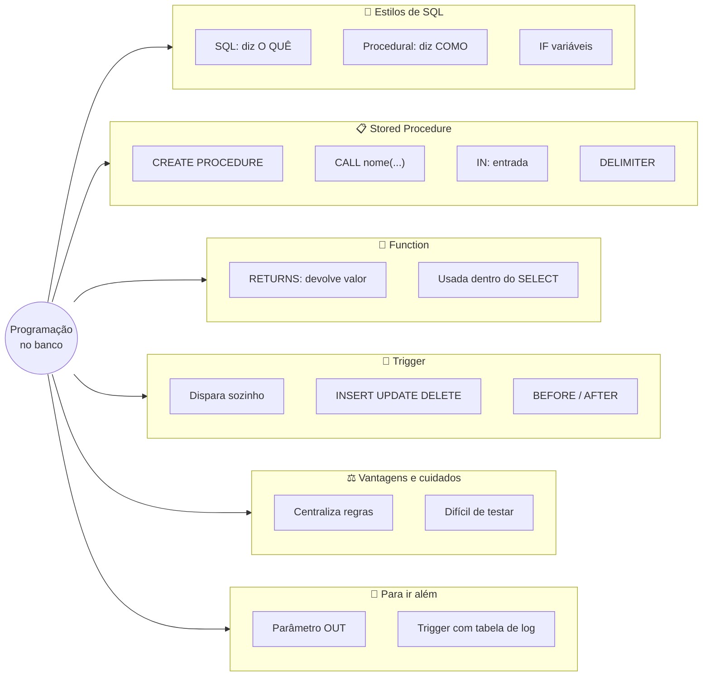
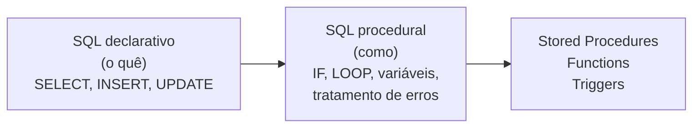

# Tópico 12 — Introdução ao PL/SQL: Procedimentos Armazenados

**Disciplina:** Banco de Dados e Aplicações (IBD951)  
**Professor:** Ronan Adriel Zenatti · ronan.zenatti@cps.sp.gov.br  
**Fatec Jahu — 2º Semestre/2026**

---

## 🎯 Objetivos da Aula

Ao final desta aula você deverá ser capaz de:

- Explicar a diferença entre SQL **declarativo** (diz *o quê*) e programação **procedural** (diz *como*, passo a passo) dentro do banco de dados
- Explicar o que são **stored procedures**, **functions** e **triggers** e quando usar cada uma
- Criar e executar uma stored procedure simples, com e sem parâmetros de entrada (`IN`)
- Usar variáveis (`DECLARE`) e a estrutura condicional `IF ... ELSEIF ... ELSE` dentro de um procedimento
- Criar uma function e usá-la dentro de uma consulta `SELECT`
- Explicar para que serve a troca temporária do `DELIMITER`
- Listar, consultar e remover rotinas do banco
- *(Para ir além)* Usar parâmetros de saída (`OUT`) e criar um trigger que registra o histórico de mudanças de um pedido

---

## 🗺️ Mapa Mental da Aula



---

## 1. Além do SQL declarativo

Todo o SQL que você aprendeu até aqui é **declarativo**: você diz **o que** quer, e o banco decide **como** fazer. Em `SELECT nome FROM produtos WHERE estoque = 0`, você não explica ao banco como percorrer a tabela, em que ordem, se usa atalho ou não — só descreve o resultado desejado.

> 💡 **Do dia a dia:** é como pedir no restaurante: *"Quero a feijoada completa"*. Você diz **o quê** (o prato) e a cozinha cuida do resto. Quem escreve a **receita** — *"deixe o feijão de molho, cozinhe por 40 minutos, **se** ainda estiver duro cozinhe mais 10, depois acrescente a linguiça..."* — está dizendo **como**, passo a passo, com decisões ("se") pelo caminho. Isso é a **programação procedural**.

Existem situações em que o pedido simples não basta e a gente precisa de **lógica**: *"se o estoque estiver zerado, faça isto; senão, aquilo"*, *"registre o pedido e, em seguida, guarde o número que foi gerado"*, *"toda vez que o status mudar, anote no histórico"*. É aí que entra a **programação procedural dentro do banco de dados**: variáveis, condições (`IF`), repetições (`LOOP`), tratamento de erros e várias operações encadeadas, tudo guardado dentro do próprio banco.



### 1.1 "PL/SQL" é o nome em Oracle

Cada fabricante de banco de dados deu um nome à sua extensão procedural:

| SGBD | Nome da linguagem procedural |
|---|---|
| Oracle | **PL/SQL** (*Procedural Language / SQL*) |
| SQL Server | **T-SQL** (*Transact-SQL*) |
| PostgreSQL | **PL/pgSQL** |
| MySQL / MariaDB | **Stored routines** (rotinas armazenadas) — padrão SQL/PSM |

No MariaDB, a linguagem não tem nome próprio de marca; muita gente a chama, informalmente, de "PL/SQL do MySQL". O título deste tópico segue essa tradição, mas fique atento: **o que você vai escrever aqui é a sintaxe do MariaDB**, parecida com a do PL/SQL do Oracle em ideias (procedures, functions, triggers), mas **não idêntica**. Quem aprende a ideia num SGBD aprende a sintaxe do outro com facilidade.

---

## 2. Preparando o ambiente

Vamos usar o mesmo banco dos tópicos anteriores. Selecione-o:

```sql
USE loja_virtual;
```

Se o seu banco não está como no Tópico 09 (carga do Tópico 07 mais a carga complementar do Tópico 09), refaça, **nesta ordem**: (1) o script completo da Seção 11 do [Tópico 05](Aula_06_SQL_DDL.md); (2) o script de carga da Seção 2 do [Tópico 07](Topico_07_SQL_DQL.md); (3) a carga complementar da Seção 2 do [Tópico 09](Topico_09_Agregacao_Dados.md).

> ⚠️ **Uma diferença importante deste tópico:** até aqui, tudo o que você escreveu (`SELECT`, `INSERT`...) rodava e acabava. Agora você vai **criar objetos que ficam guardados no banco** (procedimentos, funções, gatilhos). Eles permanecem lá mesmo depois de você fechar o terminal, e podem ser listados e apagados como as tabelas. Cada exemplo mostra como removê-los. Na seção de aprofundamento (Seção 7), alguns exemplos também **alteram dados** (criam um pedido, mudam um status); se quiser voltar ao estado original, refaça os três scripts acima.

---

## 3. Stored Procedure — procedimento armazenado

Uma **stored procedure** (em português, *procedimento armazenado*) é um **bloco de comandos SQL com nome, guardado dentro do banco**. Depois de criada, qualquer pessoa ou programa a executa pelo nome, sem reescrever os comandos.

> 💡 **Do dia a dia:** é a **receita da casa guardada no caderno da cozinha**. Cada cozinheiro novo não precisa inventar a feijoada: basta pedir *"faça a receita número 3, para 10 pessoas"*. O nome da receita é o nome do procedimento; o "para 10 pessoas" é um **parâmetro**, um valor que você entrega para ela usar. Se o chef mudar a receita, muda em um lugar só — e todos os cozinheiros passam a seguir a nova versão.

Vantagem principal: a **lógica de negócio fica num lugar só** (o banco), em vez de espalhada em vários programas diferentes — se a regra muda, ajusta-se o procedimento e pronto.

### 3.1 O problema do ponto e vírgula e o `DELIMITER`

Antes do primeiro exemplo, uma dificuldade prática. Até agora, o `;` (ponto e vírgula) significava **"terminou o comando, pode executar"**. Só que um procedimento é feito de **vários comandos**, cada um terminando em `;` — e todos ficam dentro do mesmo bloco. Se o terminal cortasse e executasse no primeiro `;`, o procedimento seria enviado pela metade.

A solução é dizer ao terminal, **temporariamente**, que o sinal de "fim de comando" passa a ser outro — escolhemos `$$`. Isso é feito com o comando **`DELIMITER`** (em português, *"delimitador"*):

> 💡 **Do dia a dia:** imagine escrever uma receita em que cada passo termina com ponto final — e o cozinheiro, ao ver o primeiro ponto final, achasse que a receita acabou. Para evitar, você combina antes: *"o fim da receita inteira será marcado com `$$`"*. Dentro da receita, os pontos finais voltam a ser só pontos finais.

O padrão que você vai repetir em todo procedimento é:

```sql
DELIMITER $$              -- 1) o "fim de comando" passa a ser $$

CREATE PROCEDURE ...      -- 2) cria a rotina (com ; dentro dela)
BEGIN
    comando1;
    comando2;
END$$                     -- 3) o $$ marca o fim da rotina inteira

DELIMITER ;               -- 4) volta ao ; normal
```

> ⚠️ **Não esqueça o passo 4** (`DELIMITER ;`). Se ele faltar, o terminal continua esperando o `$$` e seus próximos comandos `;` parecem "não fazer nada".

### 3.2 O primeiro procedimento

Vamos guardar uma consulta que o gerente repete todo dia — *"quais produtos estão com o estoque zerado?"* — num procedimento:

```sql
DELIMITER $$

CREATE PROCEDURE listar_produtos_sem_estoque()
BEGIN
    SELECT nome, estoque
    FROM produtos
    WHERE estoque = 0;
END$$

DELIMITER ;
```

Leitura:

- **`CREATE PROCEDURE listar_produtos_sem_estoque()`** — cria o procedimento com esse nome. Os parênteses vazios `()` indicam que ele **não recebe parâmetros**. Nome em `snake_case`, começando com um **verbo** que diz o que ele faz.
- **`BEGIN ... END`** — delimita o **corpo** (as instruções que ele executa).
- Dentro do corpo, os comandos SQL de sempre, cada um terminado em `;`.

Para executar, use **`CALL`** (em português, *"chamar"*):

```sql
CALL listar_produtos_sem_estoque();
```

```text
+-------------+---------+
| nome        | estoque |
+-------------+---------+
| Tomate (kg) |       0 |
+-------------+---------+
```

Se amanhã chegar mercadoria e outro produto zerar, o mesmo `CALL` mostrará a lista atualizada: o procedimento guarda os **comandos**, e não o resultado.

### 3.3 Parâmetros de entrada: `IN`

Um procedimento fica muito mais útil quando recebe **valores de entrada** (os parâmetros). Cada parâmetro é declarado entre os parênteses, com o **modo**, um **nome** e um **tipo** de dado (os mesmos da DDL, Tópico 05). O modo **`IN`** (*"entrada"*) significa que o valor entra no procedimento.

Convenção da disciplina: nomes de parâmetros com o prefixo **`p_`** (de "parâmetro"), em `snake_case`.

```sql
DELIMITER $$

CREATE PROCEDURE listar_pedidos_do_cliente(IN p_cliente_id BIGINT UNSIGNED)
BEGIN
    SELECT id_pedido, data_pedido, status, valor_total
    FROM pedidos
    WHERE cliente_id = p_cliente_id
    ORDER BY data_pedido;
END$$

DELIMITER ;
```

Ao chamar, passe o valor entre parênteses — é o "para 10 pessoas" da receita:

```sql
CALL listar_pedidos_do_cliente(1);
```

```text
+-----------+-------------+------------+-------------+
| id_pedido | data_pedido | status     | valor_total |
+-----------+-------------+------------+-------------+
|         7 | 2026-08-25  | entregue   |       44.99 |
|         9 | 2026-09-14  | cancelado  |       15.00 |
|         1 | 2026-10-01  | entregue   |       47.30 |
|         3 | 2026-10-05  | confirmado |       22.50 |
|        12 | 2026-10-10  | enviado    |       74.94 |
+-----------+-------------+------------+-------------+
```

O mesmo procedimento serve para qualquer cliente: `CALL listar_pedidos_do_cliente(2);` mostra os do Bruno, e assim por diante. Para um cliente sem pedido (`CALL listar_pedidos_do_cliente(5);`), a lista volta vazia.

> ⚠️ **Nunca dê a um parâmetro o mesmo nome de uma coluna.** Se o parâmetro se chamasse `cliente_id`, a condição `WHERE cliente_id = cliente_id` compararia o parâmetro com ele mesmo — sempre verdadeiro — e o procedimento devolveria **todos** os pedidos, **sem dar erro**. É por isso que usamos o prefixo `p_`.

!!! example "🔍 Checkpoint 1 — Stored procedures"
    Escreva e teste os procedimentos a seguir (lembre do `DELIMITER`):
    (a) `listar_clientes_sem_telefone`, sem parâmetros, que mostra o **nome** e o **e-mail** dos clientes com telefone `NULL`;
    (b) `listar_produtos_da_categoria`, com um parâmetro `p_categoria_id`, que mostra o **nome** e o **preço** dos produtos daquela categoria, em ordem alfabética. Chame-o para a categoria 3 (Mercearia).

    🔑 Resolução no [Gabarito do Tópico 12](Topico_12_Gabarito.md#checkpoint-1) — tente resolver antes de conferir.

### 3.4 Variáveis e `IF`: a lógica procedural

Agora sim, a parte "procedural". Dentro de um procedimento você pode **guardar valores em variáveis** e **tomar decisões**. Uma **variável** é um "pote com etiqueta" onde guardamos um valor para usá-lo mais adiante. Ela é declarada com **`DECLARE nome TIPO`**, no começo do `BEGIN`, e recebe valor de uma consulta com **`SELECT ... INTO`**. Convenção: prefixo **`v_`** nas variáveis.

A decisão é feita com **`IF ... THEN ... ELSEIF ... THEN ... ELSE ... END IF`** — o "se... então... senão" da receita.

Um procedimento que informa a situação do estoque de um produto:

```sql
DELIMITER $$

CREATE PROCEDURE situacao_do_estoque(IN p_produto_id BIGINT UNSIGNED)
BEGIN
    DECLARE v_nome    VARCHAR(255);
    DECLARE v_estoque INT;

    SELECT nome, estoque
      INTO v_nome, v_estoque
    FROM produtos
    WHERE id_produto = p_produto_id;

    IF v_estoque = 0 THEN
        SELECT v_nome AS produto, v_estoque AS estoque, 'Esgotado' AS situacao;
    ELSEIF v_estoque < 10 THEN
        SELECT v_nome AS produto, v_estoque AS estoque, 'Estoque baixo' AS situacao;
    ELSE
        SELECT v_nome AS produto, v_estoque AS estoque, 'Estoque normal' AS situacao;
    END IF;
END$$

DELIMITER ;
```

Leitura: o procedimento recebe o número de um produto; busca nome e estoque e guarda em `v_nome` e `v_estoque`; depois decide — se o estoque for 0, mostra "Esgotado"; senão, se for menor que 10, "Estoque baixo"; senão, "Estoque normal". Testando com três produtos:

```sql
CALL situacao_do_estoque(8);    -- Tomate
CALL situacao_do_estoque(11);   -- Queijo
CALL situacao_do_estoque(1);    -- Pão francês
```

```text
+-------------+---------+----------+
| produto     | estoque | situacao |
+-------------+---------+----------+
| Tomate (kg) |       0 | Esgotado |
+-------------+---------+----------+

+-----------------------+---------+---------------+
| produto               | estoque | situacao      |
+-----------------------+---------+---------------+
| Queijo mussarela (kg) |       6 | Estoque baixo |
+-----------------------+---------+---------------+

+--------------------+---------+----------------+
| produto            | estoque | situacao       |
+--------------------+---------+----------------+
| Pão francês (kg)   |      50 | Estoque normal |
+--------------------+---------+----------------+
```

Isso é impossível de fazer só com um `SELECT` simples: a decisão ("se... senão") exige o lado procedural.

### 3.5 Listando, consultando e removendo rotinas

Como as tabelas, as rotinas são objetos do banco e podem ser listadas, inspecionadas e apagadas:

```sql
-- listar as rotinas do banco loja_virtual
SELECT routine_name, routine_type
FROM information_schema.routines
WHERE routine_schema = 'loja_virtual'
ORDER BY routine_type, routine_name;
```

```text
+-----------------------------+--------------+
| routine_name                | routine_type |
+-----------------------------+--------------+
| listar_pedidos_do_cliente   | PROCEDURE    |
| listar_produtos_sem_estoque | PROCEDURE    |
| situacao_do_estoque         | PROCEDURE    |
+-----------------------------+--------------+
```

(O `information_schema` é um banco especial, mantido pelo próprio MariaDB, que contém informações sobre todos os outros bancos. Se você já criou outras rotinas, elas também aparecem.) Para ver o código de um procedimento:

```sql
SHOW CREATE PROCEDURE listar_produtos_sem_estoque\G
```

(O `\G` no lugar do `;` exibe o resultado na vertical, mais fácil de ler para textos longos.) E para apagar:

```sql
DROP PROCEDURE IF EXISTS situacao_do_estoque;
```

Para **alterar** um procedimento, o caminho simples é apagar (`DROP PROCEDURE`) e criar de novo com o código corrigido. Tentar criar um procedimento com um nome já existente dá o erro 1304.

---

## 4. Function — função armazenada

Uma **function** (em português, *função armazenada*) é parecida com um procedimento, mas com duas diferenças importantes:

1. **sempre devolve um valor** (o resultado do cálculo), declarado com a palavra `RETURNS`;
2. pode ser **usada dentro de uma consulta SQL**, como qualquer função embutida (`ROUND`, `UPPER`, `DATEDIFF`...) que você já conhece.

> 💡 **Do dia a dia:** se o procedimento é a **receita completa**, a função é a **calculadora do caixa**: você digita dois números, ela devolve um resultado, e você usa esse resultado no meio de outra conta — por exemplo, "preço com desconto" — sem precisar refazer a continha toda vez.

```sql
DELIMITER $$

CREATE FUNCTION calcular_desconto(preco DECIMAL(10, 2), percentual INT)
RETURNS DECIMAL(10, 2)
DETERMINISTIC
BEGIN
    RETURN preco - (preco * percentual / 100);
END$$

DELIMITER ;
```

Leitura:

- **`CREATE FUNCTION calcular_desconto(preco DECIMAL(10, 2), percentual INT)`** — recebe dois valores: um preço e um percentual. (Em função, todos os parâmetros são de entrada, então não se escreve `IN`.)
- **`RETURNS DECIMAL(10, 2)`** — o tipo do valor que ela devolve: um número com 2 casas decimais.
- **`DETERMINISTIC`** — avisa ao banco que, para os mesmos valores de entrada, o resultado é **sempre o mesmo**. (O contrário seria uma função que depende da hora atual, por exemplo.) Isso permite ao banco otimizar.
- **`RETURN ...`** — calcula e devolve o resultado.

Ao contrário do procedimento (que se chama com `CALL`), a função é usada **dentro de um `SELECT`**, pelo nome:

```sql
SELECT nome,
       preco,
       calcular_desconto(preco, 10) AS preco_com_desconto
FROM produtos
ORDER BY preco DESC
LIMIT 4;
```

```text
+-----------------------+-------+--------------------+
| nome                  | preco | preco_com_desconto |
+-----------------------+-------+--------------------+
| Queijo mussarela (kg) | 44.90 |              40.41 |
| Presunto fatiado (kg) | 39.90 |              35.91 |
| Arroz 5kg             | 29.90 |              26.91 |
| Bolo de fubá          | 18.00 |              16.20 |
+-----------------------+-------+--------------------+
```

Ela também funciona no `WHERE`, e com valores soltos:

```sql
SELECT calcular_desconto(100, 15) AS teste;
```

```text
+-------+
| teste |
+-------+
| 85.00 |
+-------+
```

```sql
-- produtos que, com 10% de desconto, custam menos de R$ 8
SELECT nome, preco
FROM produtos
WHERE calcular_desconto(preco, 10) < 8;
```

```text
+--------------------+-------+
| nome               | preco |
+--------------------+-------+
| Suco de laranja 1L |  7.50 |
| Banana prata (kg)  |  6.90 |
| Detergente 500ml   |  2.99 |
+--------------------+-------+
```

### 4.1 Procedure × Function

| | Stored Procedure | Function |
|---|---|---|
| Como executar | `CALL nome(...)` | dentro de um `SELECT`/`WHERE`: `nome(...)` |
| Devolve valor? | Pode devolver resultados e parâmetros de saída; não é obrigatório | **Sempre** devolve **um** valor (`RETURNS`) |
| Pode fazer `INSERT`/`UPDATE`/`DELETE`? | Sim, é o uso comum | Possível, mas **evite**: uma função num `SELECT` não deveria alterar dados |
| Para que serve | Executar uma **tarefa** (uma sequência de passos) | Calcular um **valor** reutilizável |

A confusão mais comum é tentar usar `CALL` numa função, o que devolve o erro 1305 (`PROCEDURE ... does not exist`): função se usa dentro de um `SELECT`. Para apagar uma função: `DROP FUNCTION IF EXISTS calcular_desconto;`.

!!! example "🔍 Checkpoint 2 — Functions"
    (a) Crie a função `aplicar_acrescimo(preco, percentual)`, que devolve o preço **mais** o percentual informado (o contrário do desconto).
    (b) Use-a em um `SELECT` para mostrar o **nome**, o **preço** e o preço com **acréscimo de 10%** (apelido `preco_reajustado`) dos produtos da categoria 1 (Padaria).
    (c) Use-a para mostrar o **nome**, o **preço** e o preço com **acréscimo de 5%** (apelido `preco_reajustado`) dos produtos com preço **menor que R$ 8**, do mais barato ao mais caro.

    🔑 Resolução no [Gabarito do Tópico 12](Topico_12_Gabarito.md#checkpoint-2) — tente resolver antes de conferir.

---

## 5. Trigger — gatilho automático

Um **trigger** (em português, *gatilho*) é uma rotina que o banco **executa sozinho**, sem que ninguém a chame, **quando acontece um evento específico em uma tabela**: um `INSERT`, um `UPDATE` ou um `DELETE`. É um "se isso acontecer, faça aquilo automaticamente".

> 💡 **Do dia a dia:** é o **sino na porta da padaria**: ninguém precisa apertar um botão, toda vez que a porta abre o sino toca sozinho. Ou o **livro de protocolo da prefeitura**: toda vez que um requerimento muda de setor, o funcionário *tem* que registrar a data e o setor no livro — o sistema do trigger faz esse registro automaticamente, e ninguém consegue "esquecer".

Um trigger é definido por três escolhas:

| Escolha | Opções | Significado |
|---|---|---|
| **Tabela** | qualquer tabela | onde o evento acontece |
| **Evento** | `INSERT`, `UPDATE`, `DELETE` | o que dispara o gatilho |
| **Momento** | `BEFORE` (antes) ou `AFTER` (depois) | executa antes ou depois da operação ser gravada |

Dentro de um trigger, o banco oferece duas "fotografias" da linha afetada:

- **`OLD`** — os valores **antes** da mudança (existe em `UPDATE` e `DELETE`);
- **`NEW`** — os valores **depois** da mudança (existe em `INSERT` e `UPDATE`).

Para quê serve, na prática:

- **Auditoria:** guardar quem mudou o quê, quando.
- **Validações complexas:** impedir uma operação que fere uma regra de negócio.
- **Manutenção automática de dados derivados:** por exemplo, recalcular `valor_total` do pedido sempre que um item é inserido.

O exemplo completo, que registra no histórico toda mudança de status de um pedido, está na **Seção 7.2** (aprofundamento). Por ora, guarde a ideia: o trigger é uma rotina que **você não chama** — ela dispara por conta própria.

---

## 6. Vantagens e cuidados

A programação procedural dentro do banco de dados traz benefícios claros, e também armadilhas.

**Vantagens:**

- **Centraliza a lógica de negócio:** a regra fica em um só lugar, em vez de repetida em cada aplicativo (site, aplicativo de celular, relatórios).
- **Reduz o tráfego de rede:** uma única chamada (`CALL`) executa várias operações dentro do servidor, em vez de várias idas e vindas.
- **Melhora a segurança:** é possível dar à aplicação permissão para executar o procedimento **sem** dar acesso direto às tabelas.
- **Facilita a manutenção:** corrigir a regra num lugar corrige para todos.

**Cuidados:**

- O código dentro do banco é **mais difícil de versionar, testar e depurar** do que o código de uma aplicação (que fica em arquivos no Git, com ferramentas de teste).
- **Regras escondidas:** um trigger dispara "por baixo dos panos"; quem faz um simples `UPDATE` pode se surpreender com o que acontece em outras tabelas.
- **Dependência do fabricante:** cada SGBD tem sua sintaxe; um procedimento escrito para MariaDB não roda no Oracle sem adaptações.
- **Desempenho:** procedimentos mal escritos (ou triggers em cascata) podem deixar o banco lento.

**Regra de bolso:** use rotinas armazenadas com moderação, **documente bem** (comentários com `--` explicando o que cada uma faz) e guarde o código-fonte em arquivos `.sql` no repositório do projeto, como você faz com o script de criação do banco.

---

## 7. 🚀 Para ir além

!!! tip "Seção de aprofundamento"
    Daqui em diante, o conteúdo é **complementar**: recursos que aparecem em sistemas reais, mas que **não são cobrados nos checkpoints nem no quiz** deste tópico. Domine primeiro as seções 3 a 6. Os exemplos desta seção **alteram dados** do banco.

### 7.1 Parâmetro de saída: `OUT`

Além de `IN` (entrada), um parâmetro pode ser `OUT` (**saída**): é um "recado" que o procedimento devolve a quem o chamou. O procedimento abaixo registra um pedido novo e **devolve o número gerado** pelo banco:

```sql
DELIMITER $$

CREATE PROCEDURE registrar_pedido(
    IN  p_cliente_id  BIGINT UNSIGNED,
    IN  p_status      VARCHAR(20),
    OUT p_id_pedido   BIGINT UNSIGNED
)
BEGIN
    -- Insere o pedido
    INSERT INTO pedidos (cliente_id, data_pedido, status)
    VALUES (p_cliente_id, CURDATE(), p_status);

    -- Devolve o ID gerado
    SET p_id_pedido = LAST_INSERT_ID();
END$$

DELIMITER ;
```

Os elementos novos:

- **`OUT p_id_pedido`** — parâmetro que o procedimento *preenche* e devolve.
- **`SET p_id_pedido = ...`** — atribui um valor a uma variável ou parâmetro.
- **`LAST_INSERT_ID()`** — função do MariaDB que devolve o último número `AUTO_INCREMENT` gerado nesta sessão (aqui, o `id_pedido` do pedido recém-inserido).

Para receber o valor de saída, passe uma **variável de sessão** (nome começando por `@`), que guarda o valor durante a sua conexão:

```sql
CALL registrar_pedido(1, 'pendente', @novo_id);
SELECT @novo_id AS pedido_criado;
```

```text
+---------------+
| pedido_criado |
+---------------+
|            14 |
+---------------+
```

O banco criou o pedido número 14 (para a cliente 1, com status `'pendente'`, data de hoje, `valor_total` 0,00) e o procedimento devolveu o número dele em `@novo_id`. Isso resolve um problema real: a aplicação precisa saber o número do pedido que acabou de criar para, em seguida, cadastrar os itens dele.

Para desfazer o exemplo e voltar ao estado anterior:

```sql
DELETE FROM pedidos WHERE id_pedido = 14;
DROP PROCEDURE IF EXISTS registrar_pedido;
```

(O contador `AUTO_INCREMENT` não volta atrás: o próximo pedido criado receberá o número 15, e não 14. Se isso incomodar, refaça os três scripts da Seção 2.)

### 7.2 Trigger completo: histórico de mudança de status

Vamos construir o exemplo clássico de auditoria: **toda vez que o status de um pedido mudar, guardar o status anterior, o novo e o momento da mudança** numa tabela de histórico. Primeiro, a tabela, seguindo as convenções da disciplina (plural, `snake_case`, PK `id_...`, chave estrangeira):

```sql
CREATE TABLE IF NOT EXISTS logs_pedidos (
    id_log_pedido    BIGINT UNSIGNED  NOT NULL AUTO_INCREMENT,
    pedido_id        BIGINT UNSIGNED  NOT NULL,
    status_anterior  VARCHAR(20)      NOT NULL,
    status_novo      VARCHAR(20)      NOT NULL,
    criado_em        DATETIME         NOT NULL DEFAULT CURRENT_TIMESTAMP,

    CONSTRAINT pk_log_pedido PRIMARY KEY (id_log_pedido),
    CONSTRAINT fk_log_pedido FOREIGN KEY (pedido_id)
                             REFERENCES pedidos (id_pedido)
                             ON DELETE CASCADE
                             ON UPDATE CASCADE
) COMMENT='Histórico de mudanças de status dos pedidos';
```

Agora o trigger:

```sql
DELIMITER $$

CREATE TRIGGER after_pedido_update
AFTER UPDATE ON pedidos
FOR EACH ROW
BEGIN
    IF OLD.status <> NEW.status THEN
        INSERT INTO logs_pedidos (pedido_id, status_anterior, status_novo, criado_em)
        VALUES (NEW.id_pedido, OLD.status, NEW.status, NOW());
    END IF;
END$$

DELIMITER ;
```

Leitura:

- **`AFTER UPDATE ON pedidos`** — dispara **depois** de um `UPDATE` na tabela `pedidos`.
- **`FOR EACH ROW`** — executa **uma vez para cada linha** afetada pelo comando.
- **`IF OLD.status <> NEW.status`** — só registra se o status **realmente mudou** (um `UPDATE` que altere só a observação não gera registro). Pode-se escrever também `!=`, que é equivalente.
- O `INSERT` grava no histórico o antigo (`OLD.status`) e o novo (`NEW.status`).

Teste: mude o status do pedido 3 duas vezes e altere só a observação do pedido 4:

```sql
UPDATE pedidos SET status = 'enviado'  WHERE id_pedido = 3;
UPDATE pedidos SET observacoes = 'teste' WHERE id_pedido = 4;
UPDATE pedidos SET status = 'entregue' WHERE id_pedido = 3;

SELECT id_log_pedido, pedido_id, status_anterior, status_novo
FROM logs_pedidos;
```

```text
+---------------+-----------+-----------------+-------------+
| id_log_pedido | pedido_id | status_anterior | status_novo |
+---------------+-----------+-----------------+-------------+
|             1 |         3 | confirmado      | enviado     |
|             2 |         3 | enviado         | entregue    |
+---------------+-----------+-----------------+-------------+
```

Duas mudanças de status, dois registros; a alteração só na observação (pedido 4) não gerou nada. Quem fez os `UPDATE` não chamou trigger nenhum — ele disparou sozinho.

Para listar e remover os triggers:

```sql
SELECT trigger_name, event_manipulation, event_object_table, action_timing
FROM information_schema.triggers
WHERE trigger_schema = 'loja_virtual';
```

```text
+---------------------+--------------------+--------------------+---------------+
| trigger_name        | event_manipulation | event_object_table | action_timing |
+---------------------+--------------------+--------------------+---------------+
| after_pedido_update | UPDATE             | pedidos            | AFTER         |
+---------------------+--------------------+--------------------+---------------+
```

Para desfazer o exemplo e restaurar o pedido 3 ao status original:

```sql
DROP TRIGGER IF EXISTS after_pedido_update;
UPDATE pedidos SET status = 'confirmado' WHERE id_pedido = 3;
UPDATE pedidos SET observacoes = NULL WHERE id_pedido = 4;
DROP TABLE IF EXISTS logs_pedidos;
```

---

## 8. Erros comuns com rotinas armazenadas

| Código | Mensagem (resumo) | Causa típica | Correção |
|---|---|---|---|
| **1064** | `You have an error in your SQL syntax ... near ''` (e depois `near 'END'`) | Esqueceu o `DELIMITER $$`: o terminal cortou o procedimento no primeiro `;` | Envolver a criação com `DELIMITER $$ ... END$$ DELIMITER ;` |
| **1304** | `PROCEDURE ... already exists` | Tentou criar um procedimento com nome já existente | `DROP PROCEDURE IF EXISTS nome;` e criar de novo |
| **1305** | `PROCEDURE ... does not exist` | Nome errado no `CALL`, ou usou `CALL` numa **função** | Conferir o nome; funções vão dentro do `SELECT` |
| **1318** | `Incorrect number of arguments for PROCEDURE ...; expected 1, got 0` | Chamou com mais ou menos valores do que os parâmetros declarados | Passar um valor para cada parâmetro |
| Comandos "não fazem nada" | — | Esqueceu o `DELIMITER ;` final | Digitar `DELIMITER ;` |
| Resultado com **todas** as linhas, sem erro | — | Parâmetro com o mesmo nome de uma coluna (Seção 3.3) | Prefixo `p_` nos parâmetros |

---

## 📝 Exercícios de Fixação

### Exemplo Resolvido — Identifique os erros

O estagiário tentou usar rotinas armazenadas. Antes de olhar a resposta, tente descobrir o que há de errado em cada trecho — e lembre-se: **nem todo erro faz o banco reclamar**:

```sql
-- Trecho 1: criar um procedimento
CREATE PROCEDURE listar_clientes()
BEGIN
    SELECT nome FROM clientes;
    SELECT COUNT(*) FROM clientes;
END;

-- Trecho 2: procedimento que lista os pedidos de um cliente
DELIMITER $$
CREATE PROCEDURE listar_pedidos(IN cliente_id BIGINT UNSIGNED)
BEGIN
    SELECT id_pedido FROM pedidos WHERE cliente_id = cliente_id;
END$$
DELIMITER ;
CALL listar_pedidos(5);

-- Trecho 3: usar a função calcular_desconto
CALL calcular_desconto(100, 10);

-- Trecho 4: chamar um procedimento que espera um parâmetro
CALL listar_pedidos_do_cliente();
```

??? question "🔍 Ver a resolução"
    **Trecho 1:** faltou o `DELIMITER`. O terminal corta o comando no primeiro `;` (depois de `SELECT nome FROM clientes`) e envia um procedimento incompleto — erro 1064. O correto é envolver a criação com `DELIMITER $$` ... `END$$` ... `DELIMITER ;`.

    **Trecho 2:** o parâmetro se chama `cliente_id`, igual à coluna. O banco entende `cliente_id = cliente_id` como "o parâmetro é igual a ele mesmo", sempre verdadeiro, e o `CALL listar_pedidos(5)` devolve **todos os 13 pedidos** — sem erro. O correto é nomear o parâmetro `p_cliente_id`.

    **Trecho 3:** `calcular_desconto` é uma **função**, e não um procedimento; não se chama com `CALL` (erro 1305, `PROCEDURE ... does not exist`). Uma função é usada dentro de um `SELECT`: `SELECT calcular_desconto(100, 10);`, que devolve `90.00`.

    **Trecho 4:** o procedimento exige um parâmetro (`p_cliente_id`) e a chamada passou zero valores — erro 1318, `expected 1, got 0`. O correto é `CALL listar_pedidos_do_cliente(1);`.

    Versões corrigidas:

    ```sql
    DELIMITER $$
    CREATE PROCEDURE listar_clientes()
    BEGIN
        SELECT nome FROM clientes;
        SELECT COUNT(*) FROM clientes;
    END$$
    DELIMITER ;

    DELIMITER $$
    CREATE PROCEDURE listar_pedidos(IN p_cliente_id BIGINT UNSIGNED)
    BEGIN
        SELECT id_pedido FROM pedidos WHERE cliente_id = p_cliente_id;
    END$$
    DELIMITER ;

    SELECT calcular_desconto(100, 10);

    CALL listar_pedidos_do_cliente(1);
    ```

---

## 🃏 Flashcards de Revisão

??? question "Qual a diferença entre SQL declarativo e programação procedural?"
    No SQL declarativo você diz **o quê** quer (`SELECT ...`) e o banco decide como fazer. Na programação procedural você descreve **como**, passo a passo, com variáveis, condições (`IF`), repetições e várias operações encadeadas.

??? question "O que é uma stored procedure e como ela é executada?"
    É um bloco de comandos SQL com nome, guardado no banco. É criada com `CREATE PROCEDURE` e executada com `CALL nome(...)`.

??? question "Para que serve o `DELIMITER` ao criar um procedimento?"
    Troca temporariamente o sinal de "fim de comando" do terminal (de `;` para `$$`), para que os `;` do corpo do procedimento não o interrompam. Depois da criação, volta-se ao normal com `DELIMITER ;`.

??? question "Qual a diferença entre procedure e function?"
    A procedure executa uma tarefa e é chamada com `CALL`. A function **sempre devolve um valor** (`RETURNS`) e é usada dentro de uma consulta, como o `ROUND` ou o `UPPER`.

??? question "O que é um trigger e o que significam `OLD` e `NEW`?"
    É uma rotina que dispara **sozinha** quando ocorre um `INSERT`, `UPDATE` ou `DELETE` em uma tabela. `OLD` guarda os valores da linha **antes** da mudança e `NEW` os valores **depois**.

??? question "Cite duas vantagens e dois cuidados ao colocar lógica de negócio no banco."
    Vantagens: centraliza as regras em um só lugar; reduz o tráfego de rede (uma chamada faz várias operações); melhora a segurança. Cuidados: é mais difícil de versionar, testar e depurar; um trigger age "escondido"; fica preso à sintaxe do fabricante.

---

## ✅ Quiz de Fixação

<quiz>
Qual comando executa um procedimento chamado `listar_produtos_sem_estoque`?
- [ ] `RUN listar_produtos_sem_estoque;`
- [ ] `SELECT listar_produtos_sem_estoque();`
- [x] `CALL listar_produtos_sem_estoque();`
- [ ] `EXECUTE PROCEDURE listar_produtos_sem_estoque;`

No MariaDB, procedimentos são executados com `CALL`. O `SELECT nome_da_rotina()` serve para **funções**. `RUN` e `EXECUTE PROCEDURE` não existem no MariaDB.
</quiz>

<quiz>
Por que usamos `DELIMITER $$` antes de criar um procedimento?
- [ ] Porque o `$$` é obrigatório em todo comando SQL
- [ ] Para que o procedimento rode mais rápido
- [x] Para o terminal não interpretar o primeiro `;` do corpo do procedimento como o fim do comando
- [ ] Para que o procedimento possa receber parâmetros

O corpo do procedimento tem vários comandos terminados em `;`. Sem trocar o delimitador, o terminal enviaria o procedimento cortado no primeiro `;`, e o MariaDB devolveria o erro 1064.
</quiz>

<quiz>
Qual afirmação sobre functions está correta?
- [ ] Uma function é executada com `CALL`
- [x] Uma function sempre devolve um valor e pode ser usada dentro de um `SELECT`
- [ ] Uma function dispara automaticamente quando uma tabela é alterada
- [ ] Uma function não aceita parâmetros

A function declara o que devolve com `RETURNS` e é usada como qualquer função embutida: `SELECT calcular_desconto(preco, 10) FROM produtos;`. Quem dispara sozinho é o trigger; e `CALL` é para procedures.
</quiz>

<quiz>
Sobre triggers, quais afirmações são verdadeiras? (selecione todas as corretas)
- [x] São executados automaticamente quando ocorre um `INSERT`, `UPDATE` ou `DELETE` na tabela
- [x] Dentro de um trigger de `UPDATE`, `OLD` guarda os valores antes da mudança e `NEW` os valores depois
- [x] Podem ser usados para registrar um histórico de alterações (auditoria)
- [ ] Precisam ser chamados com `CALL` para funcionar

O trigger é uma rotina que **ninguém chama**: ele dispara por conta própria quando o evento ocorre. É isso que o torna útil para auditoria, e também o que exige cuidado, pois suas ações ficam "escondidas".
</quiz>

<quiz>
Um procedimento recebe o parâmetro `cliente_id` e tem `WHERE cliente_id = cliente_id`. O que acontece ao chamá-lo?
- [ ] Erro 1054: coluna desconhecida
- [ ] Devolve apenas os pedidos do cliente informado
- [x] Devolve todas as linhas da tabela, sem erro
- [ ] Devolve zero linhas

O nome do parâmetro é igual ao da coluna, e a condição compara o parâmetro com ele mesmo, o que é sempre verdadeiro. Por isso adotamos o prefixo `p_` (`p_cliente_id`).
</quiz>

---

## 📝 Resumo

Neste tópico você deu o primeiro passo na **programação dentro do banco de dados**. Enquanto o SQL declarativo diz *o que* se quer, a programação procedural — com variáveis, `IF` e várias operações encadeadas — diz *como* fazer. Uma **stored procedure** é um bloco de comandos com nome, guardado no banco, criado com `CREATE PROCEDURE` (usando `DELIMITER` para que os `;` do corpo não encerrem o comando) e executado com `CALL`, podendo receber parâmetros de entrada (`IN`). Uma **function** sempre devolve um valor (`RETURNS`) e pode ser usada dentro de qualquer consulta. Um **trigger** é uma rotina que dispara sozinha quando uma tabela sofre `INSERT`, `UPDATE` ou `DELETE`, enxergando os valores `OLD` e `NEW`. Centralizar regras no banco reduz tráfego e melhora a segurança, mas torna o código mais difícil de versionar, testar e depurar — por isso, use com moderação e documente. No último tópico, vamos olhar para trás e para a frente: o caminho que você percorreu e as tecnologias que vêm a seguir.

---

## 🏆 Conquista da Aula

!!! success "Selo desbloqueado: ⚙️ Programador(a) de Rotinas"
    Você ensinou o banco a seguir uma receita: criou rotinas com nome, parâmetros,
    decisões e funções reaproveitáveis, e conheceu os gatilhos que disparam sozinhos.
    Isso é o que transforma um banco que só guarda dados em um banco que também
    aplica regras. A próxima parada — a última — é olhar o caminho percorrido e o que
    vem pela frente.

---

## 📚 Referências

- ELMASRI, R.; NAVATHE, S. B. *Sistemas de Banco de Dados*. 7 ed. Cap. 10 — Programação em SQL. São Paulo: Pearson, 2018.
- PUGA, S.; FRANÇA, E.; GOYA, M. *Banco de Dados: Implementação em SQL, PL/SQL e Oracle 11g*. Pearson, 2020.
- Documentação oficial do MariaDB — [Stored Procedures](https://mariadb.com/kb/en/stored-procedures/)
- Documentação oficial do MariaDB — [Stored Functions](https://mariadb.com/kb/en/stored-functions/)
- Documentação oficial do MariaDB — [Triggers](https://mariadb.com/kb/en/triggers/)

---

## 🔗 Navegação

⬅️ [Tópico 11 — Junções Externas (Outer Join)](Topico_11_Outer_Join.md) · ➡️ [Tópico 13 — Encerramento do Semestre](Topico_13_Encerramento.md)

---

*Fatec Jahu · IBD951 · Prof. Ronan Adriel Zenatti · 2026*
