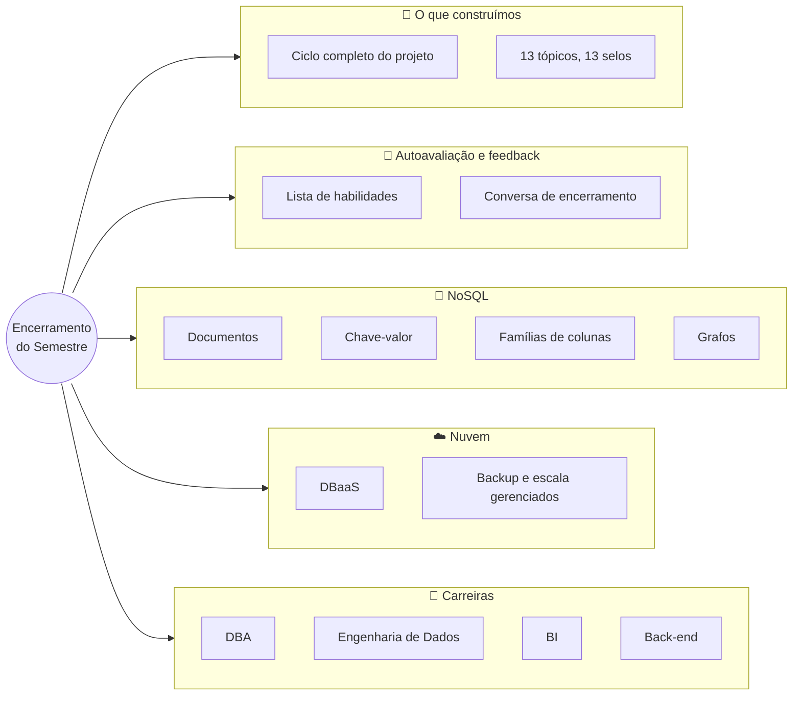
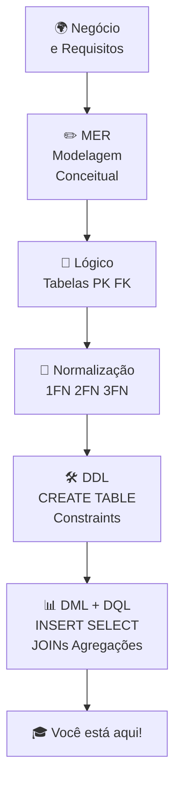
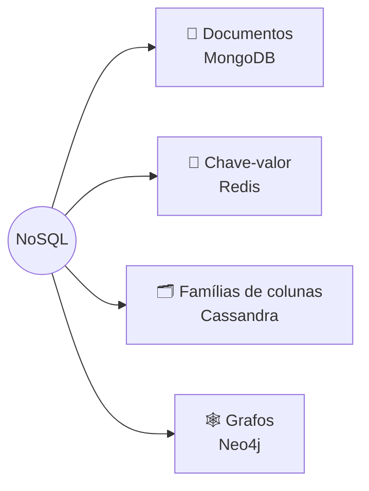

# Tópico 13 — Encerramento do Semestre: Feedback e Novas Tecnologias

**Disciplina:** Banco de Dados e Aplicações (IBD951)  
**Professor:** Ronan Adriel Zenatti · ronan.zenatti@cps.sp.gov.br  
**Fatec Jahu — 2º Semestre/2026**

---

## 🎯 Objetivos da Aula

Este tópico de encerramento tem como objetivo celebrar o aprendizado do semestre, contextualizar o que você estudou dentro do panorama atual da área e mostrar os caminhos de evolução profissional em banco de dados. Ao final, você deverá ser capaz de:

- Reconstituir o **ciclo completo** de um projeto de banco de dados, do negócio às consultas
- Reconhecer o que você aprendeu no semestre e identificar o que ainda precisa reforçar (autoavaliação)
- Explicar o que são bancos **NoSQL** e citar os quatro tipos principais, com um exemplo de uso de cada um
- Explicar o que é **banco de dados como serviço (DBaaS)** e por que ele é tendência
- Descrever pelo menos três caminhos de carreira que usam banco de dados

---

## 🗺️ Mapa Mental da Aula



---

## 1. O que construímos juntos

Ao longo deste semestre, passamos por uma jornada completa: começamos entendendo **por que bancos de dados existem**, aprendemos a **modelar o mundo real** em diagramas, transformamos esses modelos em **tabelas relacionais bem normalizadas**, implementamos fisicamente usando **DDL**, e aprendemos a **cadastrar, consultar e juntar dados** com SQL. Isso representa o ciclo completo de um projeto de banco de dados.



> 💡 **Do dia a dia:** é como construir e administrar um **mercado do zero**. Primeiro você entende o negócio e desenha a planta (modelagem). Depois monta as prateleiras e etiquetas, com regras claras de onde cada coisa vai (DDL, normalização). Em seguida, abastece, atende e corrige os preços (DML). E, por fim, fecha o caixa e confere o estoque para decidir o que comprar (consultas, agregações e junções). Quem sabe só atender no balcão não consegue montar o mercado — e quem só desenha a planta não consegue vender nada.

### 1.1 A sua trilha de selos

A cada tópico você desbloqueou um selo da **Trilha do(a) Arquiteto(a) de Dados**. Veja o caminho percorrido e o que cada selo representa que você sabe fazer:

| Tópico | Selo | O que você aprendeu a fazer |
|---|---|---|
| 01 | 🧭 Explorador(a) de Dados | Explicar o que é um banco de dados e por que ele é melhor que arquivos soltos |
| 02 | 🗺️ Cartógrafo(a) de Entidades | Modelar entidades e atributos (MER) |
| 03 | 🔗 Mestre dos Relacionamentos | Definir relacionamentos, cardinalidade, PK e FK |
| 04 | 🧹 Guardião(ã) da Normalização | Aplicar as formas normais para eliminar redundância |
| 05 | 🛠️ Construtor(a) DDL | Criar o banco e as tabelas (`CREATE`), com tipos de dados e constraints |
| 06 | ✏️ Operador(a) de Dados | Cadastrar, corrigir e remover dados (`INSERT`, `UPDATE`, `DELETE`) |
| 07 | 🔍 Investigador(a) de Dados | Consultar com `SELECT`: colunas, cálculos, `NULL`, `DISTINCT` |
| 08 | 🎯 Filtrador(a) de Precisão | Filtrar linhas (`WHERE`) e ordenar (`ORDER BY`) |
| 09 | 📊 Analista de Indicadores | Resumir dados com `COUNT`, `SUM`, `AVG`, `GROUP BY`, `HAVING` |
| 10 | 🧩 Mestre dos Joins | Juntar tabelas com `INNER JOIN` |
| 11 | 🔦 Auditor(a) de Dados Ausentes | Achar o que falta com `LEFT JOIN` e `RIGHT JOIN` |
| 12 | ⚙️ Programador(a) de Rotinas | Criar procedures, functions e conhecer triggers |
| 13 | 🏆 Arquiteto(a) de Dados — IBD951 | Enxergar o projeto de banco de dados de ponta a ponta |

---

## 2. Autoavaliação: o que eu já sei fazer?

Antes de olhar para a frente, vale conferir como você está. Leia cada item e responda honestamente a si mesmo: *"eu consigo fazer isso sozinho, sem consultar o material?"*. Os itens que ficarem em dúvida são o seu **roteiro de revisão**.

**Modelagem**
- [ ] Desenhar um diagrama de entidades e relacionamentos a partir de um problema do dia a dia
- [ ] Identificar a cardinalidade (1:1, 1:N, N:M) e transformá-la em chaves primária e estrangeira
- [ ] Reconhecer uma tabela que não está na 1FN, 2FN ou 3FN e corrigi-la

**Criação e manipulação (DDL e DML)**
- [ ] Escrever o `CREATE TABLE` de uma tabela, com tipos de dados adequados, `PRIMARY KEY`, `FOREIGN KEY` e `NOT NULL`
- [ ] Inserir dados respeitando a ordem "primeiro os pais, depois os filhos"
- [ ] Usar `UPDATE` e `DELETE` **sempre** com `WHERE` e conferir antes com um `SELECT`

**Consultas (DQL)**
- [ ] Filtrar com `WHERE` combinando `AND`, `OR`, `BETWEEN`, `IN`, `LIKE` e `IS NULL`
- [ ] Ordenar com `ORDER BY` e limitar com `LIMIT`
- [ ] Agrupar com `GROUP BY` e filtrar grupos com `HAVING`, explicando a diferença para o `WHERE`
- [ ] Juntar duas ou mais tabelas com `INNER JOIN ... ON` e usar apelidos de tabela
- [ ] Usar `LEFT JOIN` para listar "quem não tem par" (clientes sem pedido, produtos sem venda)

**Programação no banco**
- [ ] Explicar a diferença entre procedure, function e trigger
- [ ] Criar uma procedure simples com um parâmetro

> 📌 **Como usar:** para cada item que você não marcou, volte ao tópico correspondente, releia os **flashcards** e refaça os **checkpoints** sem olhar o gabarito. A [página de Atividades e Avaliações](../atividades/index.md) também reúne exercícios para praticar.

---

## 3. Feedback do semestre

O semestre é uma via de mão dupla: você avalia o seu aprendizado, e o seu olhar sobre a disciplina ajuda a melhorar a próxima turma. Na conversa de encerramento, pense nestas perguntas e traga as suas respostas ao professor:

1. **Qual tópico foi mais fácil de aprender e por quê?** O que ajudou — a analogia, o exemplo, o exercício?
2. **Qual tópico foi mais difícil?** Em que ponto exatamente você se perdeu?
3. **O que você ainda não consegue explicar com as suas palavras?**
4. **O formato do material funcionou?** (mapa mental, flashcards, quiz, gabaritos) O que você tiraria ou acrescentaria?
5. **Onde você pretende usar o que aprendeu?** (trabalho, projeto pessoal, outra disciplina)

Este material é mantido e ajustado a cada semestre a partir justamente desse tipo de retorno.

---

## 4. Para onde ir daqui: NoSQL

O modelo relacional — tabelas, linhas, colunas, chaves, SQL — domina o mercado há décadas e continuará relevante por muito tempo. Mas o **volume** e a **variedade** dos dados da era atual (redes sociais, sensores, aplicativos com milhões de usuários) levaram ao surgimento dos bancos **NoSQL** (do inglês *Not Only SQL*, "não apenas SQL"), que oferecem modelos alternativos para necessidades específicas.

> 💡 **Do dia a dia:** o banco relacional é a **planilha organizada e padronizada** do contador: tudo em linhas e colunas, com regras rígidas — perfeito para dinheiro, estoque e cadastros. Já o NoSQL é um conjunto de **ferramentas especializadas**: o caderno de receitas com anotações livres (documentos), o fichário de endereço por nome (chave-valor), o armário gigante com gavetas que se multiplicam conforme a demanda (famílias de colunas) e o mapa de ruas e conexões (grafos). Nenhuma "vence" a outra: cada uma é a melhor para um tipo de problema.



| Tipo | Como guarda os dados | Exemplo de produto | Quando é uma boa escolha |
|---|---|---|---|
| **Documentos** | Documentos no formato JSON (texto com campos e valores), cada um podendo ter campos diferentes | MongoDB | Dados semiestruturados e que mudam de forma: catálogo de produtos com características variadas, perfis de usuário |
| **Chave-valor** | Pares simples "chave → valor", como um dicionário | Redis | Operações muito rápidas e simples: **cache**, sessões de login, contadores em tempo real |
| **Famílias de colunas** | Tabelas "largas" distribuídas em muitos servidores | Cassandra | Volumes gigantescos que crescem sem parar, com escrita muito intensa: histórico de eventos, dados de sensores |
| **Grafos** | Nós (coisas) e arestas (conexões entre elas) | Neo4j | Dados fortemente conectados: redes sociais ("amigos de amigos"), recomendações, detecção de fraude |

Para sentir a diferença, veja como um mesmo pedido seria guardado em cada mundo. No banco relacional que você construiu, as informações ficam **espalhadas** em tabelas (`pedidos`, `itens_pedidos`, `produtos`) e precisam de `JOIN` para serem reunidas. Em um banco de **documentos**, o pedido inteiro costuma ficar **junto**, em um único documento:

```json
{
  "pedido": 1,
  "cliente": "Ana Souza",
  "data": "2026-10-01",
  "status": "entregue",
  "itens": [
    { "produto": "Pão francês (kg)",  "quantidade": 2, "preco_unitario": 14.90 },
    { "produto": "Café torrado 500g", "quantidade": 1, "preco_unitario": 17.50 }
  ]
}
```

Lê-se o pedido de uma vez só, sem junção. Em compensação, se o nome da Ana mudar, ele precisará ser atualizado em todos os documentos onde aparece — o problema de **redundância** que a normalização resolvia. É isso que significa "trade-off": toda escolha ganha alguma coisa e perde outra.

A boa notícia: **quem domina bem o modelo relacional aprende NoSQL com muito mais facilidade**, pois entende os trade-offs e sabe quando cada abordagem faz sentido. Na prática, muitos sistemas usam os dois: um banco relacional para os dados que não podem errar (pedidos, pagamentos) e um Redis para acelerar as consultas mais frequentes.

---

## 5. Banco de dados na nuvem

A tendência atual é o banco de dados como serviço — **DBaaS** (*Database as a Service*). Em vez de instalar e administrar um servidor de banco de dados em uma máquina sua (como você fez com o XAMPP), você **aluga** um serviço **gerenciado** na nuvem: o provedor cuida de backups, replicação, escalabilidade, segurança e atualizações; você cuida do projeto das tabelas e das consultas.

> 💡 **Do dia a dia:** é a diferença entre **ter um carro** (você compra, abastece, faz revisão, paga seguro e conserta) e **usar um aplicativo de transporte** (você só diz para onde quer ir e paga pela corrida). No DBaaS, o "carro" é o servidor; a "revisão" é o backup e a atualização; e você paga pelo que usa.

Exemplos de serviços (a lista e os planos mudam com frequência, então consulte sempre a documentação atual): **Amazon RDS** (suporta MySQL, MariaDB, PostgreSQL, Oracle e outros), **Google Cloud SQL**, **Azure SQL Database** e **PlanetScale**. Repare que várias dessas ofertas rodam os mesmos bancos que você já conhece — o SQL que você aprendeu serve lá também.

Esse tema é aprofundado na disciplina de Computação em Nuvem.

---

## 6. Caminhos de evolução na carreira

Quem quer se especializar em banco de dados pode seguir diferentes direções:

| Carreira | O que faz | O que você já tem de base |
|---|---|---|
| **DBA** (*Database Administrator*) | Cuida da instalação, configuração, desempenho, segurança e backup dos SGBDs | Arquitetura de SGBD, DDL, rotinas armazenadas |
| **Engenheiro(a) de Dados** | Projeta *pipelines* (fluxos automáticos) de dados e trabalha com grandes volumes em ambientes de *Data Warehouse* e *Data Lake* | Modelagem, SQL avançado, agregações e junções |
| **Analista de BI** (*Business Intelligence*) | Transforma dados em informações estratégicas com ferramentas de visualização e painéis | Consultas, `GROUP BY`, `JOIN`, interpretação de resultados |
| **Desenvolvedor(a) back-end** | Constrói a parte do sistema que conversa com o banco | O SQL é habilidade fundamental — quase toda aplicação o usa |

Em qualquer uma delas, o que você aprendeu neste semestre é o **alicerce**: modelar bem, escrever SQL correto e entender o que acontece dentro do banco.

---

## 🎓 Parabéns pelo semestre!

Você completou a disciplina de Banco de Dados e Aplicações. O conhecimento que adquiriu aqui é a base de toda aplicação que manipula dados — ou seja, praticamente toda aplicação do mundo real. Use bem!

---

## 🃏 Flashcards de Revisão

??? question "Quais são as etapas do ciclo completo de um projeto de banco de dados, na ordem em que as vimos?"
    Negócio e requisitos → modelagem conceitual (MER) → modelo lógico (tabelas, PK e FK) → normalização (1FN, 2FN, 3FN) → DDL (`CREATE TABLE` e constraints) → DML e DQL (`INSERT`, `UPDATE`, `DELETE`, `SELECT`, junções e agregações).

??? question "O que significa NoSQL e por que ele surgiu?"
    *Not Only SQL* ("não apenas SQL"). Surgiu para atender necessidades que o modelo relacional atende mal, como volumes gigantescos, dados sem estrutura fixa e dados fortemente conectados. Não substitui o relacional: complementa.

??? question "Quais os quatro tipos principais de bancos NoSQL e um exemplo de cada?"
    Documentos (MongoDB), chave-valor (Redis), famílias de colunas (Cassandra) e grafos (Neo4j).

??? question "O que é DBaaS e qual a vantagem principal?"
    *Database as a Service*: um banco de dados **gerenciado** na nuvem. O provedor cuida de backups, replicação, escalabilidade e atualizações, e você cuida do projeto das tabelas e das consultas.

??? question "Qual a diferença entre o trabalho de um DBA e o de um(a) Engenheiro(a) de Dados?"
    O DBA cuida da instalação, do desempenho, da segurança e do backup dos SGBDs. O(a) Engenheiro(a) de Dados projeta os fluxos (*pipelines*) que levam dados de várias origens a ambientes como *Data Warehouse* e *Data Lake*, em grandes volumes.

---

## ✅ Quiz de Fixação

<quiz>
Qual a ordem correta das etapas de um projeto de banco de dados que você percorreu no semestre?
- [ ] DDL → modelagem conceitual → normalização → consultas
- [x] Modelagem conceitual → modelo lógico → normalização → DDL → DML/consultas
- [ ] Consultas → DDL → modelagem conceitual → normalização
- [ ] Normalização → DDL → modelagem conceitual → consultas

Primeiro entende-se o negócio e modela-se (conceitual e lógico), depois normaliza-se, só então cria-se o banco com DDL e, por fim, usam-se DML e consultas. Criar tabelas sem modelar antes é construir sem planta.
</quiz>

<quiz>
Qual tipo de banco NoSQL é o mais indicado para um **cache** muito rápido ou para guardar sessões de login?
- [ ] Documentos (como o MongoDB)
- [x] Chave-valor (como o Redis)
- [ ] Famílias de colunas (como o Cassandra)
- [ ] Grafos (como o Neo4j)

Os bancos chave-valor guardam pares simples "chave → valor" e são extremamente rápidos para operações simples, o que os torna ideais para cache e sessões.
</quiz>

<quiz>
Uma rede social quer recomendar "amigos de amigos". Qual tipo de banco é naturalmente mais adequado?
- [ ] Chave-valor
- [ ] Famílias de colunas
- [x] Grafos
- [ ] Documentos

Os bancos de grafos guardam entidades e conexões entre elas, o que torna perguntas como "amigos de amigos" muito naturais e rápidas. (Dá para fazer no relacional com vários `JOIN`s, mas fica mais complicado e lento em redes grandes.)
</quiz>

<quiz>
Sobre DBaaS (banco de dados como serviço), quais afirmações são verdadeiras? (selecione todas as corretas)
- [x] O provedor cuida de backups, replicação e atualizações
- [x] Você não precisa instalar nem administrar o servidor do banco em uma máquina própria
- [x] Há ofertas que usam bancos relacionais que você já conhece, como MySQL e PostgreSQL
- [ ] Com DBaaS, o SQL deixa de ser necessário

O SQL continua sendo a linguagem de consulta; o que muda é *quem administra* o servidor. Você ainda precisa modelar as tabelas e escrever as consultas.
</quiz>

---

## 📝 Resumo

Neste último tópico você olhou para o **caminho percorrido**: um ciclo completo de projeto de banco de dados — negócio, modelagem conceitual e lógica, normalização, DDL, DML e consultas com filtros, agregações, junções e rotinas. Fez uma autoavaliação para identificar o que ainda reforçar e conheceu o que vem pela frente: os bancos **NoSQL** (documentos, chave-valor, famílias de colunas e grafos), que complementam o modelo relacional em necessidades específicas; os bancos **na nuvem (DBaaS)**, em que o provedor administra o servidor; e as **carreiras** que usam banco de dados (DBA, engenharia de dados, BI e desenvolvimento back-end). Quem domina o modelo relacional aprende tudo isso com muito mais facilidade.

---

## 🏆 Conquista da Aula

!!! success "Selo final desbloqueado: 🏆 Arquiteto(a) de Dados — IBD951"
    Você percorreu a trilha inteira: do primeiro "para que serve um banco de dados?"
    até criar tabelas, cadastrar, consultar, juntar, resumir e programar dentro do
    banco. Você não apenas usa dados: sabe **projetá-los** do negócio ao relatório.
    Parabéns, Arquiteto(a) de Dados!

---

## 📚 Referências

- SILBERSCHATZ, A.; KORTH, H. F.; SUDARSHAN, S. *Sistema de Banco de Dados*. Campus, 2006.
- ELMASRI, R.; NAVATHE, S. B. *Sistemas de Banco de Dados*. 7 ed. São Paulo: Pearson, 2018.
- Documentação oficial do MongoDB — [O que é MongoDB?](https://www.mongodb.com/docs/manual/introduction/)
- Documentação oficial do Redis — [Introduction](https://redis.io/docs/latest/get-started/)
- Documentação oficial do Apache Cassandra — [Overview](https://cassandra.apache.org/doc/latest/)
- Documentação oficial do Neo4j — [Graph database concepts](https://neo4j.com/docs/getting-started/appendix/graphdb-concepts/)

---

## 🔗 Navegação

⬅️ [Tópico 12 — Introdução ao PL/SQL](Topico_12_Introducao_PLSQL.md) · 🎓 Este é o último tópico do semestre.

---

*Fatec Jahu · IBD951 · Prof. Ronan Adriel Zenatti · 2026*
